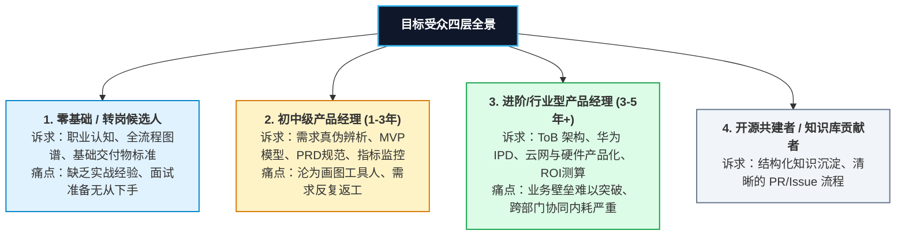
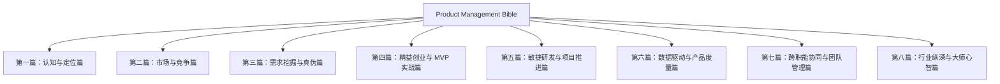

# 《产品经理实战与思考圣经》（Product Management Bible）开源知识库项目 PRD 需求文档

---

## 1. 文档基本信息 (Document Metadata)

| 属性 | 内容 |
| :--- | :--- |
| **项目名称** | Product Management Bible（产品经理实战与思考圣经） |
| **项目形态** | 开源知识库 / 数字化开源电子书 / GitHub Pages 在线文档站点 |
| **目标仓库** | `product-manage-bible` |
| **文档版本** | v1.0.0 (Release Candidate) |
| **状态** | Approved (已确认) |
| **输入来源** | Obsidian 知识库核心笔记 `RES-Product-Management.md` 及其全量双链子图谱 |
| **文档作者** | Terry & Antigravity AI |
| **创建日期** | 2026-10-13 |

---

## 2. 项目背景与愿景 (Vision & Background)

### 2.1 背景现状
在 Obsidian 知识库中，已经积累了大量涵盖产品全生命周期的学习笔记、实战心得、行业深度解析与培训实录：
- 包含从全球知名产品管理课程体系（LinkedIn Learning、Steve Blank 精益客户开发、Josh Elman 等）的系统沉淀；
- 包含资深大厂与一线实战专家（大白学堂、知群、3PM LAB、新浪博客等）对 ToB/ToC、硬件产品、电信运营商产品的切身体会；
- 包含企业级体系化实践（华为 IPD 变革实录、敏捷 Scrum/Kanban 实操、Kano/波特五力/BUC 决策模型、张小龙产品方法论等）；
- 包含一手真实案例分析（OFO 共享单车商业可行性测算、微信支付与红包演进、通信网络产品化等）。

然而，当前这些高质量内容呈现**卡片化、碎片化分布于 Obsidian 双链网络**中，存在以下痛点：
1. **缺乏结构化阅读体验**：双链适合网状联想，但不适合零基础或进阶者系统性、端到端地按章节顺序研读。
2. **缺乏版本控制与公开协作机制**：个人单点存储，无法借助开源社区的力量进行多人勘误、案例扩充与持续迭代。
3. **资产引用不统一**：包含 Roam 迁移语法、Obsidian 专有双链（`[[...]]`）、本地图片散落等问题，不利于通用 Markdown 渲染。

### 2.2 项目愿景
本项目旨在将这套完整的个人知识网络**重构并升华**为一套具备高专业度、工业级规范、开箱即用的**开源产品经理学习笔记与实战指南电子书（Product Management Bible）**，托管于 GitHub，并通过现代静态文档站点（如 VitePress / GitHub Pages）向全球产品从业者开放。

打造一个：
> **“扎根于实战、兼具 ToB/ToC/硬件/电信跨领域视野、贯穿从‘想法萌芽’到‘退市复盘’全生命周期的产品经理硬核知识宝典。”**

---

## 3. 目标受众与用户画像 (Target Audience & Personas)



### 画像详情
1. **Persona A: 转岗/应届新人（如技术/运营/设计转 PM）**
   - **核心诉求**：理清产品经理到底干什么（UX/Business/Tech 三环），搞懂与项目经理的核心区别，掌握基本交付物（Wireframe、PRD、User Story、Epic Spec）的标准写法。
2. **Persona B: 互联网/软件行业 1-3 年 PM**
   - **核心诉求**：摆脱盲目堆砌功能的陷阱（警惕张小龙所说的“垃圾产品”），掌握科学的需求优先级判定（BUC、Kano、MoSCoW）与精益验证技术（6种 MVP 验证打法、HEART 与 AARRR 数据指标）。
3. **Persona C: ToB / 行业领域（电信、硬件、企业系统）PM**
   - **核心诉求**：解决长周期、高风险、重资产交付问题。渴望借鉴华为 IPD 投资管理视角、定制系统与 SaaS 转化路径、软硬件协同开发难点。

---

## 4. 产品信息架构与图书目录规划 (Information Architecture)

全书规划为 **8 大篇章、28 个核心专题**，完全覆盖 Obsidian 双链中的全部深层知识点，并补充结构化推演：



### 详细目录大纲规划

#### 【第一篇：认知与定位篇 —— 探寻产品经理的本质】
- **第 1 章：什么是产品经理**
  - 产品管理三环模型（用户体验 UX、企业业务 Business、工程技术 Technology 的平衡中枢）
  - 核心角色特质：好奇心、同理心、理性、勇于说不、跨学科通才
  - 产品经理的“不要做清单”（Stop Doing List）：技术无知、需求含糊、脱离产品、盲目指挥、甩锅工程
  - 产品经理的一日工作切片（A Typical Day in the Life of a PM）
- **第 2 章：职业发展路径与核心竞争力**
  - PM vs 研发 / 设计 / 项目经理（Project Manager）的核心边界
  - 职业晋升天梯：功能模块 PM → 产品线高级 PM → 业务领域总监/VP → 产品 CEO
  - 冰山模型与十年宿命：如何建立业务护城河，避免“归于平庸”或“画图工具人”
  - 真实能力鉴别法则：简历文笔、细节追问、交付物规范性、价值观与眼界

#### 【第二篇：市场与竞争篇 —— 站在宏观视角看机会】
- **第 3 章：市场分析与容量测算**
  - 市场定义与增长驱动力
  - 市场容量测算双模型：自上而下（Top-down）vs 自下而上（Bottom-up，更稳健）
  - 波特五力模型实战应用（供应商议价、买方议价、潜在进入者、替代品、同业竞争）
- **第 4 章：全方位竞争情报与对手监控**
  - 竞争对手四级分类：直接（Direct）、间接（Indirect）、潜在（Potential）、替代品（Substitute）
  - 评估竞品的五大黄金维度：产品核心团队（Core）、用户规模（Size）、设计水准（Design）、品牌忠诚（Brand）、迭代速度（Speed）
  - 竞品对比利器：Feature Table（特性矩阵图）构建实操
  - 竞争情报动态监控体系（融投资、并购、新版本、技术雷达）

#### 【第三篇：需求挖掘与真伪篇 —— 穿透表象直达本质】
- **第 5 章：需求从何而来（EMUC 模型）**
  - 员工与内部管理层（Employees）
  - 数据异常与瓶颈（Metrics）
  - 最终用户（Users）
  - 决策买单方（Clients/Customers）
  - 核心辨析：用户（User，使用体验）与客户（Customer，商业买单）的诉求平衡
- **第 6 章：需求分析与伪需求粉碎机**
  - 黄金提问法则：连续 3~5 次追问“Why”穿透核心痛点
  - 什么是“伪需求”：无痛点、痒点、不能支撑商业闭环、人群时机错位
  - 5W2H 分析法在需求定义中的标准化应用
  - 经典案例深度剖析：以 OFO / 摩拜 为例的真实出行痛点与商业模型测算
- **第 7 章：客户开发与用户访谈全流程**
  - Steve Blank 客户开发理念（走出大楼，办公室里没有事实，只有观点）
  - 四类访谈全景：探索性访谈、验证性访谈、满意度访谈、效率型访谈
  - 访谈中的原则与陷阱：避免诱导性、假设性问题，保持客观中立
  - 访谈冷启动邀约技巧与实战邮件话术（短小、个性化、提供价值）
  - 用户画像（User Persona）构建实操

#### 【第四篇：精益创业与 MVP 实战篇 —— 用最小代价验证商业假设】
- **第 8 章：精益思维与 MVP 哲学**
  - 精益循环：构建（Build）- 度量（Measure）- 学习（Learn）- 迭代（Repeat）
  - 迭代速度大于迭代质量，数据大于主管观点
  - 战略支点（Pivot）与愿景（Vision）的坚守
- **第 9 章：假设拆解与高风险定位**
  - 从“我们什么都不知道”开始列出所有假设
  - 最致命假设（Riskiest Assumption）识别与“风险-难度”四象限矩阵
  - 将假设转化为可操作的假设陈述（Hypothesis Formulation）
- **第 10 章：MVP 实验的 6 大实战技法与落地**
  - 最小成功标准（MCS）与投入产出（Cost vs Reward）公式
  - 邮件 MVP（Email MVP）
  - 影子按钮 MVP（Shadow Button MVP）
  - 404 / 即将推出预售页 MVP（Coming Soon / Fake Landing Page）
  - 演示视频 MVP（Explainer Video，如 Dropbox）
  - 组合拼装 MVP（Piecemeal MVP）
  - 贵宾式人工服务 MVP（Concierge MVP）与绿野仙踪（Wizard of Oz）
- **第 11 章：原型设计与概念可视化**
  - 从手绘草图到低保真线框图（Wireframe）
  - 视觉模型（Mockup）与高保真交互原型（Prototype）的分工协作
  - 主流工具生态（Balsamiq, Axure, Sketch, Figma, 墨刀）

#### 【第五篇：敏捷研发与项目推进篇 —— 从文档到代码的高效交付】
- **第 12 章：研发模式对比：敏捷（Agile） vs 瀑布（Waterfall）**
  - 适用场景、风险承受力与变革成本对比
  - 软件生命周期四阶段（引入、成长、成熟、退市/Sun-setting）
- **第 13 章：Scrum 与看板（Kanban）实战指南**
  - Scrum 核心仪式：Sprint 规划会、每日站会（Standup）、评审会与回顾会（Retro）
  - 看板管理：流动控制、在制品限制（WIP）
  - 故事点（Story Points）与团队研发吞吐速率（Velocity）估算
- **第 14 章：标准交付物模板与规范**
  - 史诗需求说明书（Epic Spec Sheet）四核心区块：简介、产品要求、设计要求、工程要求
  - 用户故事（User Story）规范：`As a... I want to... So that...`
  - 验收准则（Acceptance Criteria）编写标准：`Given... When... Then...`
- **第 15 章：需求优先级排序决策模型库**
  - Kano 模型（魅力因素、期望因素、必备因素、无差异因素及演进规律）
  - BUC 价值评估模型（Business Benefits + User Benefits - Cost）
  - MoSCoW 优先级四分法（Must, Should, Could, Would）
  - RWW 筛选法（Real, Win, Worth）
  - 假设风险优先级排序法

#### 【第六篇：数据驱动与产品度量篇 —— 用客观指标度量成功】
- **第 16 章：核心度量框架与指标体系**
  - 指标哲学：“无法度量就无法管理”
  - 报告型指标（Reporting Metrics）与探索型指标（Exploratory Metrics）
  - 优质指标四大特征：易理解、比率或比值、具有强相关性、可被行动改变
- **第 17 章：HEART 框架落地实践**
  - 幸福感（Happiness）、参与度（Engagement）、采纳度（Adoption）、留存率（Retention）、任务成功（Task Success）
  - Goals - Signals - Metrics 三步映射实操
- **第 18 章：AARRR 海盗模型与用户生命周期**
  - 获取（Acquisition）、激活（Activation，激活用户 vs 安装用户辨析）、留存（Retention，留存与复活用户）、推荐（Referral）、变现（Revenue，LTV 与 CAC 测算）
  - 常用数据采集与分析工具链（Google Analytics、Mixpanel、Sensors Data 等）

#### 【第七篇：跨职能协同与团队管理篇 —— 作为无行政权力的沟通中枢】
- **第 19 章：跨部门 Stakeholder 协同沟通指南**
  - 与研发工程师（Engineers）：给细节、重逻辑、不做传声筒、关注技术债（Tech Debt）
  - 与设计师（Designers）：讲痛点而非画图命令、给予创意自由、共享数据
  - 与市场销售团队（Marketing & Sales）：提供可杠杆化武器库（白皮书、FAQ、宣传册）、对齐预期
  - 与高层管理者（Executives）：汇报抓重点（Bullet Points）、直击商业回报与战略对齐
- **第 20 章：高价值会议管理与沉淀机制**
  - 会议前中后闭环原则
  - 会议纪要（Meeting Minutes）模板与 Action Items 追踪
- **第 21 章：外企与行业暗语（PM Jargon / Buzzwords）速查**
  - 核心术语剖析：Armotized、Oversubscribed、Supersede、Replenishment、Pro Rata、ETA 等

#### 【第八篇：行业纵深与大师心智篇 —— 拓宽视野与思维格局】
- **第 22 章：ToB 产品经理专项方法论**
  - 2B 产品的四大核心类型：定制外包、广告系统（小前端大后端）、内部支撑系统、SaaS 系统
  - 为什么说 SaaS 和后端能力是企业的核心护城河
  - 2B 产品立项的五大核心考量：场景、商业可行性、价格模型、典型标杆案例、协同对接
- **第 23 章：电信运营商与 ICT 产品运营系统**
  - 电信产品经理的历史沿革与角色重塑：从“网络建设项目制”到“产品化经营”
  - 电信级产品支撑体系（BSS 业务支撑系统、Looking Glass 网络时延矩阵、资源中心、云网融合平台）
- **第 24 章：硬件产品经理实战视界**
  - 摸得着的产品：消费级硬件与智能硬件生态链特点
  - 硬件开发周期、模具制造（DFM）、供应链管理与软硬件结合的挑战
- **第 25 章：华为 IPD（集成产品开发）体系实录与启示**
  - 变革的本质是利益再分配
  - 流程去个人化：流程、IT、管理体系固化
  - 核心理念：将产品开发当做一项商业投资进行管理（投资回报率 ROI）
  - 跨部门重量级团队（PDT）运作机制与分批受控资源投入
  - IPD 框架与敏捷软件开发模式的有机融合
- **第 26 章：张小龙产品方法论与哲学心法**
  - 顺势而为：演进方向必须迎合时代的洪流
  - 社交的本质是寻找同类
  - 产品定位的灯塔效应（生活方式、人人皆可创作的短内容）
  - 简单即优美：用“简单”作为美观、实用、合理、优雅的代名词
  - 警惕内耗与冗余：克制加功能、三天想不出的问题换条路走

---

## 5. 技术架构与工程规范 (Technical Architecture & Engineering)

### 5.1 知识库建站技术选型

| 方案 | 优势 | 劣势 | 选型结论 |
| :--- | :--- | :--- | :--- |
| **VitePress (Vue 驱动)** | 现代化 UI、速度极快、开箱即用支持 Markdown 扩展、Mermaid 图表、全文搜索、本地部署与 GitHub Pages Actions 极简配置 | 需 Node.js 环境构建 | **推荐（首选方案）**：开发体验最佳、阅读体验现代高级、社区支持强 |
| **Quartz (Obsidian 专属建站)** | 原生深度支持 Obsidian 双链与图谱视图，搬迁成本极低 | 自定义主题和复杂组件稍显受限 | **备选方案**：若希望最大化保留 Obsidian 原生网络图谱 |
| **纯 GitHub Markdown 仓库** | 零建站成本，直接通过 GitHub 目录结构与链接查看 | 移动端与长文排版体验一般，无全文检索侧边栏 | **基础兜底**：必须保证纯 Markdown 也在 GitHub 仓库内可读 |

> **技术决策**：
> 采用 **双模兼容架构**：
> 1. 底层为**严格符合 GitHub 标准 Markdown 语法的文档库**（任何人在 GitHub 网页端均可顺畅阅读与跳转）。
> 2. 顶层配置 **VitePress 静态站点生成器**，通过 GitHub Actions 自动化编译发布至 GitHub Pages，提供极致的在线搜索、侧边栏导航和移动端排版体验。

### 5.2 目录与工程结构设计

```text
product-manage-bible/
├── .github/
│   ├── workflows/
│   │   └── deploy-docs.yml      # GitHub Actions: 自动构建并部署 VitePress 至 GitHub Pages
│   ├── ISSUE_TEMPLATE/
│   │   ├── bug_report.md        # 内容勘误与建议模板
│   │   └── case_submission.md   # 案例投稿模板
│   └── pull_request_template.md # PR 提交规范
├── assets/                      # 全书统一图表与多媒体资源目录
│   └── images/                  # 28张高清实战图表与手绘脑图
├── part1-cognition/             # 第一篇：认知与定位篇
├── part2-market/                # 第二篇：市场与竞争篇
├── part3-requirements/          # 第三篇：需求挖掘与真伪篇
├── part4-lean-mvp/              # 第四篇：精益创业与 MVP 实战篇
├── part5-agile-delivery/        # 第五篇：敏捷研发与项目推进篇
├── part6-metrics/               # 第六篇：数据驱动与产品度量篇
├── part7-collaboration/         # 第七篇：跨职能协同与团队管理篇
├── part8-industry-wisdom/       # 第八篇：行业纵深与大师心智篇
├── PRD-Product-Management-Bible.md # 需求规划与架构设计文档
├── LICENSE                      # 开源协议 (CC BY-NC-SA 4.0)
├── CONTRIBUTING.md              # 社区共建与贡献指南
└── README.md                    # 仓库门户说明书 (项目定位、徽章、在线阅读链接、目录总览)
```

### 5.3 资产与语法迁移规范 (Migration Standards)
1. **双链语法标准化转换**：
   - 将 Obsidian 内部形如 `[[ARCH-偽需求|偽需求]]` 转换为相对路径 Markdown 语法 `[偽需求](../part3-requirements/fake-demands.md)`。
2. **图片资源治理**：
   - 将散落在 Roam/Obsidian 附件目录中相关图片（如 `PVFvMjtoFg.png`、`HcM6x3CR1g.png`、`6E7wARmPh_.png`、`Nu4nnpvq-k.png` 等）提取并重命名为具象语义化文件名（如 `tob-vs-toc-matrix.png`、`pm-three-rings.png`）。
   - 统一存放在 `assets/images/` 下，统一通过相对路径引用。
3. **图表现代化渲染**：
   - 优先采用 **Mermaid 文本代码块** 替代模糊的低清手绘图，确保可维护、自适应深色/浅色模式、易修改。

---

## 6. 内容交付标准与写作规范 (Writing Guidelines)

为保证全书的高质量与工程规范，每一篇章需遵循统一的内容结构：

### 6.1 章节三段论结构 (The 3-Part Structure)
1. **概念与原理（Theory & Principle）**：用简练语言说清“是什么”与“核心逻辑”，避免冗长废话。
2. **实战推演与案例（Deep Dive & Case Study）**：结合真实场景（如 OFO 共享单车、微信红包、通信云网支撑、SaaS 权限等）进行端到端拆解。
3. **行动工具箱与模板（Actionable Toolkit）**：提供可直接套用的对比表、计算公式、Checklist、PRD 模板或用户故事规范。

### 6.2 语言与排版规范 (Typography & Style)
- **中英文排版**：中英文、中文与数字之间严格保持 1 个半角空格。
- **术语双语对照**：关键专业术语首次出现时标注英汉双语，例如：最小可行产品（Minimum Viable Product, MVP）。
- **呼应与高亮**：善用 GitHub / VitePress 提示块（`[!NOTE]`, `[!TIP]`, `[!WARNING]`）标明关键避坑指南。

---

## 7. 项目开发与发布里程碑 (Roadmap & Milestones)

| 阶段 | 周期 | 核心交付物 | 关键验证标准 |
| :--- | :--- | :--- | :--- |
| **阶段 1：工程脚手架与目录构建** | Day 1 | - 初始化工程结构与 `package.json`<br>- 配置 VitePress 及 GitHub Actions 自动化部署流水线<br>- 输出顶级 `README.md` 与 `CONTRIBUTING.md` | `npm run docs:dev` 本地成功预览，GitHub Actions 工作流就绪 |
| **阶段 2：核心双链内容提炼与编写（基础与交付篇）** | Day 2 - Day 3 | - 篇章一：认知与定位篇<br>- 篇章二：市场与竞争篇<br>- 篇章三：需求挖掘篇<br>- 篇章四：精益 MVP 篇<br>- 篇章五：敏捷与交付篇 | 核心 15 个章节撰写完毕，图表转换为 Mermaid 或本地图片，双链全部打通 |
| **阶段 3：深度领域与心智篇编写（进阶篇）** | Day 4 - Day 5 | - 篇章六：数据度量篇<br>- 篇章七：协同沟通篇<br>- 篇章八：行业纵深与大师心法篇（ToB、硬件、电信、华为IPD、张小龙） | 全书 26 个章节全部完成，案例与实战分析完整入库 |
| **阶段 4：质量校验、链接测试与开源发布** | Day 6 | - Markdown 链接无死链测试<br>- 全站排版与移动端自适应优化<br>- 提交 GitHub 仓库并部署 GitHub Pages 上线 | 在线站点可正常访问、搜索顺畅、GitHub 仓库完整规范 |

---

## 8. 附录：Obsidian 原始双链资产溯源映射矩阵 (Traceability Matrix)

为确保“无一遗漏”，下表完整记录了从原始 Obsidian 笔记到本 PRD 各章节的映射追溯关系：

| 原始 Obsidian 笔记 / 资源 | 核心内容提炼 | 对应规划章节 |
| :--- | :--- | :--- |
| `RES-Product-Management.md` | 产品经理总览大纲、ToB vs ToC 对比图 | 全书索引与导读、第 22 章 |
| `RES-產品經理之路-Road-to-Product-Manager.md` | 三环模型、通才、Stop Doing List、精益敏捷全流程、客户开发、Epic/Story/AC、优先级别模型 | 第 1, 2, 7, 8, 10, 13, 14, 15, 19 章 |
| `RES-Product-Management-Guide.md` | 市场容量 Top-down/Bottom-up、竞品分类、6周迭代周期、Ian McAllister 框架、Roadmap 规划 | 第 3, 4, 8, 9, 14 章 |
| `ARCH-Product Management Tools.md` | 波特五力分析、CPCC、Confluence 协作 | 第 3, 4, 20 章 |
| `ARCH-Product Management Tricks.md` / `ARCH-產品經理行業暗語.md` | 外企沟通 Call out、Make noises、暗语集（ETA、Pro Rata、Armotized等） | 第 19, 21 章 |
| `ARCH-Product Requirement Analysis.md` / `ARCH-以OFO為例做產品需求分析.md` | 共享单车出行痛点、商业可行性测算、折旧与规模效应 | 第 6 章 |
| `ARCH-Meeting of Product Manager Template.md` / `RES-5W2H分析法.md` | PM 会议前中后闭环、5W2H、Meeting Minutes 模板 | 第 6, 20 章 |
| `ARCH-張小龍產品方法論.md` | 时代洪流、社交本质寻找同类、产品定位灯塔、简单优雅、克制内耗 | 第 26 章 |
| `RES-Training-華為產品開發IPD培訓.md` | 华为 IPD 变革实录、商业投资视角、跨部门重量级团队（PDT）、结构化受控投资 | 第 25 章 |
| `RES-Product-Manager-產品經理全書.md` | PM 十年宿命、冰山模型、真实能力考察、ToB 四种形态、硬件 PM 实战、产品经理主动价值 | 第 2, 22, 24 章 |
| `AREA-CTG-CTG Product Support Systems.md` / `ARCH-CPC...` | 电信行业产品经理、BSS 支撑系统、网络时延矩阵、云网融合平台 | 第 23 章 |
| `RES-Model-Kano Model.md` | Kano 质量与满意度双轴模型、必备/期望/魅力属性演进 | 第 15 章 |
| `RES-Course-Course Becoming a product manager Linkedin Learning HKD350.md` | EMUC 需求来源、MCS 成功标准、HEART/AARRR 指标、Stakeholders 跨部门沟通艺术 | 第 5, 9, 10, 16, 17, 18, 19 章 |

---
*（文档结束）*
