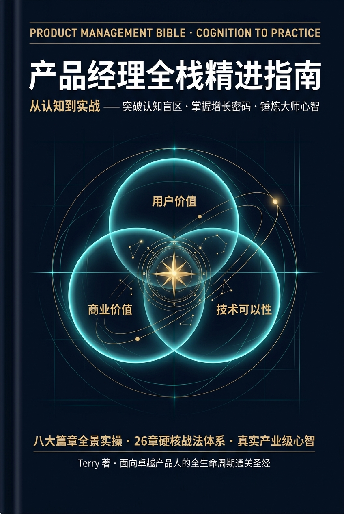
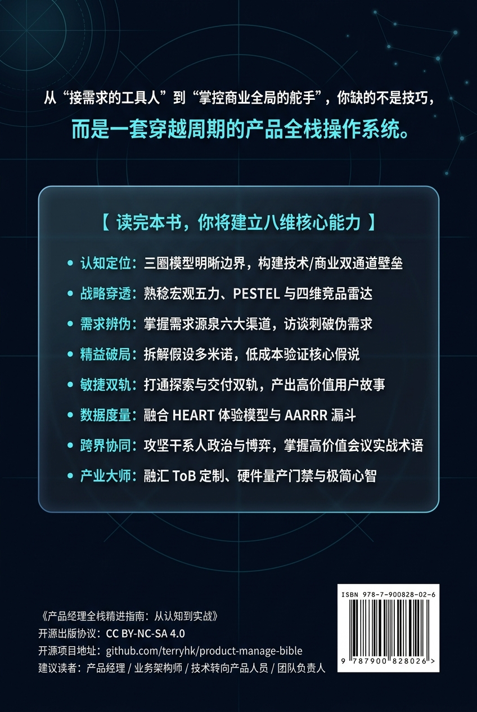

# Product Management Bible（产品经理实战与思考圣经）

> 致力于打造一本扎根于实战、兼具 ToB / ToC / 硬件 / 电信跨领域视野、贯穿从“想法萌芽”到“退市复盘”全生命周期的开源产品经理硬核指南。

[](https://creativecommons.org/licenses/by-nc-sa/4.0/)
[]()
[](./CONTRIBUTING.md)

---

## 封面

<p align="center">
  
  <br/>
  <em>《产品经理全栈精进指南：从认知到实战》封面</em>
</p>

---

## 📖 项目愿景与特色

本项目源自一线产品从业者数年沉淀的 Obsidian 核心笔记网络，经过系统性重构与工业级推演，旨在为中文互联网与开源社区提供一份**体系严密、案例翔实、开箱即用**的产品经理全生命周期知识库。

- **三环视野**：穿透 UX（用户体验）、Business（商业可行）、Technology（技术落地）三者交界。
- **全生命周期闭环**：覆盖 构思（Conceive）→ 规划（Plan）→ 研发（Develop）→ 迭代（Iterate）→ 发布（Launch）→ 运营（Steady State）→ 退市（Sun-setting）。
- **跨行业纵深**：不仅涵盖互联网软件与 C 端消费级产品，还深度涵盖企业级 ToB 架构、智能硬件生态链、电信运营商 ICT 产品支撑体系以及华为 IPD 商业变革实录。
- **大师心智沉淀**：融入张小龙产品哲学、Steve Blank 客户开发理论、精益创业 MVP 战术与大厂高阶产品评审心法。

---

## 🗺️ 全书结构概览


| 篇章 | 主题 | 核心内容 | 状态 |
| :--- | :--- | :--- | :---: |
| **[第一篇](./part1-cognition/index.md)** | **认知与定位篇** | 什么是产品经理、三环模型、Stop Doing List、职业天梯、冰山模型、十年宿命 | 🟢 已完成 |
| **[第二篇](./part2-market/index.md)** | **市场与竞争篇** | 市场容量 Top-down/Bottom-up 测算、波特五力模型、竞品五维分析、Feature Table | 🟢 已完成 |
| **[第三篇](./part3-requirements/index.md)** | **需求挖掘与真伪篇** | EMUC 来源、伪需求粉碎机、5次 Why、OFO 案例分析、Steve Blank 客户开发 | 🟢 已完成 |
| **[第四篇](./part4-lean-mvp/index.md)** | **精益创业与 MVP 实战篇** | 假设拆解、最致命风险四象限、6类 MVP 战法、MCS 成功阈值公式 | 🟢 已完成 |
| **[第五篇](./part5-agile-delivery/index.md)** | **敏捷研发与项目推进篇** | Scrum vs 看板、Epic Spec、User Story 与 AC 规范、Kano/BUC/MoSCoW 优先级 | 🟢 已完成 |
| **[第六篇](./part6-metrics/index.md)** | **数据驱动与产品度量篇** | HEART 框架、AARRR 海盗模型、指标设计哲学、激活与留存度量 | 🟢 已完成 |
| **[第七篇](./part7-collaboration/index.md)** | **跨职能协同与团队管理篇** | 与研发/设计/高管/销售高效协同、会议前中后闭环、外企行业暗语速查 | 🟢 已完成 |
| **[第八篇](./part8-industry-wisdom/index.md)** | **行业纵深与大师心智篇** | ToB 四大形态、电信网络支撑系统、硬件生态链、华为 IPD 实录、张小龙产品方法论 | 🟢 已完成 |

---

## 🛠️ 本地阅读与构建指南

本项目基于 Markdown 编写，推荐使用现代静态文档生成器预览：

```bash
# 1. 克隆仓库
git clone https://github.com/terryhk/product-manage-bible.git
cd product-manage-bible

# 2. 安装依赖（以 VitePress 为例）
npm install

# 3. 启动本地文档服务器
npm run docs:dev
```

---

## 🤝 贡献与共建

欢迎通过 Issue 提交勘误、建议，或通过 Pull Request 分享您的实战案例与复盘总结。请参阅 [CONTRIBUTING.md](./CONTRIBUTING.md) 了解详细协作规范。

---

## 背面

<p align="center">
  
  <br/>
  <em>《产品经理全栈精进指南：从认知到实战》背面</em>
</p>

---

## 📄 授权协议

本项目采用 [知识共享署名-非商业性使用-相同方式共享 4.0 国际许可协议 (CC BY-NC-SA 4.0)](https://creativecommons.org/licenses/by-nc-sa/4.0/)。
