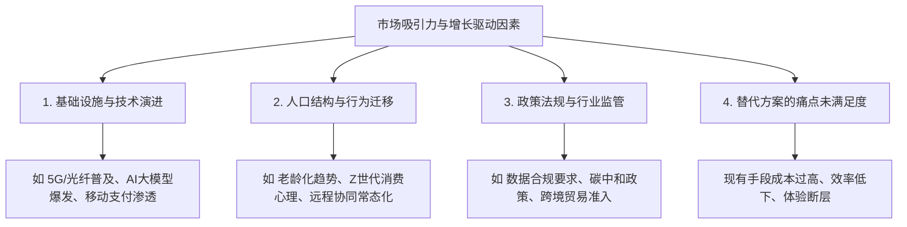
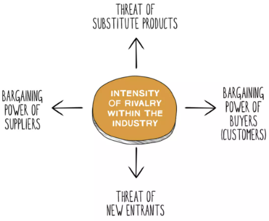
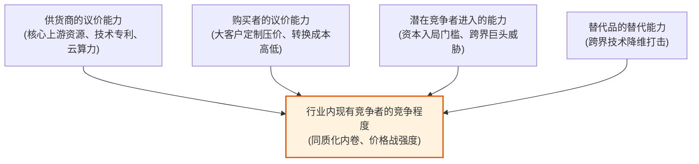
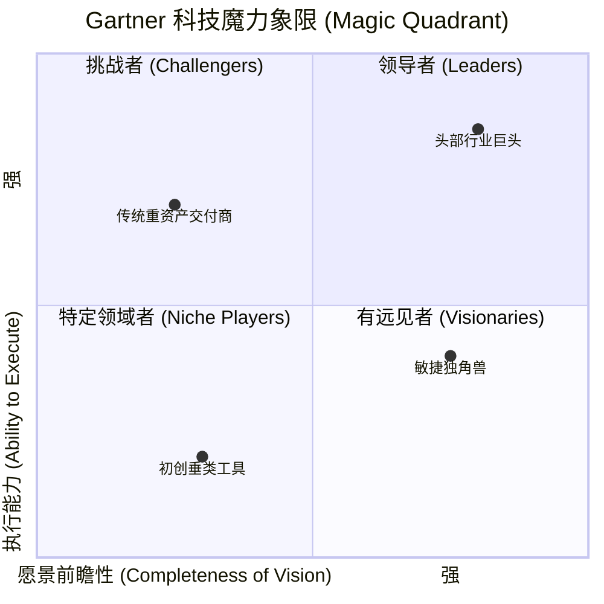

# 第 3 章：市场分析与容量测算 —— 从宏观大盘到微观切入

> “不要在干涸的池塘里练习捕鱼。一个产品的市场天花板，往往在商业立项的那一刻就被赛道的物理规律决定了。优秀的产品经理必须既能站在卫星视角看清全局容量，又能落回地面算清每一笔真实的单元经济账。”

---

## 3.1 市场的界定与吸引力评估

在讨论“做不做”之前，首先要用极其精炼的语言回答两个核心问题：
1. **这个赛道里的企业到底生产什么类型的产品与服务？**
2. **这些企业聚焦的目标客户群（Target Customers）究竟是谁？**

如果不能清晰界定市场边界，产品定位就会失焦。例如：
- 错误的市场界定：“我们做一款面向所有大学生的社交软件”（过于泛化，无法形成有效切口）。
- 正确的市场界定：“我们做一款面向海外留学生、解决跨文化学术交流与考前划重点的高频答疑社群工具”。

### 市场吸引力（Market Attractiveness）与增长动能




*图 3-1：市场吸引力评估矩阵（市场规模、增长率与进入门槛的多维平衡）*

#### 识别增长驱动力（Growth Drivers）
研究市场规模时，最危险的错误是误把“存量停滞市场”当成“高成长市场”。产品经理必须追踪深层的增长动能：
- **技术驱动（Technology Shift）**：技术红利直接打破了过去的成本曲线（例如：云原生使中小企业无需购买物理机房，大模型使个性化内容生成成本趋近于零）。
- **人口学驱动（Demographics）**：关注用户生命周期的不可逆变化（如人口结构转变带来的银发经济、独居青年带来的单身便利消费）。
- **监管驱动（Regulations）**：合规要求的升级往往瞬间释放出巨大的刚需市场（例如：网络安全等级保护合规催生了企业级安全审计产品需求）。

---

## 3.2 市场容量测算双模型：Top-down vs Bottom-up

市场规模测算（Market Sizing）是产品立项、争取预算及向管理层汇报的核心基石。业界通常使用两套截然不同的测算范式：

```mermaid
flowchart TD
    subgraph TopDown["自上而下法 (Top-down)"]
        TD1[总市场大盘 Total Market] --> TD2[假设我们能拿下 1%~5% 份额]
        TD2 --> TD3[得出预期销售额<br/>(偏乐观 / 融资导向)]
    end

    subgraph BottomUp["自下而上法 (Bottom-up)"]
        BU1[锚定生态参照物真实销量] --> BU2[测算流量入口、转化率与客单价]
        BU2 --> BU3[得出可实现的稳健预期<br/>(偏保守 / 研发与实操导向)]
    end

    TopDown -.->|交叉校验| BottomUp
```

### 1. 自上而下法（Top-down Approach）
- **基本逻辑**：获取宏观统计报告中的行业总盘子（Total Addressable Market, TAM），然后拍一个“保守估计我们能占领 1% ~ 2% 市场份额”，进而乘出预估销售收入。
- **典型推演示例**：
  > “全球 iPhone 用户有 10 亿人，假设其中有 0.1%（100 万人）下载我们的付费滤镜 App，每个 App 售价 5 美元，我们第一年将获得 500 万美元收入。”
- **优缺点分析**：
  - **优势**：速度快、逻辑宏观性感，极其适合在商业计划书（BP）中向天使投资人展示远大愿景。
  - **致命缺陷**：**充满了脆弱的链式假设**。为什么是 0.1% 而不是 0.0001%？凭什么用户能跨越几百万个竞品看到你的产品？它无法指导具体的落地打法。

### 2. 自下而上法（Bottom-up Approach）
- **基本逻辑**：基于市场上现存的相似产品真实销售数据、可触达的渠道流量以及实际的转化率漏斗，逐步叠加计算出可捕获的实际市场（Serviceable Obtainable Market, SOM）。
- **典型推演示例**：
  > “我们在 Apple App Store 搜索同类头部滤镜工具，通过数据平台（如 Data.ai / SensorTower）查出该细分垂类 Top 5 的月均下载总量为 20 万次；  
  > 我们的获客渠道主要是小红书与 TikTok KOL 合作投放，预计首期预算可触达 50 万精准受众；  
  > 按照行业平均 3% 的落地页转化率与 15% 的付费转化率，首年真实可获得的付费用户约为 2,250 人；  
  > 结合客单价，第一阶段可实现的确定性收入为 $11,250。”
- **优缺点分析**：
  - **优势**：**极度客观、保守、稳健（Conservative & Realistic）**。每一步都有数据支撑，能精准指导研发成本预算与运营投放节奏。
  - **实践结论**：**做对外 PPT 可以用 Top-down 描绘星辰大海，但团队关门做产品决策与财务预算时，必须以 Bottom-up 为准！**

---

## 3.3 波特五力模型在产品决策中的实操推演

迈克尔·波特（Michael Porter）提出的“五力分析模型”是剖析行业基本竞争态势、预测长期利润潜力的经典框架。对于产品经理而言，五力模型是识别“外部阻力与潜在杀手”的战略罗盘：



### 五力拆解与产品实战应对

1. **供货商的议价能力（Bargaining Power of Suppliers）**
   - **痛点场景**：产品极度依赖某个独家 API、底层芯片、电信牌照或大模型算力接口。如果 OpenAI 或云厂商单方面提价 30%，你的产品是否有生命力？
   - **PM 策略**：推行多供应商策略（Multi-vendor），沉淀抽象中间层，降低对单点供应商的架构耦合。
2. **购买者的议价能力（Bargaining Power of Buyers）**
   - **痛点场景**：特别是在 ToB 领域，几个 KA 大客户贡献了 80% 营收，客户频繁要求定制开发，甚至以切走业务为威胁要求无底线降价。
   - **PM 策略**：提升产品的标准化程度与**用户数据沉淀带来的转换成本（Switching Cost）**，拓展中长尾客户矩阵，分散风险。
3. **潜在竞争者进入的能力（Threat of New Entrants）**
   - **痛点场景**：产品上线三个月后被大厂直接“像素级抄袭”，并在其成熟的流量漏斗中迅速超越你。
   - **PM 策略**：在窗口期内快速构建网络效应（Network Effects）、行业专有数据壁垒或深厚的技术门槛。
4. **替代品的替代能力（Threat of Substitutes）**
   - **痛点场景**：打败你的往往不是直接竞争对手。比如：数码相机不是被尼康佳能淘汰，而是被智能手机摄像头碾压；方便面市场的下滑很大程度源自外卖平台的普及。
   - **PM 策略**：跳出功能维度的狭隘竞争，时刻关注用户核心诉求的解决方式是否发生了范式转移。
5. **行业内现有竞争者的竞争程度（Rivalry Among Existing Competitors）**
   - **痛点场景**：赛道涌入几十家同质化产品，陷入惨烈的烧钱补贴或低价竞争泥潭。
   - **PM 策略**：坚决避免正面对耗，寻找利基市场（Niche Market）实现差异化突围。

> [!WARNING]
> ### ⚠️ 波特五力模型的局限性与现代反思
> 1. **零和博弈假设**：传统五力模型假设行业总规模恒定，参与者之间只有非此即彼的血腥争夺，忽视了**生态合作（Co-opetition）与共同做大蛋糕**的可能性（如开源社区与商业生态的共生）。
> 2. **信息完备度要求极高**：五力分析要求制定战略者拥有整个上下游产业链的全局数据，而初创产品在敏捷探索期往往难以获取此类宏观洞察。

---

## 3.4 权威行业研报的解码与应用（Gartner 与 IDC）

在 ToB 企业级服务、云计算、通信（ICT）与数据智能领域，产品经理必须学会阅读并借助权威分析机构的研报建立行业说服力：



### 1. Gartner 魔力象限（Magic Quadrant）应用心法
- **Leaders（领导者）**：愿景宏大且执行能力极强。在规划产品对标时，看 Leaders 的产品架构演进能明确未来的主流标准。
- **Challengers（挑战者）**：拥有极强的销售与渠道执行力，但在前瞻技术上相对保守。适合学习其渠道下沉与商业化策略。
- **Visionaries（有远见者）**：看清了未来趋势但当前落地能力尚在成长中。适合从中挖掘差异化的前沿特性与灵感。
- **Niche Players（特定领域者）**：深耕某一个细分纵深市场。初创企业或新产品立项最适宜的切入生态位。

### 2. IDC 跟踪报告（Market Share Tracker）
- 聚焦**具体市场份额、季度出货量与复合年均增长率（CAGR）**。
- 在电信通信网络（如 SD-WAN、MPLS 专线、NaaS）和云基础设施的立项说明书中，IDC 的硬核数据是说服财务与管理层投资的最佳“通行证”。

---

## 3.5 本章自检 Checklist

- [ ] 我所定义的目标市场，是否具备明确的问题边界与清晰的受众画像，而不是一句泛化的空话？
- [ ] 针对当前产品的营收预期，我是仅仅用自上而下（Top-down）的乘法讲故事，还是有严谨的自下而上（Bottom-up）漏斗数据作支撑？
- [ ] 在波特五力框架下，我们的产品是否面临上游供应商断供或随意调价的系统性风险？是否有解耦方案？
- [ ] 我们的核心痛点解决方案，是否正在面临来自跨界技术或替代品（Substitutes）的潜在颠覆？
- [ ] 在面对行业成熟竞品时，我们是盲目同质化跟风，还是找到了特定领域者（Niche）的差异化切入点？
