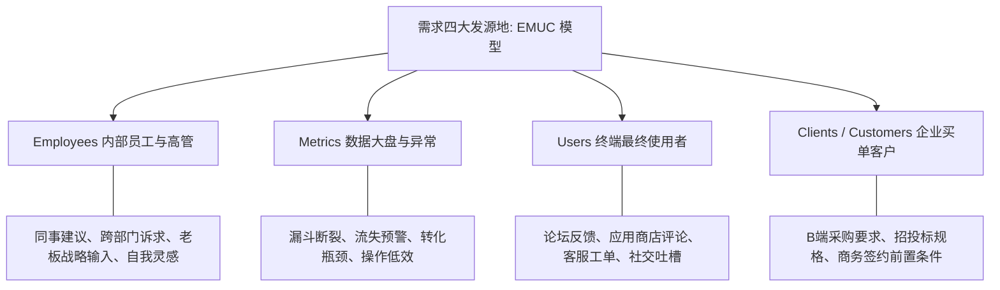
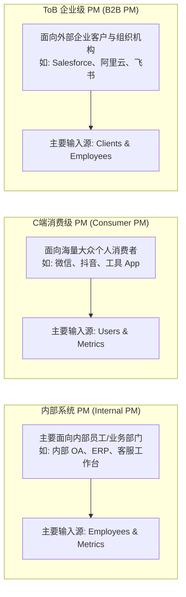
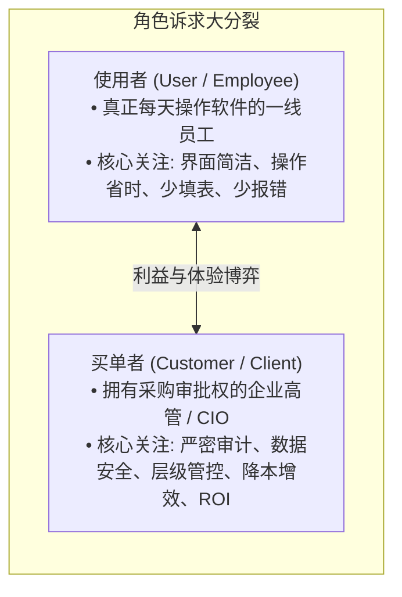

# 第 5 章：需求从何而来 —— EMUC 模型与用户 vs 客户双重诉求

> “产品经理绝不是‘点子制造机’（PM is not the idea person）。任何一个团队都从不缺乏各种天马行空的想法。产品经理的核心职责，是在市场动向与企业现实的复杂约束下，从纷繁的声音中收集需求、过滤噪音，并决定‘何时做、做什么、不做什么’。”

---

## 5.1 重新认识需求的源头：EMUC 模型

在科技企业的日常运转中，新想法与需求通常源于四个核心发源地，合称为 **EMUC 模型**：



### EMUC 四大源头深度解析

1. **Employees（内部员工与管理者）**：
   - **来源**：来自一线销售人员的客户反馈、技术团队发现的系统重构诉求、业务运营团队的活动工具诉求，以及高管层下达的战略方向。
   - **特点**：往往带有很强的业务导向或局部屁股决定脑袋的倾向。PM 必须探寻其背后的核心动因，而不是盲目听从。
2. **Metrics（数据指标与埋点大盘）**：
   - **来源**：日常监控数据仪表盘时捕捉到的反常现象（如：新注册用户的次日留存骤降 20%，或者某一流程的跳出率远高于平均水平）。
   - **特点**：最客观、最诚实的信号。它明确告诉你“哪里出了问题”，但往往无法直接给出“为什么出问题”，需要结合定性分析。
3. **Users（终端最终使用者）**：
   - **来源**：个人终端用户在社交媒体（微博、Twitter、小红书）、社区论坛（Reddit、V2EX、知乎）、App Store 差评以及客服工单系统中的呼声。
   - **特点**：高频、碎片化、情感充沛。用户会提出具体的操作细节抱怨，但容易陷入“一叶障目”的局部视角。
4. **Clients / Customers（企业采购决策方）**：
   - **来源**：主要存在于 ToB、政企及大客户销售场景中，客户的高级采购总监、CIO 或部门主管在商务谈判中提出的系统对接与功能清单。
   - **特点**：直接关系到商业成单与现金流，决策链长，往往对安全性、合规性与组织管理有严苛要求。

---

## 5.2 不同 PM 类型的需求摄入差异

不同的产品经理定位，决定了其获取需求的核心“输入法”截然不同：



- **内部系统 PM（Internal PM）**：
  - **核心用户群**：公司内部各岗位员工。
  - **优势与挑战**：用户就在身边，访谈与调研极度容易；但往往要面对复杂的跨部门政治利益与繁重的系统对接，核心指标在于“为企业降本增效”。
- **消费级 C 端 PM（Consumer PM）**：
  - **核心用户群**：成千上万乃至数以亿计的普通网民。
  - **优势与挑战**：面对极大的不确定性与残酷的留存压力，个人的主观经验往往失效。必须依赖海量埋点数据（A/B 测试、漏斗转化）与大规模用研。
- **ToB 企业级 PM（B2B PM）**：
  - **核心用户群**：外部企业客户组织。
  - **优势与挑战**：用户量可能只有几千到几十万，但客单价极高（几十万到数千万）。需求优先级往往直接与金钱权重（Revenue Weighting）挂钩。

---

## 5.3 核心冲突与深度辨析：Users（使用者）vs Customers（买单者）

在现代产品管理中，最致命的误区之一是将“使用者”与“买单者”混淆为同一个人。事实上，两者往往是完全不同的利益群体：



### 双重角色的核心分歧对比

| 比较维度 | 使用者（User） | 买单者（Customer / Client） |
| :--- | :--- | :--- |
| **角色定义** | 实际操作、使用软件功能的终端个人（如客服专员、一线销售、普通员工）。 | 评估商业价值、拍板采购预算的企业实体或高管（如 CEO、CFO、采购总监）。 |
| **关切核心** | **操作效率与个人体验**。<br>“这套系统会不会让我每天多加班半小时？界面能不能别那么卡？” | **组织管控与商业回报**。<br>“这套系统能否监控员工绩效？能否保障商业机密不外泄？能否提升公司总体产出？” |
| **反馈类型** | 具体的**技术细节、交互缺陷与操作摩擦**。<br>例如：“为什么这个表格不能批量选中？” | 宏观的**战略诉求、合规能力与行业资质**。<br>例如：“系统是否支持本地私有化部署和等保三级认证？” |

### 典型翻车案例：传统 OA 系统的悲剧
在许多传统企业级办公系统（OA）的设计中，软件开发商为了拿下大单，完全迎合了“买单者（老板与行政主管）”的管控欲：
- 增加了极其繁琐的 7 层审批流程、复杂的强制水印、严苛的离线防截屏。
- 结果：“买单者”在采购合同上签了字，但“使用者（全员员工）”苦不堪言，日常协作效率暴跌，甚至自发私下建微信群沟通，导致耗资巨额的企业系统沦为无人愿用的空壳。

> [!IMPORTANT]
> ### ⚖️ 双重诉求的平衡艺术
> 卓越的 ToB 产品经理必须懂得“踩双刹车、走平衡木”：
> 1. **在功能架构与安全合规上满足买单者（Customer）**：提供严密的权限体系、合规审计、ROI 数据大盘，这是让客户签约掏钱的**前提**；
> 2. **在人机交互与操作流转上讨好使用者（User）**：大幅精简输入字段、优化快捷操作、提供智能化默认值，这是让产品真正落地、形成粘性并最终促成**次年续费（Renew）与增购（Upsell）**的根本保证！

---

## 5.4 过滤噪音：从纷乱的想法中萃取有效需求

面对汹涌而来的需求列表，产品经理必须建立“需求过滤器”：

```mermaid
flowchart TD
    Idea[收到一个新想法 / 需求输入] --> Q1{1. 它是否对齐团队的核心目标或愿景？}
    Q1 -- 否 --> Drop[礼貌归档 / 延期考量]
    Q1 -- 是 --> Q2{2. 解决的是致命痛点还是可有可无的痒点？}
    Q2 -- 痒点 --> Deprioritize[降低优先级]
    Q2 -- 痛点 --> Q3{3. 能否给核心指标带来显著提升 (如至少提升20%以上)？}
    Q3 -- 否 --> Evaluate[评估开发成本 vs 收益]
    Q3 -- 是 --> Q4{4. 商业回报是否显著大于研发与运营投入？}
    Q4 -- 是 --> Backlog[纳入 Product Backlog 进入深度推演]
    Q4 -- 否 --> Drop
```

当有人（哪怕是老板或核心销售）向你扔来一个具体需求时，请在心中快速过一遍这四个问题：
1. **这是不是在解决一个真实的痛点？** 用户如果不做这个，会有多大损失？
2. **有多少比例的目标用户能从中获益？** 还是仅仅为了满足个别特殊客户的偶发诉求？
3. **它能否带来指标上的阶跃式提升（Step Change）？** 我们期望它让目标转化率翻倍，还是仅仅提升 0.5%？
4. **它会不会带来未曾预料的副作用？** 新增这个入口，会不会分散主流程的点击率？会不会增加后台巨额的人工审核成本？

---

## 5.5 本章自检 Checklist

- [ ] 面对最近收到的 5 个核心需求，我能否清楚地归类它们分别来自 E（员工）、M（指标）、U（用户）还是 C（企业客户）？
- [ ] 在规划即将交付的特性时，我是否明确区分了它是服务于“买单者（Customer）”的商业诉求，还是服务于“使用者（User）”的操作体验？
- [ ] 我们的产品是否陷入了“为了迎合采购高管而无底线牺牲一线员工体验”的危险泥潭？
- [ ] 面对各方提出的想法，我是否建立了清晰的过滤标准，而不是被动地沦为需求的“录入员与传声筒”？
- [ ] 针对关键指标的剧烈异常，我是否不仅看了宏观数据，还深入到一线用户的情境中探寻背后的真实归因？
