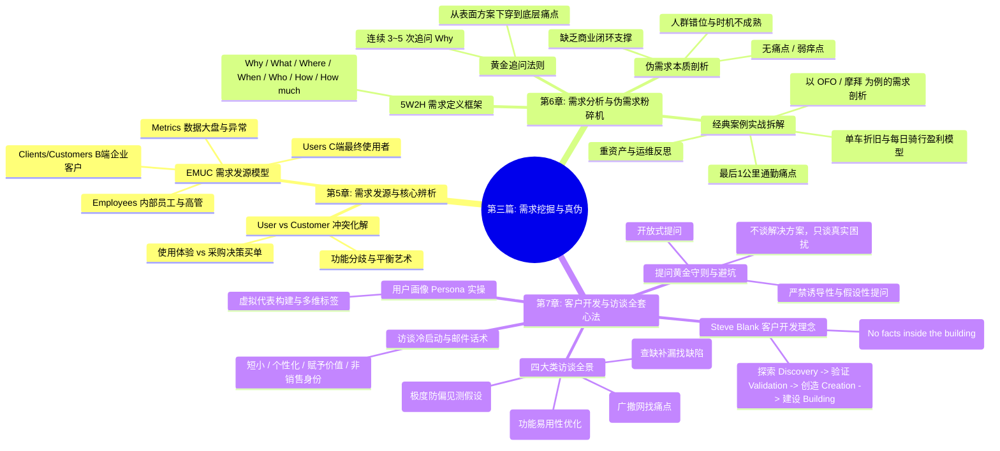

# 第三篇：需求挖掘与真伪篇 —— 穿透表象直达本质

> “客户绝不会主动告诉你他们真正需要什么，他们只会向你索要他们自以为想要的东西。如果你直接按照用户的表面要求去做，你做出的往往是一个四不像的缝合怪。产品经理的核心功力，在于穿透表面需求，挖掘出背后的底层痛点与商业闭环。”

---

## 篇章导读

每一位产品经理每天都会被潮水般的需求包围：
- 老板说：“竞品上线了这个功能，我们必须马上跟进！”
- 销售说：“客户说了，没有这个功能这笔大单就签不了！”
- 用户在论坛吐槽：“你们的界面怎么没有这个快捷按钮？”
- 数据大盘显示：“注册到激活的转化率暴跌了 15%！”

如果你是一个“来者不拒”的传声筒，你的团队将永远在疲于奔命、堆砌功能，最终把产品做成一个臃肿、难用且毫无商业价值的垃圾堆。

本篇将系统解构**需求四大发源地（EMUC 模型）**、**使用者（User）与买单者（Customer）的本质冲突**、用**连续 5 次追问“Why”**与 **5W2H 法**粉碎“伪需求”、以**共享单车 OFO/摩拜**为真实案例深度剖析出行痛点与折旧商业模式，并手把手拆解硅谷大师 **Steve Blank 的客户开发四步法**与**四大类用户访谈全套实战心法**。

---

## 本篇知识图谱

---

## 章节导航

- **[第 5 章：需求从何而来 —— EMUC 模型与用户 vs 客户双重诉求](./05-where-ideas-come-from.md)**
  - 剖析需求的四大发源地、不同类型 PM（内部/ToB/ToC）的信息摄入源，以及使用者（User）与决策买单方（Customer）的诉求平衡。
- **[第 6 章：需求分析与伪需求粉碎机 —— 5 次 Why 与 OFO 实战推演](./06-requirement-analysis-and-fake-demands.md)**
  - 拆解连续 5 次 Why 的本质穿透法、伪需求的判定标准、5W2H 需求定义标准化模板，以及共享单车的经典出行需求与折旧盈利分析。
- **[第 7 章：客户开发与用户访谈全流程 —— 从冷启动到精准画像](./07-customer-development-and-interviews.md)**
  - 详解 Steve Blank 客户开发循环、四类访谈实施准则、高情商邮件邀约话术与可落地的用户画像（User Persona）构建指南。
