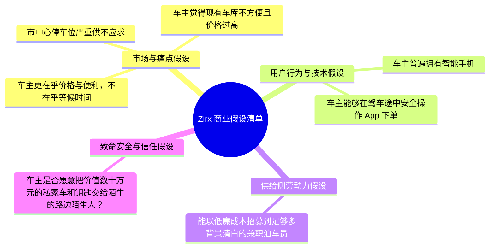
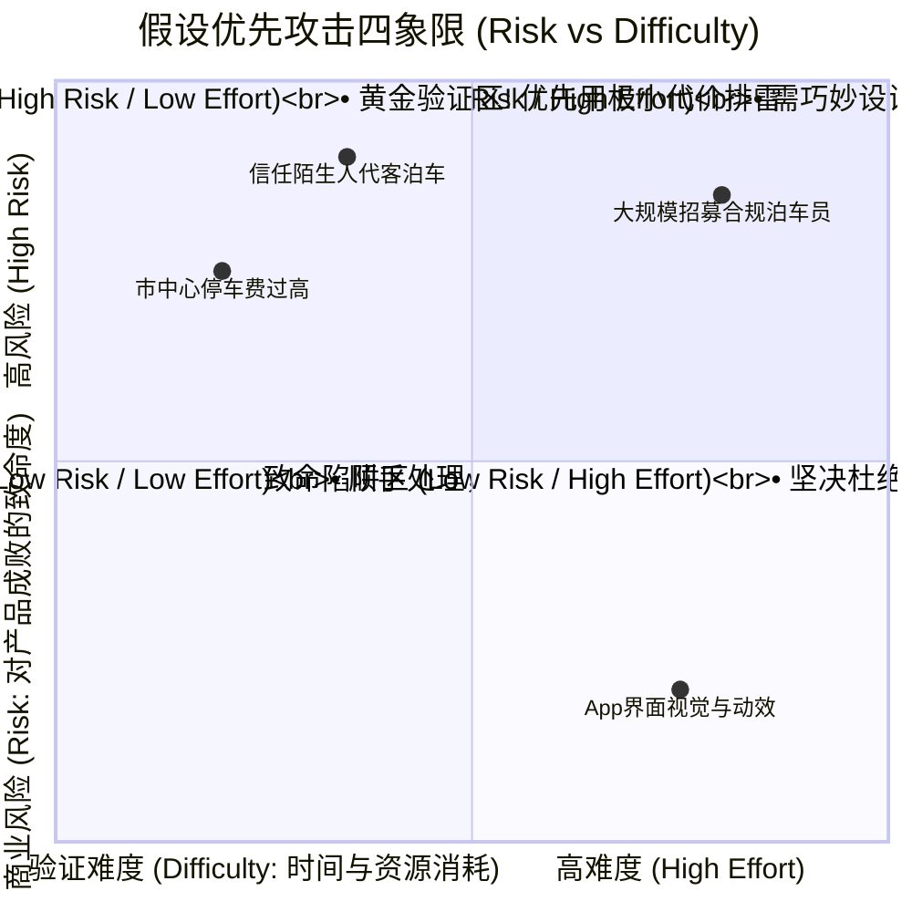
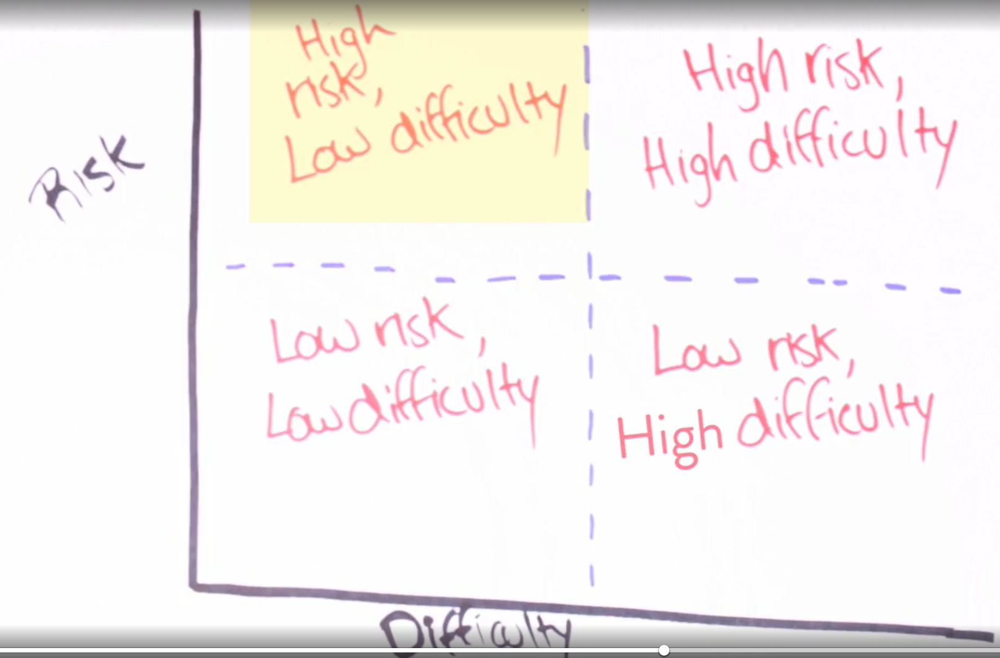
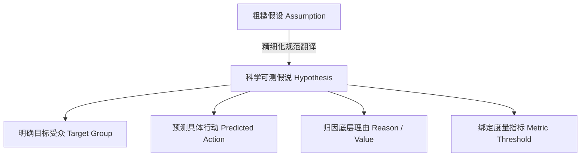

# 第 9 章：假设拆解与高风险定位 —— 风险-难度四象限与科学假说

> “商业失败最昂贵的代价，不是做错了某项功能，而是将一个致命的错误假设当成了理所当然的事实。优秀的精益产品经理在动工之前，会进入‘禅定’状态，承认自己一无所知，并以最快速度抓出那条足以杀死整个项目的‘最致命假设’。”

---

## 9.1 进入“精益禅模式”：承认我们一无所知

人类大脑有极强的主观合理化倾向。当我们突然萌生一个看似惊艳的点子时，本能会让我们搜集所有支持自己的证据，下意识忽略所有的阻碍与质疑。

在精益产品管理中，第一步就是打破这种认知自恋，进入**“精益禅模式”（Lean Zen Mode）**：
> **“在被严谨客观的用户数据和市场验证之前，你脑海里认为自己知道的一切，统统都只是主观假设（Assumptions）！”**

```mermaid
graph LR
    Self["认知自恋陷阱<br/>'用户一定会喜欢这个功能'<br/>'市场上绝对没人做过'<br/>'上线后肯定能赚大钱'"]
    -->|精益禅模式清洗|
    Zen["科学怀疑态度 (Lean Zen)<br/>'我们其实什么都不知道'<br/>'这只是团队的一条未验证假设'<br/>'我们必须设计实验来证伪它'"]
```

---

## 9.2 假设拆解实战：以智能代客泊车（Zirx）为例

为了看清一个商业模式背后隐藏了多少张“脆弱的多米诺骨牌”，我们以硅谷曾经备受关注的按需代客泊车服务 **Zirx** 为例进行系统拆解：

- **核心痛点**：在旧金山、纽约等繁华大都市，在市中心找到停车位极其痛苦，地下车库收费昂贵且步行距离远。
- **产品方案**：用户通过智能手机 App，在抵达目的地前呼叫专属泊车员，泊车员骑着折叠滑板车在路边接车并代为停至合作远端车库；用户办完事后，再通过 App 呼叫泊车员送车。

看似逻辑完美的闭环背后，究竟支撑了哪些未经证实的底层假设？



### 假设清单盘点
1. 大城市中心核心区域的公共停车位真实存在严重缺口；
2. 车主普遍对商业车库高昂的停车费感到沮丧；
3. 车主更重视“有人帮我停车的便利”，能够容忍“取车时需要提前 15 分钟呼叫”的时间延迟；
4. 市场上有足够多的年轻人愿意在严寒酷暑中从事按需代客泊车工作；
5. 合作远端车库的批发租赁成本足够低，能给平台留出可观的利润空间；
6. **车主是否愿意冒着车辆被刮蹭、车内财物被盗的心理风险，把一辆价值 50 万元的私家车车钥匙，直接交给路边一个身穿荧光背心的陌生陌生人？**

---

## 9.3 锁定“最致命假设”（The Riskiest Assumption）

当列出长达十几条的假设清单后，产品经理切忌平均用力。必须敏锐地捕捉到**最致命假设（Riskiest Assumption）**：

> [!IMPORTANT]
> ### 🎯 最致命假设的判定铁律
> **如果该条假设被证实为假，那么其余所有假设是否成立将瞬间变得毫无意义，整个产品的商业大厦将在顷刻间轰然倒塌！**

在 Zirx 案例中，前面的“车位紧缺”、“车库太贵”哪怕全部成立，只要**第 6 条信任假设（车主信任陌生人接管车辆）**不成立，或者**车主单次投保责任险的成本直接击穿了单笔毛利**，这个商业模式就彻底宣判死刑。

因此，团队所有早期的精力，根本不应该浪费在去写一个精美的 App、设计炫酷的动画，而应该**倾尽全力去测试这条最致命假设！**

---

## 9.4 决策利器：“风险-难度”四象限矩阵

在面对繁杂的假设列表时，业界通常使用 **风险-难度四象限矩阵（Risk / Difficulty Square）** 来决定实验的先后攻击顺序：




*图 9-1：假设攻击优先级决策四象限*

### 四象限实战法则

1. **第一绝对攻击靶心（高风险 / 低难度，High Risk / Low Difficulty）**：
   - 这是精益验证的“黄金靶心”。这类假设一旦证伪，项目直接免于巨大灾难；而验证它的成本又极低（通常只需几天或几百元成本）。
2. **第二攻击目标（高风险 / 高难度，High Risk / High Effort）**：
   - 商业上极度关键，但测试它看似需要重资产或复杂工程。
   - **高阶 PM 的能力正体现在这里**：能否通过巧妙的“非技术手法”（如绿野仙踪、人工跑腿代劳）将其强行拆解，转化为低成本实验。
3. **坚决杜绝的陷阱区（低风险 / 高难度，Low Risk / High Effort）**：
   - 对业务成败毫无决定性影响，却需要工程师写极其复杂的算法或架构。平庸的团队最喜欢沉迷在此处寻找虚假的“忙碌安全感”。

---

## 9.5 科学假说陈述法（Hypothesis Formulation）

“假设（Assumption）”通常是模糊的、定性的感受；而在推行精益实验前，产品经理必须将其翻译为**单一、具体、且可被客观证伪的“假说（Hypothesis）”**。



### 假说编写三大标准句式

#### 1. 新产品孵化句式（Greenfield Products）
$$\text{We believe [目标受众] will [发生何种预期行为] because [何种底层痛点/价值理由].}$$

> **示例**：  
> *“我们相信 **居住在核心商圈的 30~50 岁自驾白领（Target）** 会 **在工作日早高峰将车钥匙交给身穿统一制服的泊车员并支付 30 元（Action）**，因为 **他们在写字楼地下寻找车位平均耗时超过 20 分钟且极度焦虑（Reason）**。”*

#### 2. 存量产品优化句式（Feature Optimization）
$$\text{If we [执行何种产品改动], we believe [目标受众] will [产生何种转化提升] because [何种体验改善].}$$

> **示例**：  
> *“如果我们 **在结账支付页面增加微信一键免密授权登录（Action）**，我们相信 **移动端新客的支付转化率将提升 25%（Predicted Action）**，因为 **免去了跨屏输入繁琐短信验证码的摩擦阻碍（Reason）**。”*

#### 3. PM 工业级标准度量句式（Metric-driven Template）
$$\text{我们认为 [用户主体] 存在 [具体痛点]。如果我们提供 [解决方案]，[核心度量指标] 将会在 [测试周期] 内改善 [具体量化数值]。}$$

> [!TIP]
> **假说的第一要求是可证伪性（Falsifiability）**。如果一个假说写得含糊其辞，无论实验数据如何都能强行解释为“符合预期”，那这个假说在科学上就是毫无价值的废话。

---

## 9.6 本章自检 Checklist

- [ ] 在开始任何新功能立项前，我是否摆脱了主观偏执，进入了“我们一无所知”的精益禅模式？
- [ ] 面对产品方案，我是否完整梳理出了包含痛点、行为、供给与商业闭环的全量假设清单？
- [ ] 我是否准确定位了那条“一旦为假、整个项目将彻底崩溃”的最致命假设（Riskiest Assumption）？
- [ ] 在风险-难度矩阵中，我们的团队是否优先对“高风险 / 低难度”的区域发起了第一轮实验排雷？
- [ ] 我的假说是否严格遵循了包含“目标受众、预期行为、痛点因果与量化指标”的标准陈述模板？
