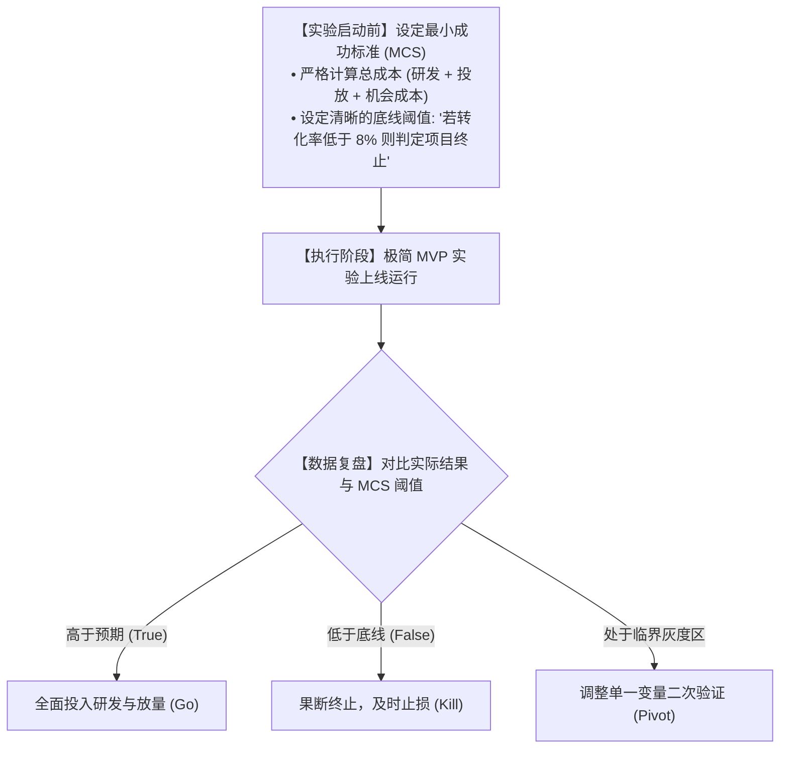
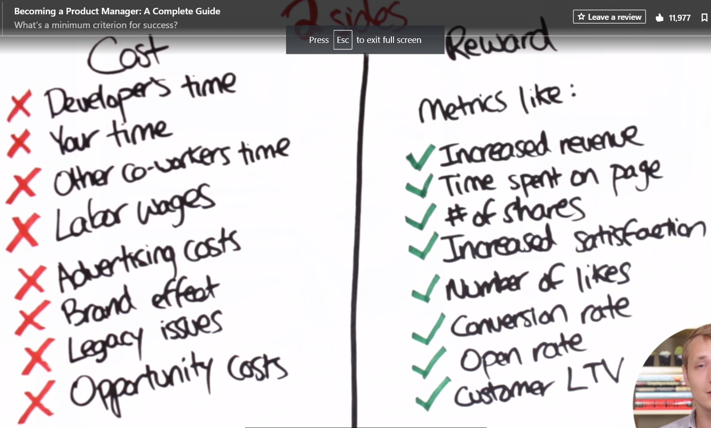
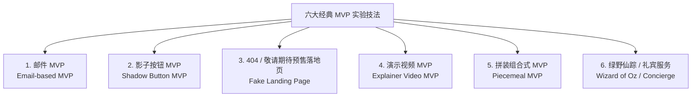
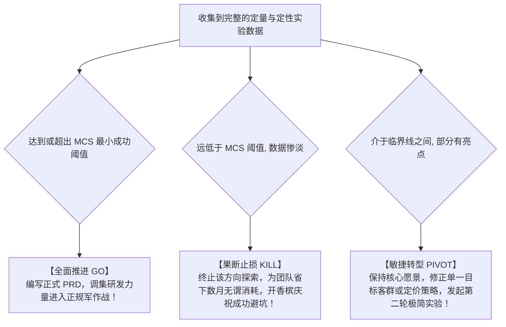

# 第 10 章：MVP 实验的 6 大实战技法与落地 —— 极简验证与成功阈值

> “不要为了写代码而写代码。如果能用一个网页、一封邮件甚至一次人工跑腿就把商业假设验证清楚，就坚决不要让工程师写哪怕一行正式代码。MVP 的最高境界，是用最‘简陋’的技术手段，完成最硬核的商业求证。”

---

## 10.1 设定最小成功标准（MCS）：提前定义胜负线

许多产品团队在做完 MVP 测试后依然陷入无休止的争吵：有人说“有 50 个人点了，说明很有前途！”有人说“才 50 个人，转化率太低彻底失败了！”

这种撕扯的根源在于：**团队没有在实验启动之前，明确设定“最小成功标准”（Minimum Criteria for Success, MCS）**。

*图 10-1：收益与成本权衡模型（投入成本 vs 预期指标回报）*

### 测算投入产出比（Cost vs Reward）公式

在给 MCS 划线时，产品经理必须拉出完整的财务与资源账本：

$$\text{实验总成本} = \text{人力研发成本} + \text{直接营销费用} + \text{团队机会成本}$$

- **实战测算推演**：
  - 投入 2 名工程师研发 2 周，薪酬折合约 $\$4,000$；
  - 投入 1 名 PM 协同 2 周，薪酬折合约 $\$2,000$；
  - 投放 Facebook/Google 种子测试流量，广告费 $\$3,000$；
  - **直接成本合计**：$\$9,000$；
  - **机会成本**：两位骨干工程师暂停了主营业务的核心性能优化（可能潜在延误了其他特性的上线）。
- **结论与阈值设定**：
  > *“既然我们本次实验直接消耗了近 1 万美元的资源，那么在测试期内，新特性的付费意向转化率**必须达到 15% 以上（且预估年化增量收益大于 5 万美元）**，才能 justify 给这个项目全面开绿灯！低于 10% 则无条件终止。”*

> [!TIP]
> **聚焦单一核心北极星指标（OMTM - One Metric That Matters）**：  
> 一次 MVP 实验严禁同时考核 5 个指标（既要注册率、又要留存率、还要分享率）。指标过多会导致验证逻辑自我冲突，务必只聚焦于最核心的那一个转化动作！

---

## 10.2 六大经典 MVP 实操战法全景

根据投入成本与验证场景的不同，业界沉淀出了 6 种开箱即用的 MVP 实验技法：

---

### 战法 1：邮件 MVP（Email-based MVP）
- **核心逻辑**：不开发系统后台，完全借助邮件列表或社群直接发起邀约或预售。
- **典型代表**：数字产品促销平台 **AppSumo**。早期没有任何复杂的电商交易与结算系统，创始人只是给自己的邮件订阅者群发了一封推荐折扣工具的纯文本邮件，附带一个 PayPal 转账链接，当天即验证了商业模式的可行性。
- **利弊与注意事项**：
  - *优势*：耗时极短（半天即可搞定）、成本几乎为零、便于分群测试。
  - *风险*：排版若过于粗糙容易被误判为垃圾邮件，可能对品牌专业形象造成轻微折损。

---

### 战法 2：影子按钮 MVP（Shadow Button MVP）
- **核心逻辑**：在现有的成熟 App 或 Web 界面上，**放置一个看似完好、但底层根本未曾开发的按钮或功能入口**，专门用来统计用户的真实点击欲望。
- **典型场景**：产品考虑是否要开发“一键生成多语言字幕”功能。在导出菜单中直接加上该选项，用户点击后弹出一个温馨提示窗口：
  > *“该高级功能正在小范围定向邀请公测中！我们已记录您的申请意向，感谢您的关注，正式开放时将第一时间邮件通知您！”*
- **实操红线**：
  - **必须严格限流与灰度控制**：只对 1%~5% 的抽样流量展示，不可全量上线。
  - **务必真诚致谢，拒绝粗暴弹窗**：给用户提供一定的安抚（如赠送 7 天通用会员或小礼品），避免产生被欺骗的挫败感。

---

### 3. 战法 3：404 与即将推出预售页 MVP（Coming Soon / Fake Landing Page）
- **核心逻辑**：用极简建站工具（如 Webflow, Framer, LaunchRock）搭建一个单页落地页。页面完整阐述产品的核心价值卖点、定价方案与核心截图，最醒目的位置放一个“立即预订（Pre-order）”或“加入候补名单（Join Waitlist）”表单。
- **验证指标**：
  - **曝光到意向转化率**：访问独立 IP 中，有多少比例的人认真填写了邮箱并点击了预约？
  - **定金测试（最高级验证）**：如果支持预付 1 美元或 9.9 元定金，掏钱人数是最无懈可击的市场刚需信号。

---

### 战法 4：演示视频 MVP（Explainer Video MVP）
- **核心逻辑**：对于那些底层架构极度复杂、研发周期漫长的产品，直接制作一段 2~3 分钟的动态概念演示视频，向目标用户直观展现它能如何神奇地解决问题。
- **标杆案例：Dropbox**：
  - 云存储与本地文件系统无缝双向同步，在 2008 年是一项极其庞大晦涩的系统工程，光写完底层驱动就需要数月。
  - 创始人德鲁·休斯顿（Drew Houston）没有埋头死磕全部代码，而是用简单的动画制作了一段 3 分钟的演示视频，模拟在 Mac 文件夹中拖入文件、并在另一台电脑上瞬间同步的神奇体验，并将其发布在 Hacker News 上。
  - **实验成果**：一夜之间，产品等候名单从 5,000 人暴涨至 75,000 人！团队拿着这份无可争议的数据，轻松完成了融资并锁定了最早的一批狂热铁粉。

---

### 战法 5：拼装组合式 MVP（Piecemeal MVP）
- **核心逻辑**：**不自研任何轮子**。利用市面上成熟的无代码与 SaaS 工具，像乐高积木一样搭建出可交付的产品流程。
- **工具链组合示例**：
  - 前端展示：Shopify 或 Notion 公开页面；
  - 表单与需求收集：Typeform 或 飞书多维表格；
  - 自动化业务流转：Zapier 或 Make（当收到表单时自动发邮件、发通知）；
  - 支付结算：Stripe 或 微信商户码。
- **价值**：整个团队无需一行后端代码，就能在 48 小时内跑通完整的线上获客与交付业务流。

---

### 战法 6：绿野仙踪 MVP（Wizard of Oz）与礼宾式服务（Concierge MVP）
- **核心逻辑**：**前台看起来像高度智能化的自动化系统，后台实际上全是产品经理与创始团队在人工纯手工搬砖**。
- **标杆案例：Zappos（美国最大在线鞋城）**：
  - 创始人尼克·斯威姆（Nick Swinmurn）想验证“人们是否愿意在网上买鞋”这一不可思议的假设。
  - 他没有租用大型仓库，也没有采购昂贵的分拣流水线。他只是拿着数码相机跑到当地的实体鞋店，把鞋子拍照上传到一个极其简陋的网站上。
  - 一旦网上有人下单付款，他就亲自跑到那家鞋店，按零售价原价买下那双鞋，自己打包并拿到邮局寄给客户。
  - **逻辑本质**：虽然每一笔订单他不仅不赚钱甚至倒贴邮费，但他用极低的成本百分之百验证了：**消费者真的愿意在网上买鞋！**

---

## 10.3 实验结果评估与复盘决策：站在三岔路口

当预设的测试周期结束、数据大盘尘埃落定后，产品经理必须召集核心团队，站在客观数据面前进行严肃的决断：

---

## 10.4 本章自检 Checklist

- [ ] 在推行本次 MVP 之前，团队是否事先签署并达成了关于“最小成功标准（MCS）”的具体量化阈值？
- [ ] 我们是否把本次实验的所有直接成本与团队机会成本全部算清，确保投入产出比具备合理性？
- [ ] 面对我们想要验证的假设，当前的方案是否已经是最精简的形态？能否用影子按钮、视频演示或绿野仙踪替代写代码？
- [ ] 如果使用了影子按钮等可能带来体验摩擦的技法，我们是否做好了严格的流量灰度控制与真诚的安抚补偿？
- [ ] 当实验数据不及预期时，团队是否有勇气直面现实按下终止键（Kill），而不是自欺欺人地继续加大赌注？
