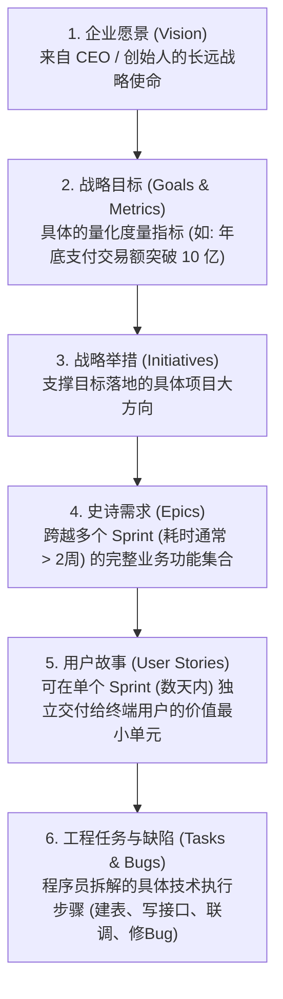
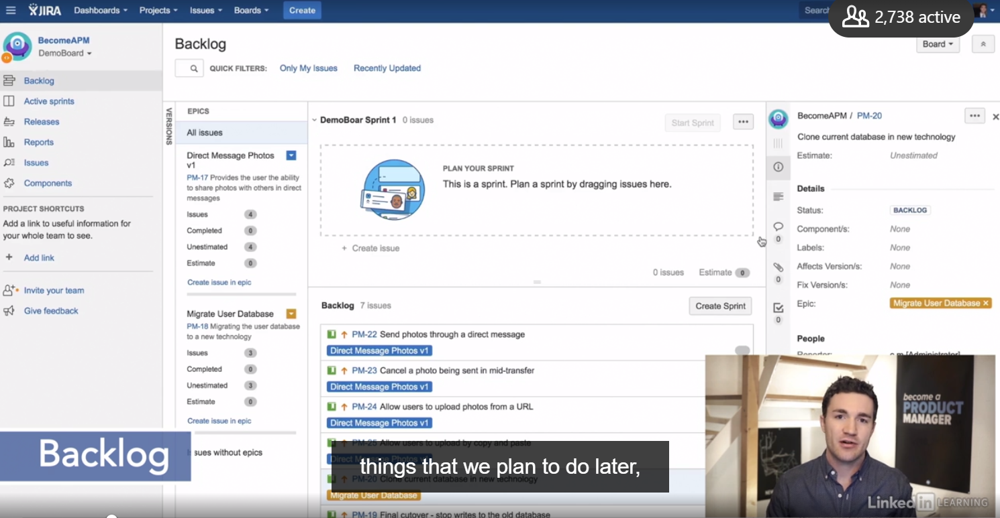
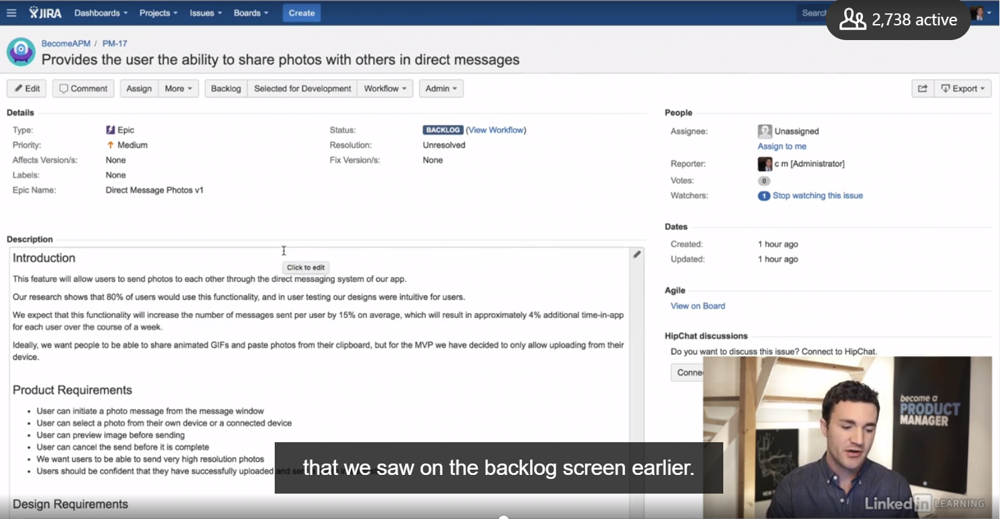
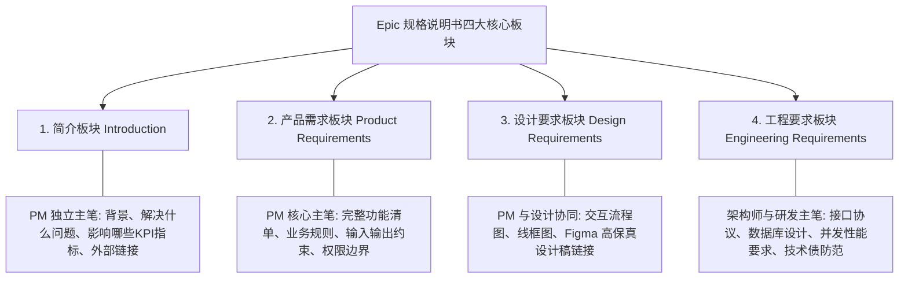
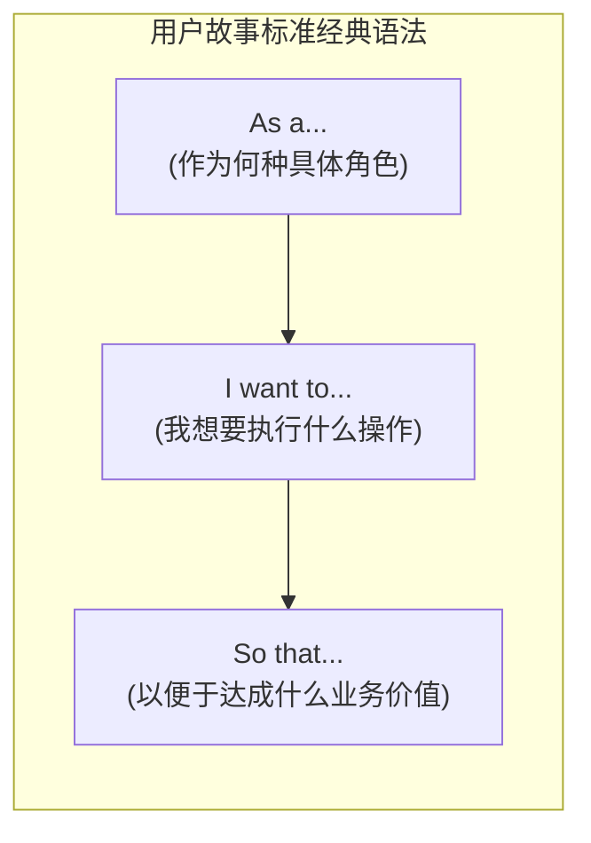
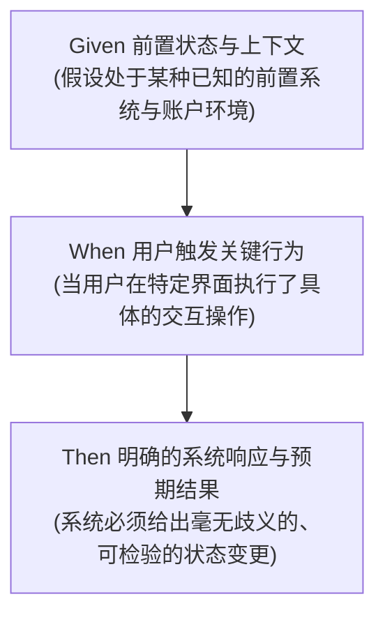

# 第 14 章：标准交付物模板与规范 —— Epic Specs, User Stories 与 AC 标准

> “没有无能的程序员，只有描述不清需求的产品经理。程序员写出的 Bug，有超过一半在产品经理敲下第一行含糊不清的需求文档时就已经注定了。工业级的规范文档，不是冗长废话的堆砌，而是用极度精准的结构化语言，在业务逻辑与工程实现之间架起一座零误差的桥梁。”

---

## 14.1 任务拆解的自上而下层级链条

在成熟的数字化团队中，一个底层的研发任务绝非凭空产生，而是顺着自上而下的战略树逐层分解下沉的：




*图 14-1：Jira 经典待办列表视图（Backlog 中按 Epic 聚合的 User Stories）*


*图 14-2：史诗需求（Epic）的详情与进度映射面板*

### 什么是史诗需求（Epic）？
- **定义**：如果一个功能过于庞大，无法在一个 Sprint（两周）内完成全部开发与测试，它就是一个 **Epic（史诗需求）**（例如：“构建跨国多币种结算系统”、“在即时通讯中支持多媒体文件互传”）。
- **拆解关系**：一个 Epic 必须被拆解为 5~10 个可在几天内独立交付的 **User Story（用户故事）**。

---

## 14.2 史诗规格说明书（Epic Spec Sheet）标准四大模块

工业级团队通常使用一套标准化的 **Epic 规格说明书（Epic Spec Sheet）** 作为整个跨职能团队的唯一定义源：



### Epic 规格说明书工程模板

```markdown
# [EPIC-1024] 跨境大客户多币种即时结算中台

- **文档负责人 (PM)**: @Terry
- **技术负责人 (Tech Lead)**: @LeadEngineer
- **设计负责人 (UI/UX)**: @Designer
- **当前状态**: [In Review / Approved / Developing]
- **预计交付时间**: Sprint 18 ~ Sprint 20 (共计 6 周)

---

## 一、 简介 (Introduction)
### 1.1 背景与核心痛点
当前欧洲及东南亚大客户在采购云网服务时，仅支持美元单币种手动电汇转账。财务人工对账周期长达 3~5 个工作日，严重阻碍了欧洲市场的快速拓展。

### 1.2 预期业务目标与指标 (Metrics to Improve)
- 将欧洲区域成单签约到首笔款到账周期从 5 天压缩至 10 分钟以内；
- 目标指标：提升欧洲区新签订单支付转化率 35% 以上，减少财务月度人工对账工时 80 小时。

### 1.3 相关资产与外部文档链接
- [市场调研与合规备忘录](https://confluence.internal/wiki/legal-cross-border)
- [汇率 API 供应商选型评估表](https://confluence.internal/wiki/fx-provider)

---

## 二、 产品需求 (Product Requirements)
### 2.1 核心功能特性清单
1. 支持欧元（EUR）、英镑（GBP）、日元（JPY）等主流币种在线结算；
2. 实时对接彭博/路透实时外汇牌价，锁定订单创建时 15 分钟内的即时汇率；
3. 多层级分权机制：企业主账号可配置子账号的单笔结算限额与复核审批流。

### 2.2 核心业务约束与边界规则
- 若 15 分钟内客户未完成支付，该笔汇率自动失效，提示客户重新刷新订单；
- 单笔金额超过等值 50,000 美元时，强制触发双人安全认证与短信 OTP 验证。

---

## 三、 设计要求 (Design Requirements)
- **交互流程图**: [点击查看 Mermaid/Miro 全局业务跳转图]
- **高保真原型链接**: [Figma 设计稿链接 (包含暗黑模式与空数据状态)]
- **设计重点**: 汇率倒计时组件必须具备高醒目度，支付结果页面清晰展示原币种与换算金额对照。

---

## 四、 工程要求 (Engineering Requirements) *[由技术负责人填写]*
- **系统架构方案**: 结算模块独立为微服务，引入 Redis 分布式锁确保高并发下防重复扣款；
- **接口与协议标准**: 对接第三方合规清算网关，所有通信报文强制使用 AES-256 加密与 RSA 签名；
- **非功能性指标**: 汇率查询接口 P99 响应耗时必须控制在 200ms 以内，服务可用性 SLA $\ge 99.95\%$；
- **技术债务规避**: 废弃旧版单币种静态配置代码库，完成数据库冗余字段归档清洗。
```

---

## 14.3 用户故事（User Story）的黄金标准模板

用户故事（User Story）是敏捷软件工程中最小的可交付价值单元。它**不是给程序员写代码指令，而是从真实使用者的第一人称视角描述愿望**。



### 用户故事好坏反面对比

| 级别 | 用户故事内容 | 致命缺陷 / 优秀亮点 |
| :--- | :--- | :--- |
| ❌ **极差** | *“作为开发人员，我想要在 MySQL 数据库的 users 表中增加一个 last_login 字段。”* | **完全错误**。把技术任务当成了用户故事，没有从用户视角出发，毫无业务价值说明。 |
| ❌ **平庸** | *“作为用户，我想要能够搜索商品。”* | **过于空泛**。不知道是什么类型的用户、在什么情境下搜索、要达成什么目的。 |
| ✅ **优秀** | *“作为一个**经常出差的高级商务白领（Role）**，我想要在搜索机票时**一键筛选提供高速车载 Wi-Fi 的航班（Action）**，以便于我在空中飞行期间**能够无缝参与公司的在线视频会议（Value）**。”* | **完美典范**。角色具象、行为清晰、背后的商业价值与动机一目了然！ |

---

## 14.4 验收准则（Acceptance Criteria）标准化：Given-When-Then

用户故事只讲了“想要什么”，而**验收准则（Acceptance Criteria, AC）** 则是判定这个功能是否真正被做完的**唯一验收法官**。

业界普遍采用源自行为驱动开发（BDD）的 **Given-When-Then** 黄金三段式范式：



### 实战案例推演：在即时通讯中发送图片
假设用户故事为：*“作为即时聊天用户，我想要在私信中向好友发送手机本地图片，以便于分享生活瞬间。”*

产品经理为其制定的标准验收准则如下：

> **场景 1：成功上传并发送常规尺寸图片**
> - **Given**：用户已成功登录，处于与好友的单聊会话界面，且网络连接正常；
> - **When**：用户点击输入框旁边的“+”加号并选择“图片”，从本地相册选取一张小于 5MB 的 JPG 图片并点击“发送”；
> - **Then**：
>   1. 聊天窗口立即生成一个消息气泡，展示该图片的模糊渐进式占位缩略图，并显示环形进度条；
>   2. 上传完成后进度条消失，图片成功送达对方客户端，数据库生成该条图片的唯一消息 ID。
>
> **场景 2：弱网与超时异常处理**
> - **Given**：用户处于极其微弱的弱网（2G 或高延迟丢包）环境下；
> - **When**：用户尝试上传一张 8MB 的高清大图；
> - **Then**：
>   1. 系统在持续重试 30 秒后判定超时中断；
>   2. 消息气泡右侧显示红色感叹号“发送失败”警示图标；
>   3. 用户点击红色感叹号时，弹出确认框：“网络超时，是否立即重新发送？”。
>
> **场景 3：格式不支持拦截**
> - **Given**：用户试图通过相册选取一个 `.exe` 或 `.dmg` 格式的未知扩展名文件；
> - **When**：用户尝试点击确认；
> - **Then**：系统在前端直接给出 Toast 提示：“仅支持 JPG, PNG, GIF 格式图片”，阻止上传请求发出。

> [!TIP]
> **产品经理的最终检验责任**：  
> 工程师宣称“开发完了”不代表功能真正完成。**产品经理必须亲自拿着这套验收准则（AC），在验收测试环境（Staging）逐条点验测试通过后，才有资格在看板上将卡片拖至“Done”并批准发布！**

---

## 14.5 本章自检 Checklist

- [ ] 团队中的具体研发任务，是否具备清晰的“Vision -> Goals -> Initiatives -> Epics -> Stories”追溯链路？
- [ ] 针对周期大于两周的大型模块，我是否编写了包含“简介、产品需求、设计要求与工程要求”的规范 Epic Spec 说明书？
- [ ] 所有的用户故事是否严格遵循了“As a... I want to... So that...”语法，只关注用户业务价值，而不指手画脚代码实现细节？
- [ ] 我的验收准则（AC）是否做到了无歧义、覆盖正常场景与边界异常，并采用了标准的“Given-When-Then”三段式结构？
- [ ] 在版本正式发布前，我是否亲自对照验收准则跑通了全部场景（Dogfooding），切实履行了产品经理的最终把关责任？
