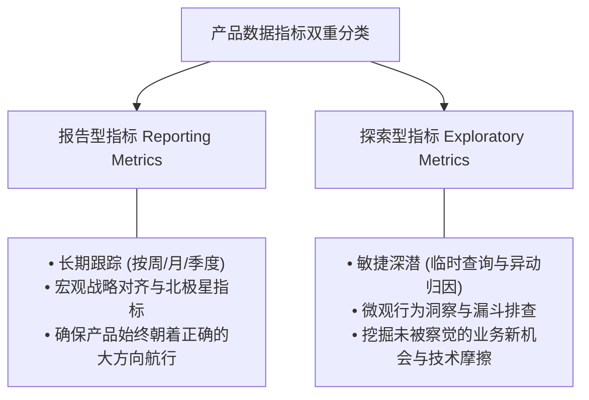
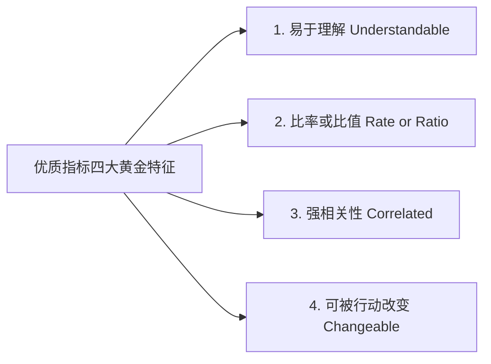
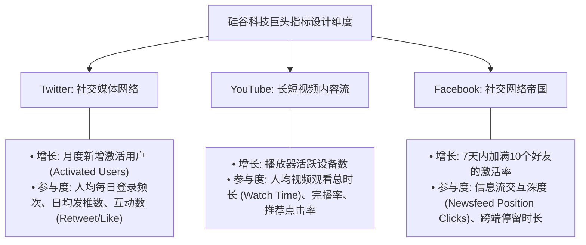

# 第 16 章：核心度量框架与指标体系 —— 无法度量就无法管理

> “如果一个东西无法被度量，它就无法被管理。（What gets measured gets managed.）没有数据的产品经理，只是一艘在狂风暴雨中闭眼航行的巨轮舵手。科学的指标体系不是用来应付汇报的漂亮报表，而是产品演进中最敏感、最诚实的神经末梢。”

---

## 16.1 指标背后的管理哲学：反馈回路理论

管理学宗师彼得·德鲁克（Peter Drucker）曾留下过一句商业名言：**“被度量的事物，才会被有效管理。”**

在现代控制论与软件工程中，这被称为**反馈回路（Feedback Loops）**机制：

### 为什么反馈的“频次”与“精度”至关重要？
以智能运动手环（Fitness Tracker）为例：
- 在没有手环的时代，一个人想要减肥，通常只能在几个月后去医院体检或者站上电子秤。这种**“反馈周期长达数月、缺乏归因细节”**的回路，极易让人半途而废；
- 现代智能手环将反馈回路缩减到了**“秒级”**：只要你跑动两步，屏幕上的心率数值、步数和卡路里消耗立即跳动。这种即时、精确的正向激励，重塑了数亿人的运动习惯。

在产品研发中同理：**团队获取客观数据反馈的频次越高、颗粒度越精准，产品的自我进化能力就越呈指数级飞跃**。

---

## 16.2 指标的双重分类：报告型 vs 探索型

产品经理在日常工作中面对成百上千个数据字段，必须清晰界定两类指标的不同使命：

### 1. 报告型指标（Reporting Metrics）：业务的“仪表盘”
- **特征**：相对固定、长期追踪。通常出现在每周管理层周会大盘或核心 KPI 看板中。
- **典型指标**：月活跃用户数（MAU）、年度经常性收入（ARR）、净推荐值（NPS）、首期付费转化率。
- **使命**：回答*“我们是否正在赢得市场？整体业务是否健康？”*。

### 2. 探索型指标（Exploratory Metrics）：深潜排雷的“显微镜”
- **特征**：平时不一定高高挂在总大盘上，但在排查具体异动或论证新功能时，需要产品经理主动拉取交叉分析。
- **典型指标**：搜索框输入无结果率、从点击‘结账’到弹出收银台的网络耗时 P99、某个二级页面下折叠面板的展开率。
- **使命**：回答*“为什么转化率在上周二突然下跌了 8%？用户到底卡在哪个交互步骤上了？”*。

---

## 16.3 优质指标的四大黄金特征

并不是所有数字都配被称为“指标”。很多团队采集了海量数据，却对业务毫无帮助。一个值得团队为之奋斗的优质指标，必须满足以下四大特征：

1. **易于理解（Understandable）**：
   - 指标必须能用全员听得懂的大白话表述。不需要复杂的统计学公式推导，研发、运营、销售甚至客服，在听到这个指标的瞬间就能明白它的好坏。
2. **必须是比率或比值（Rate or Ratio），而非绝对值**：
   - **绝对数字往往具有欺骗性**：汇报“我们今天有 10,000 人注册”毫无意义，如果背后有 9,900 人在 30 秒内就退出了软件；
   - **比率天然具备比较属性**：使用“次日留存率（45%）”、“完成首单转化率（3.2%）”，无论在公司规模只有 100 人还是 1,000 万人时，都能自适应反映系统的真实健康度。
3. **具备强相关性（Correlated）**：
   - 该指标的上升或下降，必须与最终的商业成功或用户核心满意度紧密绑定。
4. **可被团队行动切实改变（Changeable）**：
   - 如果一个指标是“明天全国会不会下雨”，即使它很重要，团队也无法改变它，这就不是一个合格的产品指标。
   - 优质指标必须满足：**如果产研团队在接下来的两个 Sprint 中重构了流程、消除了 Bug，它的数值就必须产生肉眼可见的正向反馈！**

---

## 16.4 警惕“虚荣指标”（Vanity Metrics）的自欺欺人

在数据分析领域，最大的陷阱莫过于**虚荣指标（Vanity Metrics）**：

> [!CAUTION]
> ### 🚨 虚荣指标的典型面孔
> - **累计注册用户数（Cumulative Users）**：该数字在数学上只增不减。哪怕产品已经彻底死亡、老用户全跑光了，累计注册量依然是一条看似漂亮的上升曲线。
> - **总页面浏览量（Total Page Views / PV）**：用户在系统里迷路、报错频繁、不得不反复刷新页面时，PV 也会暴涨。这不仅不是繁荣，反而是灾难！
> - **应用累计下载量（Total Downloads）**：只代表营销广告花钱买来了安装，完全不能证明用户真正使用过一次。

### 寻找你的“北极星指标”（North Star Metric）
产品经理必须剔除虚荣指标，找到真正驱动组织前进的单一北极星指标：
- **Airbnb 的北极星指标**：不是注册房东数，而是**“预订成功的间夜数（Nights Booked）”**；
- **Slack 的北极星指标**：不是账号注册数，而是**“一个企业团队内部发送消息达到 2,000 条的激活团队数”**；
- **Spotify 的北极星指标**：不是下载量，而是**“用户每周深度聆听音乐的时长（Time Spent Listening）”**。

---

## 16.5 硅谷科技巨头的指标设计实践

不同业务形态的产品，其度量体系的设计存在鲜明的侧重。以下是 Twitter、YouTube、Facebook 等标杆产品的实战指标切片：

### 标杆启示录：Twitter 的“激活用户（Activated User）”法则
Twitter 早期曾面临严重的“只注册不发声”难题。后来数据分析团队发现了一个惊人的相关性：
- 那些仅仅注册账号并浏览几条推文的用户，在一个月内的流失率高达 80%；
- 而**在注册首周内，主动关注（Follow）了至少 30 位感兴趣人物的用户，其次月留存率高达 85% 以上！**
- 从此，Twitter 的增长团队将所有重心从“注册拉新”，全部转向了“**如何在注册引导流程中，以最快速度帮助用户完成这 30 个关注动作**”。这就是指标驱动产品迭代的终极威力。

---

## 16.6 本章自检 Checklist

- [ ] 我们团队当前每周汇报的指标中，是否存在只增不减、自欺欺人的“虚荣指标（Vanity Metrics）”？
- [ ] 针对当前的核心特性，我是否定义出了全员一眼看懂、且由比率构成的核心健康度量？
- [ ] 团队是否清晰地区分了宏观长期跟踪的“报告型指标”与针对问题排雷的“探索型指标”？
- [ ] 我们的核心指标是否具备“可行动性（Changeable）”？如果团队上线了一个优秀改版，该指标能否产生敏锐波动？
- [ ] 我们的业务是否找到了类似于 Twitter“首周关注 30 人”那样的关键激活拐点？
