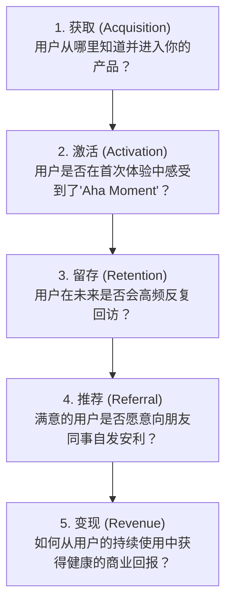
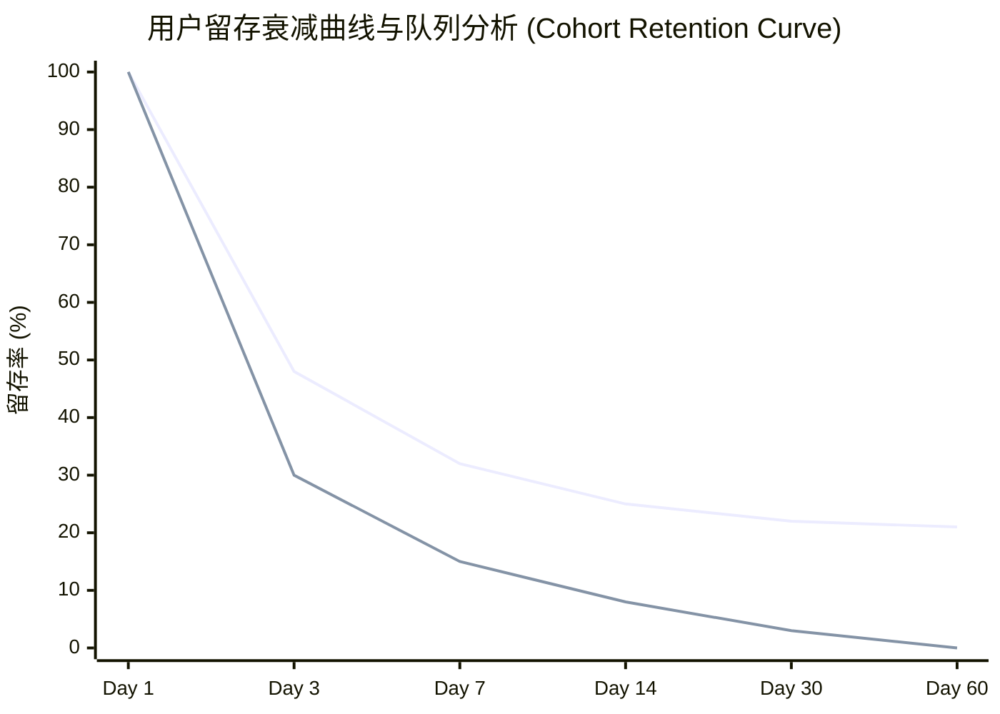
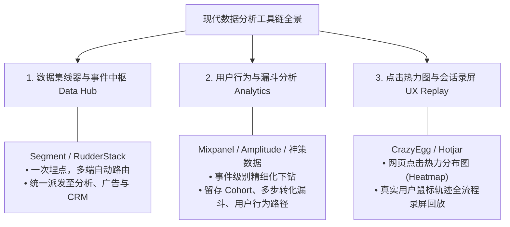

# 第 18 章：AARRR 海盗模型与用户生命周期 —— 激活、留存与单位经济学

> “一个底部漏水的桶，注定装不满水。如果你的产品次日留存只有 10%、次月留存趋近于零，那么花再多广告费买来的‘获取（Acquisition）’，都只是一场昂贵的烟花秀。现代精益增长的真谛，在于先用留存封堵漏洞，再用健康的单位经济学放量规模。”

---

## 18.1 AARRR 海盗漏斗全景：从流量到商业变现

由硅谷知名投资人戴夫·麦克卢尔（Dave McClure）提出的 **AARRR 模型**（因首字母发音类似海盗标志性的吼声“Ahoy/Arrgh”而被称为海盗模型），是贯穿用户全生命周期最经典的漏斗框架：



---

## 18.2 关键断层辨析：安装用户（Installed）vs 激活用户（Activated）

很多初级产品经理和市场部门最常犯的错误，就是将“下载安装了软件”等同于“获得了一个用户”。**这两者之间存在天堑般的本质差异**：

```mermaid
graph LR
    Install["单纯安装用户 (Installed)<br/>• 用户下载了 App 或打开了网页<br/>• 尚未体验到任何核心业务价值<br/>• 3天内流失率通常高达 80%~90%"]
    -->|经历 Aha Moment / 完成首个核心动作|
    Active["真正激活用户 (Activated)<br/>• 跨越了认知摩擦门槛<br/>• 亲身体验到了核心解决痛点的爽点<br/>• 长期留存率提升 3~5 倍以上"]
```

### 什么是“Aha Moment”（惊喜时刻）？
Aha Moment 是指用户在产品交互中，**第一次真正领略到产品核心价值、内心发出‘哇，这东西真好用！’的那一瞬间**。

产品经理的全部增长设计，必须围绕“以最短的时间、最少的点击阻碍，将用户推向 Aha Moment”展开：

| 产品 | 虚假表面动作 | 真正的 Aha Moment（关键激活行为） |
| :--- | :--- | :--- |
| **Facebook** | 注册账号、上传头像 | **在注册前 10 天内成功添加满 7 个真实好友** |
| **Dropbox** | 下载客户端安装包 | **在同步文件夹中存入第一个文件，并在另一台设备上秒级看到** |
| **Slack** | 团队创建账号 | **企业内部团队在一个工作群里累计发送达到 2,000 条消息** |
| **Twitter** | 注册用户名 | **在 3 天内关注了至少 30 个感兴趣的垂直行业博主** |

---

## 18.3 留存（Retention）：增长的基石与队列分析

如果说激活是点燃火种，那么留存就是让火焰持续燃烧的木柴。**留存是所有产品指标中最重要的地基。没有留存，一切增长都是虚妄！**



- **绿色曲线（健康有粘性的产品）**：经历初期的自然脱落后，在 Day 14 ~ Day 30 逐渐**“拉平走平”（Flatten the Curve）**。平稳收敛的基底意味着产品具备了真实忠诚的基本盘！
- **红色曲线（漏水的烂桶）**：留存曲线持续下滑直至触底贴近坐标轴。这种产品哪怕买来 100 万下载，三个月后依然会沦为鬼城。

### 留存用户的两类画像：持续留存 vs 唤醒复活
1. **持续留存用户（Retained Users）**：
   - 每周、每月保持稳定周期的自然回访用户。核心策略是持续提供高价值内容与稳定服务，不打扰即是最好的维护。
2. **唤醒复活用户（Resurrected Users）**：
   - 曾经沉寂了数周甚至数月，但在收到特定场景化通知（如“你的好友刚刚赞了你的作品”、“企业账号新增了年度报税特权”）后，重新打开并回到系统中的老用户。
   - 复活用户的再激活成本，往往远低于重新获取一个全新陌生用户的成本。

---

## 18.4 变现与单位经济学（Unit Economics）：LTV 与 CAC 的生死线

产品最终必须走向健康的商业盈利。产品经理必须精通**单位经济学（Unit Economics）**的核心算盘：

```mermaid
flowchart LR
    CAC["单个获客成本 (CAC)<br/>Customer Acquisition Cost<br/>(总市场销售费用 / 获取新客数)"]
    <-->|黄金对比比例|
    LTV["单个用户生命周期总价值 (LTV)<br/>Customer Lifetime Value<br/>(单客在全生命周期贡献的净毛利总和)"]
```

### LTV / CAC 黄金比例法则

$$\text{健康度指标} = \frac{\text{LTV（单客生命周期价值）}}{\text{CAC（单客获客成本）}}$$

业界公认的投资与运营评判基准如下：

| 比例区间 | 商业健康状态诊断 | 产品与市场策略 |
| :---: | :--- | :--- |
| **$\text{LTV} / \text{CAC} < 1$** | **处于自杀性失血状态**。<br>每多卖出一单，企业就多亏损一笔钱。 | **立即踩死营销刹车！** 严禁盲目放量，必须回过头重构产品体验与定价模型。 |
| **$\text{LTV} / \text{CAC} \approx 1 \sim 2$** | **勉强糊口，极其脆弱**。<br>毛利刚刚打平成本，一旦扣除公司人力研发与行政开销，整体依然亏损。 | 提高转化效率，优化流失率，尝试上调价格或提高客单价。 |
| **$\text{LTV} / \text{CAC} \ge 3$** | **🏆 黄金健康标准！**<br>每投入 1 块钱营销成本，能稳健回收 3 块钱以上的商业回报。 | **全面踩下油门！** 调集一切资本与资源放量获客，快速抢占赛道垄断份额。 |
| **$\text{LTV} / \text{CAC} > 5$** | **虽然赚钱，但过于保守**。<br>可能意味着市场投放过于保守，没有充分利用资本杠杆，容易被激进的追随对手反超。 | 适当放宽获客渠道筛选标准，加大品牌与市场曝光力度。 |

---

## 18.5 现代产品数据分析工具链生态

构建一套实时、可下钻的数据大盘，需要组合搭配现代化的数据分析基础设施：



- **Segment（数据路由集线器）**：
  工程师只需在前端代码埋入一套标准的 `analytics.track('Completed Purchase')` 事件，Segment 会自动将这笔数据清洗并并行分发给 Mixpanel（供 PM 做漏斗分析）、Google Ads（供市场做转化归因）和 Salesforce（供销售更新客户线索）。
- **Mixpanel / 神策数据（深入事件漏斗）**：
  摒弃死板的页面浏览（PV），完全基于“用户属性（User Properties）”与“事件行为（Event Tracking）”构建任意维度的动态漏斗。

---

## 18.6 本章自检 Checklist

- [ ] 针对当前产品的注册流，我们是否准确定义出了能够让用户瞬间体验到爽点的“Aha Moment”？
- [ ] 我们的留存曲线在 30 天之后是持续走向死亡零点，还是逐渐走平形成健康的留存基底？
- [ ] 团队是否清晰地算清了单客获客成本（CAC）与生命周期总价值（LTV）？我们的 $\text{LTV} / \text{CAC}$ 是否健康地大于 3？
- [ ] 我们是否为沉睡的流失用户设计了基于场景与价值诱因的“复活机制（Resurrection）”？
- [ ] 团队的数据埋点系统，是杂乱无章的散装代码，还是通过标准事件字典（Event Dictionary）规范化管理？
