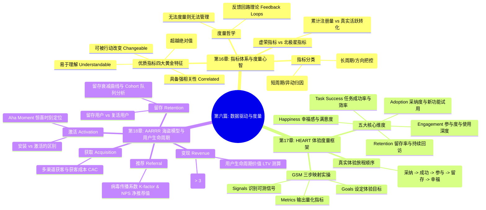

# 第六篇：数据驱动与产品度量篇 —— 用客观指标度量成功

> “如果一个东西无法被度量，它就无法被管理。（What gets measured gets managed.）没有数据的产品决策，充其量只是个人的主观偏见。产品经理的终极使命，不是用直觉说服别人，而是让客观的数据大盘成为业务演进的指南针。”

---

## 篇章导读

很多新手产品经理常陷入两种极端的数据误区：
- **数据虚无主义**：只凭“拍脑袋”和“艺术家的直觉”做产品，觉得数据是冷冰冰的教条，阻碍了创新；
- **虚荣指标狂热**：每天盯着累计注册用户数、总下载量等“虚荣指标（Vanity Metrics）”自欺欺人，却对断崖式下跌的真实次日留存、空空如也的活跃度视而不见。

数据指标是产品的神经末梢。正如彼得·德鲁克所言，科学的反馈回路（Feedback Loops）决定了团队管理与迭代的效率。

本篇将带领大家建立严密的数据度量心智：
- 从**报告型指标**与**探索型指标**的辨析，到优质指标的四大黄金特征（易理解、比率化、强相关、可改变）；
- 深度拆解 Google 经典的 **HEART 用户体验度量框架**，厘清真实用户旅程的 **A.T.E.R.H.** 演进规律，并实操“目标-信号-指标（Goals-Signals-Metrics）”工作流；
- 全景拆解 **AARRR 海盗漏斗模型**，彻底穿透“激活（Activation）”与“单纯安装”的本质代差、“留存用户（Retained）”与“复活用户（Resurrected）”的运营策略，以及 **LTV / CAC 单位经济学**的生死法则。

---

## 本篇知识图谱

---

## 章节导航

- **[第 16 章：核心度量框架与指标体系 —— 无法度量就无法管理](./16-metrics-mindset-and-frameworks.md)**
  - 阐述指标反馈回路哲学、报告型与探索型指标分类、优质指标四大黄金特征，以及硅谷科技巨头（Twitter、YouTube、Facebook）的指标实践。
- **[第 17 章：HEART 框架落地实践 —— 从用户旅程到指标映射](./17-heart-framework-in-action.md)**
  - 详述 Google HEART 五大维度、A.T.E.R.H. 用户真实旅程流向，以及“目标-信号-指标（GSM）”在实际项目中的落地映射表。
- **[第 18 章：AARRR 海盗模型与用户生命周期 —— 激活、留存与单位经济学](./18-aarrr-pirate-funnel-and-lifecycle.md)**
  - 剖析 AARRR 五阶段全漏斗闭环、安装与激活的代差、留存与复活用户分类策略，以及 LTV / CAC 单位经济学健康度公式。
