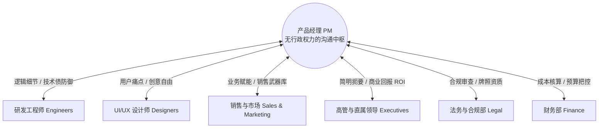
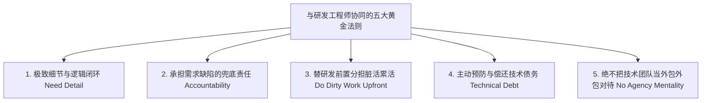
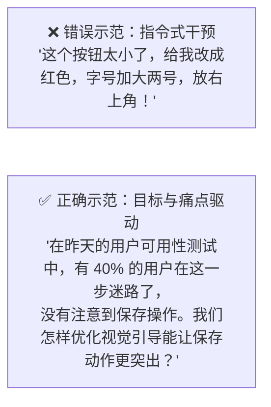
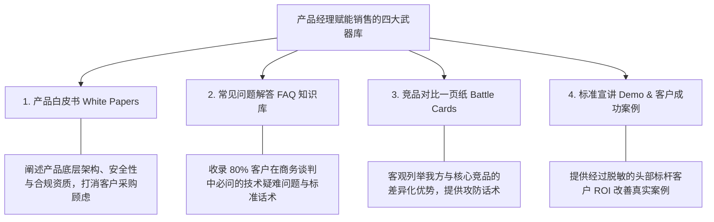
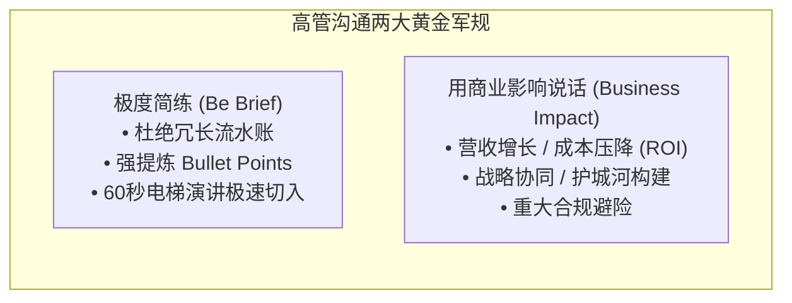

# 第 19 章：跨部门 Stakeholder 协同沟通指南 —— 沟通中枢的影响力法则

> “平庸的产品经理在各个部门之间来回传话，沦为被动受气的‘二道贩子’；优秀的产品经理则是组织中的‘同声传译器’与‘价值粘合剂’。当你学会用工程师的逻辑思考、用设计师的眼光观察、用销售的敏锐切入、用高管的商业视角算账时，你才能真正实现‘无权之治（Leading without Authority）’。”

---

## 19.1 沟通中枢的本质：无行政权力的影响力

在现代矩阵式企业架构中，产品经理（PM）几乎永远处于一种看似矛盾的尴尬境地：
- **职责无限大**：产品的用户增长、业务营收、上线延期、系统线上事故，全由 PM 负最终责任；
- **权力等于零**：你不能决定工程师的绩效打分，不能命令设计师使用何种配色，更不能开除任何一个合作方。

> [!NOTE]
> ### 💡 跨职能冲突的根源：语境鸿沟
> 各个职能部门并没有恶意，冲突的根源在于**大家的绩效衡量与认知语境完全不同**：
> - 工程师关心的是：*“逻辑是否严密？会不会引发线上故障？架构是否优雅？”*
> - 销售关心的是：*“下周能不能上线？没有这个功能我这笔 50 万的单子就飞了！”*
> - 高管关心的是：*“对本季度的 ARR 贡献是多少？有没有合规风险？”*  
> 产品经理的核心功底，就是**把同一个业务目标，精准翻译成各方听得懂、愿意听的语言！**

---

## 19.2 与研发工程师（Engineers）的高效协同法则

工程师是把产品构想变为现实的核心伙伴。产品经理必须赢得研发团队发自内心的专业尊重：

1. **逻辑自洽，细节制胜（Need Detail）**：
   - 程序员的思维模型是严密的布尔逻辑（True/False）。模糊的词汇（如“看着办”、“要流畅”）是对研发最大的侮辱。
   - 需求文档必须明确覆盖所有**边界条件（Edge Cases）**：网络中断怎么办？并发点击怎么防重？空数据怎么渲染？超长字符怎么截断？
2. **勇于兜底：做错了是 PM 的错，不是研发的错（"That is your fault, not theirs"）**：
   - 如果上线后发现功能实现完全跑偏，或者遗漏了核心业务规则，**根源一定是产品经理在前期没有梳理清楚上下文与验收准则**。
   - 永远不要在复盘会上当众甩锅：“是技术开发理解错了我的意思”。主动站出来承担需求定义的失误，才能赢得技术骨干的生死信赖。
3. **替技术前置分担脏活累活（Do the Dirty Work Upfront）**：
   - 在向工程师提交 Bug 或提出优化诉求之前，**PM 应当自己先做足前置排查**：亲自抓包核对 HTTP 状态码、翻看数据埋点日志、录制可 100% 复现的视频、提供具体的问题用户 ID。不要一遇到问题就扔给研发一句“系统崩了你快看下”。
4. **技术债务（Technical Debt）的主动防御与治理**：
   - **什么是技术债？** 为了赶工走捷径（Quick and Dirty）而写下的不规范代码，后期必须花费成倍的代价重构偿还。
   - **高阶 PM 的良心**：在每个 Sprint 中，**主动为技术团队预留 15%~20% 的工时点数，专门用于清偿技术债与底层重构**。不要逼迫研发一直“带伤狂奔”，否则系统迟早会以大规模线上宕机的方式报复业务！
5. **绝不把研发当成外包执行团队（Do Not Treat Engineers like an Agency）**：
   - 严禁自己闭门把每一个技术实现细节写死，然后像扔工单一样砸给工程师。
   - 正确姿势：带着**业务问题和用户痛点**找技术架构师商讨：*“我们接下来要支撑 10 万人并发在线抽奖，这是我们的业务规则，在架构上你们觉得怎样设计性能最好？”* 工程师不仅懂代码，往往还能提出极具创造性的技术创新方案！

---

## 19.3 与 UI/UX 设计师的协同艺术：以目标驱动创意

设计师是用户体验的灵魂守护者。与设计师沟通，切记尊重专业边界：

> [!CAUTION]
> ### 🛑 与设计师协同的三大天条
> 1. **永远先讲用户痛点，把解决方案留给设计师（Always talk about user problems first, solutions second）**：  
>    你的职责是定义“问题（What & Why）”，设计师的专业是提供“体验方案（How）”。
> 2. **给予充分的设计与创意自由（Give designers their creative freedom）**：  
>    不要把设计师当成在 Figma 里替你画图的“鼠标操作员”。给他们留出探索情感化交互和动效的空间。
> 3. **全量数据与用户原声透明共享**：  
>    把客研访谈录音、热力图数据、可用性测试录屏第一时间同步给设计师，让他们与你处于同一认知同温层。

---

## 19.4 与销售和市场团队协同：构筑“可杠杆化武器库”

销售和市场是产品与外部真实商业世界连接的前沿阵地。

### 销售团队的心理与痛点
- 销售人员的生存命脉是**“签单业绩与佣金”**。他们最恐惧的是客户提出一个功能诉求时，自己答不上来或者产品不支持，导致即将到手的订单泡汤。
- 销售往往会把偶发客户的个性化请求放大为“全宇宙最紧急的生死需求”。

### 产品经理的破局抓手：提供可杠杆化武器库（Collateral）
产品经理不可能每天陪着销售去见客户。你必须制造出**可被销售团队反复调用的“杠杆化武器（Collateral）”**：

- **市场团队发布对齐（Launch Readiness Checklist）**：
  新版本上线前 3~4 周，提前与市场 PR、活动运营团队锁定发布计划，提供特性亮点、截屏素材与核心文案，确保产品发布的那一天，市场宣传能形成合力打透用户心智。

---

## 19.5 与高管及直属领导的沟通：简明扼要，直击商业影响

向公司高管（CEO、CFO、VP）或直属领导汇报，是决定资源倾斜与个人职业发展的关键时刻。

### 高管汇报实战对照示范

- ❌ **平庸冗长的汇报**：
  > *“领导，我们过去两周把支付模块的接口从 V1 升级到了 V2，改写了底层 12 个字段，重构了数据库索引，并且把前端的输入框边框做了高斯模糊效果，另外还修复了 15 个 Bug，大家通宵了三次……”*  
  > *(高管内心：所以呢？这跟我关心的业务增长有什么关系？)*

- ✅ **卓越高效的高管汇报**：
  > *“领导，向您简报支付改版的最新成效：  
  > 1. **营收拉动**：本期成功上线多币种结算中台，欧洲区新客成单周期从 5 天压缩至 10 分钟，首周拉动订单转化率提升 32%；  
  > 2. **降本成效**：全自动化对账替代了人工操作，预计每月为财务部门节省 80 小时核算工时；  
  > 3. **下一步风险预警**：目前日元结算链路受限于上游银行网关维护，我们已启动备用通道，预计下周一全面跑通，整体进度受控。”*

---

## 19.6 本章自检 Checklist

- [ ] 面对技术团队，我的需求文档是否做到了逻辑严密自洽，并在出现理解偏差时勇于主动承担责任？
- [ ] 我是否定期在 Sprint 中为工程团队主动预留了 15%~20% 的工时，用于重构和偿还“技术债务”？
- [ ] 面对设计师，我是指手画脚命令其修改字号颜色，还是把全部数据和用户痛点托盘托出，由设计师主导解决方案？
- [ ] 针对前线销售团队，我是否为他们武装了健全的武器库（FAQ、白皮书、竞品对比一页纸），而不是每天疲于当传声筒？
- [ ] 在向高管汇报时，我是否做到了用简洁的 Bullet Points 阐述问题，并通篇围绕“商业回报与风险把控”说话？
