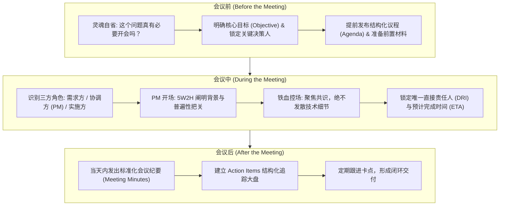
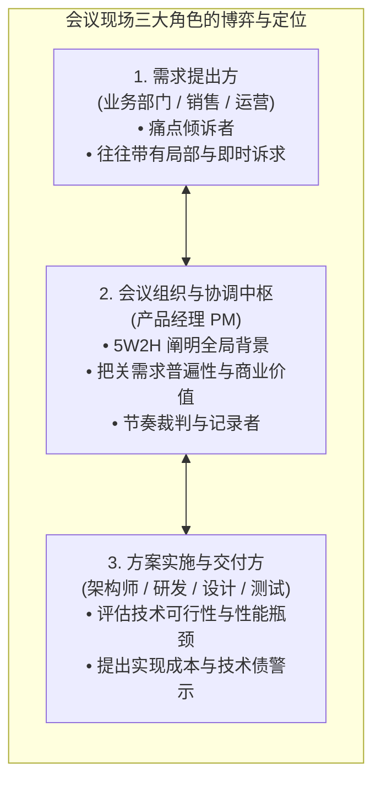

# 第 20 章：高价值会议管理与沉淀机制 —— 会议前中后闭环与 Meeting Minutes

> “在现代企业中，最昂贵、也最容易被浪费的资产就是员工的时间。一场 8 个人的 1 小时会议，直接消耗的是整整 1 个高级工程师的人天成本。产品经理作为大量会议的发起者与召集人，如果不能做到‘前有严谨议程、中有铁血控场、后有结构化闭环’，你就是在谋杀团队的生产力。”

---

## 20.1 会议管理总纲：前、中、后的闭环生命线

一场高价值的专业会议，必须严格遵循前、中、后三个阶段的标准化推进链条：



---

## 20.2 会议前（Before）：杜绝无准备之会

很多低效会议在召开之前就已经注定了失败。产品经理在发出任何会议邀约前，必须完成三项前置动作：

1. **第一灵魂拷问：真的需要开会吗？**
   - 规则：**纯单向的信息同步（如‘新版本上线通知’），用邮件或文档@相关人即可，严禁开会！**
   - 只有当存在**多方利益冲突、需求方案歧义、复杂技术权衡需要多工种碰撞出共识**时，才启动会议。
2. **确认关键决策人（Key Stakeholders）必须出席**：
   - 明确这次会议的核心目标（Objective）：我们要通过这 45 分钟达成什么具体决断？
   - 核查最终拍板人（如技术负责人、业务总监）是否在场。**如果核心决策人因冲突无法参会，会议必须立即取消或延期！坚决不开“讨论了一小时却无法下结论的空转会议”！**
3. **专业邀约规范：提供双选项与清晰议程（Agenda）**：
   - 邀约邮件通常提供两个可选时间段供核心方协调；
   - 邮件正文中必须用 3~5 行明确列出：**会议背景、要讨论的 2~3 个具体议题，以及会前需通读的 PRD 或原型链接**。绝不接受毫无描述的“空白日历占位”。

---

## 20.3 会议中（During）：角色定位与 5W2H 铁血控场

在典型的产研跨部门会议中，产品经理必须敏锐识别现场的三种核心角色：



### 1. PM 的 5W2H 开场艺术
会议开始的第一分钟，产品经理必须快速掌握麦克风，用 **5W2H 法** 将所有人拉回同一上下文：
- **Why**：为什么今天会有这个需求？（例如：“收到海外销售团队的集中反馈，如果不解决欧元即时结算，三季度 40% 的欧洲潜在客户无法签约”）；
- **What**：今天具体讨论的核心范围是什么；
- **Universal Value（普遍性把关）**：该需求是仅服务于某一个客户的奇葩诉求，还是在行业内具备普遍性？如果满足了，能否复制赋能给更多客户？

### 2. 铁血控场与争吵制止
- 当技术人员和前端业务开始就“这个接口应该叫 `user_id` 还是 `uid`”这类底层细节发生激烈争吵时，PM 必须在 60 秒内果断打断：  
  > *“各位，我们今天的目标是确认跨国清算业务流是否可行。具体的字段命名与数据库表设计属于技术内部细节，我们记为一个待办项，请技术团队在会后线下技术评审会敲定，我们现在回到第二个议题！”*
- **锁定唯一直接负责人（DRI - Directly Responsible Individual）**：
  每一个结论必须明确到具体的“某一个人”头上，绝不允许写“由技术部负责”这种模糊集体责任！

---

## 20.4 会议后（After）：工业级会议纪要（Meeting Minutes）模板

会议结束并不代表工作完成。**会议纪要（Meeting Minutes）是锁死各方共识、防止事后扯皮抵赖的法律契约！**

### 黄金 24 小时法则
会议结束后，产品经理必须在**当天工作结束前（最迟不超过次日上午 10:00）**，整理输出结构化的会议纪要，并正式抄送所有参会人及相关业务主管。

```markdown
# [Meeting Minutes] 跨境多币种即时结算中台方案对齐会

- **会议日期**: 2026-10-14 14:00 - 15:00
- **会议地点**: 腾讯会议 882-910-234 / 4号会议室
- **主持人 / 纪要整理**: @Terry (PM)
- **参会人员**: @LeadEngineer, @SalesHead, @FinanceLead, @Designer, @LegalCounsel
- **核心会议目标**: 敲定多币种实时汇率锁定的业务流、合规风控边界与研发排期。

---

## 一、 会议核心共识与决策事项 (Decisions Made)
1. **结算模式敲定**: 全员一致同意采用“15分钟汇率锁定 + 彭博实时牌价兜底”方案，废弃原有的次日集中人工结算模式；
2. **风控额度界限**: 单笔交易超过等值 50,000 美元时，强制要求企业财务总监二级审批并校验双因素短信 OTP，该规则由法务与财务部门共同签字确认；
3. **交付排期锁定**: 技术团队承诺在 Sprint 19 完成联调并部署至灰度环境，预定在 11 月 15 日正式向欧洲区大客户开放试运行。

---

## 二、 关键讨论与待跟进分歧点 (Key Discussion & Open Questions)
- **分歧点**: 销售端希望针对 VIP 战略客户免除汇率失效限制。
- **结论**: 财务部门明确指出该动作会导致企业单边承担外汇波动敞口风险，予以驳回；但同意对年交易额超 500 万美元的 KA 客户延长锁定窗口至 30 分钟。

---

## 三、 行动项追踪大盘 (Action Items Tracker)

| 序号 | 具体行动事项 (Action Item) | 唯一负责人 (DRI) | 交付截止时间 (ETA) | 交付验收标准 (Deliverable) |
| :---: | :--- | :---: | :---: | :--- |
| **01** | 输出多币种结算完整高保真原型交互稿 | @Designer | 10-16 18:00 | Figma 原型完成所有边界状态覆盖并@研发验收 |
| **02** | 调研第三方外汇清算网关的 SLA 与备用线路 | @LeadEngineer | 10-18 12:00 | 在 Confluence 输出双通道容灾架构评估方案 |
| **03** | 起草面向欧洲客户的跨境资金出海合规声明 | @LegalCounsel | 10-19 18:00 | 法务正式批复中英文双语用户协议免责条款 |
| **04** | 更新产品 PRD 并正式向产研团队发出版审通知 | @Terry (PM) | 10-20 10:00 | JIRA 关联对应 Epic 并完成全部 User Story 拆解 |
```

---

## 20.5 本章自检 Checklist

- [ ] 在发起下一次会议前，我是否做到了三思：这个问题能否通过两行文字或单点沟通解决，是否真正必须开会？
- [ ] 我的会议邀约中，是否包含了明确的会议核心目标（Objective）、清晰的议程，以及可提前阅读的材料链接？
- [ ] 会议过程中，我是否运用 5W2H 帮大家快速校准了上下文，并果断打断了陷入无休止技术争吵的边缘细节？
- [ ] 会议形成的每一个决策，是否都落实到了唯一的具体责任人（DRI）和明确的交付时间（ETA）？
- [ ] 散会后，我是否严格遵守了“当天闭环输出会议纪要”的黄金法则，将行动项（Action Items）同步给了全部利益相关者？
