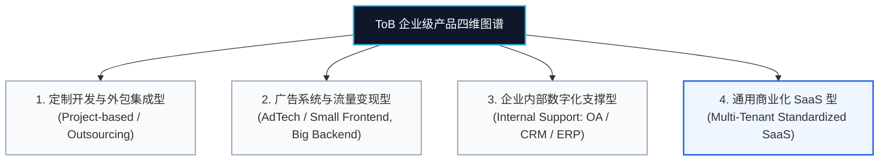
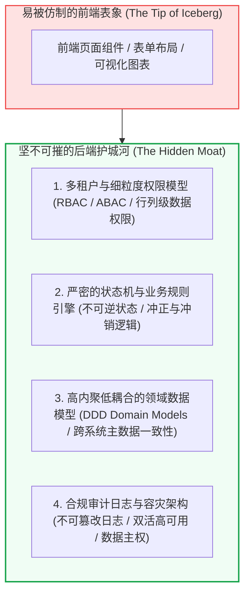
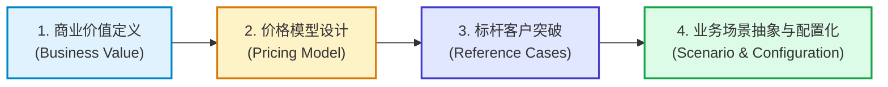

# 第22章：ToB 与 SaaS 企业服务方法论 (ToB & SaaS Product Methodology)

在互联网消费红利逐渐见顶的今天，企业级市场（ToB、SaaS、产业互联网）成为了数字化转型的核心主战场。然而，大量习惯了 ToC 快速迭代、感性体验和单点功能突破的产品经理在转战 ToB 领域后，遭遇了前所未有的挫败：产品界面做得极度精致却无人买单、频繁被客户的定制化需求牵着鼻子走沦为“外包小工”、上线后基层员工拼命抵触、甚至导致项目因无法通过财务审计与安全评审而夭折。

本章将基于真实的产业实践与企业级产品方法论，深度解剖 ToB 产品的底层逻辑、产品形态、后端壁垒与规模化产品化之道。

---

## 1. ToB 产品的四大典型形态

企业级产品绝非铁板一块，依据其商业目标、技术架构与业务支撑维度的不同，业界通常将 ToB 划分为以下四大典型形态：

### 1.1 定制开发与外包集成型 (Project-based Customization)
- **业务本质**：以满足特定企业（通常为大型国央企、金融机构或政府单位）的招投标文件和专项定制诉求为目的。
- **商业模式**：按人天（Man-Days）或项目总包合同计费。验收交付即结算，维保期收取 10%~15% 的年度服务费。
- **致命痛点**：缺乏边际收益递增效应。团队规模随着营收线性增长，代码碎片化严重，每次交付都是一次重新造轮子。

### 1.2 广告系统与商业变现型 (AdTech: Small Frontend, Big Backend)
- **业务本质**：连接流量供给方（媒体/App）与广告采购方（广告主/代理商）。典型的“小前端、大后端”。
- **系统核心**：
  - 前端：直观简单的投放配置台（计划创建、定向人群包、出价策略、素材上传）。
  - 后端：复杂的实时竞价（RTB）引擎、CTR/CVR 预估机器学习模型、毫秒级防刷反作弊、多维度数据归因与财务账单结算系统。
- **壁垒所在**：后端算力吞吐性能、高并发撮合机制与算法精准度构筑了极深的业务护城河。

### 1.3 企业内部数字化支撑系统 (Internal Support Systems: OA / CRM / ERP / BSS)
- **业务本质**：为公司内部各职能部门（销售、供应链、财务、人力、运营、运维）服务的生产运营系统。
- **产品目标**：保障业务合规运转、打破部门数据孤岛、阻断内部腐败与舞弊、实现端到端跨部门流程协同。
- **核心特征**：重权限、重日志、重审计。产品经理必须兼备极强的业务组织理解力与流程梳理功底。

### 1.4 通用商业化 SaaS 型 (Standardized Multi-Tenant SaaS)
- **业务本质**：将某个行业领域（如电销 CRM、协同办公、人事薪酬、电子签名、客服工单）的业务逻辑抽象为标准产品，部署在云端供成千上万家企业租用。
- **商业模式**：订阅制（Subscription），按年付费（ARR/MRR），追求高净金额留存率（NRR > 110%）。
- **技术基础**：多租户隔离架构、高可配置化字段与低代码审批流引擎。

---

## 2. ToB 与 ToC 的根本分野

ToB 产品与 ToC 产品的差异，绝不是“界面丑一点还是美一点”的区别，而是底层逻辑的系统性颠覆：

| 比较维度 | ToC 消费级产品 | ToB 企业级产品 |
| :--- | :--- | :--- |
| **用户角色关系** | **使用权与买单权高度合一**（用户自己用，自己掏腰包） | **使用者与决策者/买单者彻底分离**（基层用，中层管，高层买） |
| **决策链条与周期** | 个人冲动决策，链路极短（几秒至几分钟） | 组织群体决策，链条漫长（立项、技术评审、采购招标、财务审批，3-12个月） |
| **核心诉求与动机** | 娱乐、情感认同、社交连接、即时满足、审美愉悦 | **开源（提升收入）、节流（降低成本）、提效（缩短周期）、避险（合规安全）** |
| **功能容忍度** | 稍有卡顿或操作繁琐直接卸载流失 | 愿意为核心业务价值忍受繁琐步骤；但对**系统稳定性、数据零丢失、业务零停摆**要求极其苛刻 |
| **系统核心与壁垒** | 前端交互、用户增长飞轮、内容生态、视觉设计 | **后端业务规则、底层数据模型、复杂状态机、权限审计与行业深水 Know-How** |
| **生命周期与替换成本** | 转换成本极低（随时换用竞争对手 App） | **转换成本极高**（牵扯历史数据迁移、全员操作重训、旧系统集成解耦） |

> [!IMPORTANT]
> **采购决策链铁三角分析**：
> 1. **经济买家（Economic Buyer - CEO/CFO/业务副总裁）**：只关心投资回报率（ROI）、年度预算与合规避险。“买了它能帮我省几个人？能多带来多少销售业绩？”
> 2. **管理把关人（Technical/Gatekeeper - IT主管/信息安全官）**：关心系统集成、OpenAPI、单点登录（SSO）、数据隔离、等保三级与售后 SLA。
> 3. **实际使用者（End User - 基层员工/业务执行者）**：关心日常操作是否便捷、数据录入是否繁重、会不会让自己“背锅”或被变相监控。
> 
> **ToB 产品经理的胜负手**：必须在产品设计中同时满足三方利益——给买单人出具可量化的收益大盘与驾驶舱报表，给技术人提供严谨的配置与安全集成能力，给基层使用者提供批量导入与智能降负工具。

---

## 3. 后端构筑壁垒：为什么 ToB 前端可以抄，后端抄不走？

许多初级团队常犯的错误，是把竞品 SaaS 的前台界面截屏下来，组织前端工程师一比一像素级复刻，以为就能做出同等产品。结果一上线，遇到跨部门流程流转、退款冲正、多组织权限继承、数据审计时全线崩溃。

1. **细粒度多维权限控制（RBAC / ABAC）**：
   - 不仅是简单的“角色对应菜单”，而是包含**功能权限**（能否看到某个按钮）、**数据范围权限**（只能看自己/本部/跨分支机构数据）、以及**行列级脱敏**（手机号脱敏、薪资列仅 HRD 可见）。
2. **严密的状态机与回滚补偿机制**：
   - 订单从“草稿 $\to$ 待审批 $\to$ 已生效 $\to$ 履约中 $\to$ 已报竣 $\to$ 计费中 $\to$ 欠费停机 $\to$ 销户退款”，中间每一步都牵涉资金流与资源状态流转。严禁出现“薛定谔的中间态”，必须具备高可靠的冲正与逆向事务处理能力。
3. **领域驱动模型（DDD）与主数据管理（MDM）**：
   - 统一抽象客户（Account）、组织架构（Org）、合同（Contract）、计费项（Billing Item）与资产生命周期。无论前端界面如何根据用户诉求改动，底层领域实体稳如磐石。

---

## 4. ToB 产品化的四大核心支柱 (The 4 Pillars of Productization)

如何避免陷入“客户要什么我们就写什么代码”的定制化泥潭？核心在于推行**“产品化”（Productization）**。产品化是指将特定客户的离散需求，转化为可复制、可配置、具备通用商业价值的标准产品能力。

### 支柱一：商业价值清晰可量化 (Business Value Definition)
- 任何 ToB 功能立项，必须给出量化的价值方程式：
  $$\text{净收益 (Net ROI)} = \frac{\Delta \text{增收额} + \Delta \text{降本额} - \text{系统采购与实施成本}}{\text{系统采购与实施成本}} \times 100\%$$
- 案例：某自动化报账工具不仅宣传“界面美观”，而是宣称：“将企业员工月度贴发票报销时间从 3 小时缩短至 15 分钟，财务初审人工成本减少 60%，杜绝重复报销虚假发票隐患 100%”。

### 支柱二：科学的价格模型设计 (Pricing Model Design)
ToB 产品的定价是产品战略的核心组成部分，常见的定价维度包括：
1. **按坐席/用户数收费（Per-Seat Pricing）**：如 Slack、Salesforce。适合全员使用型协同办公软件。
2. **按使用量/资源阶梯计费（Usage-based Pricing）**：如 AWS、云短信服务、API 调用次数。客户门槛低，伴随客户业务成长而扩展。
3. **功能分级版本（Tiered Feature Packages）**：基础版（满足小微企业核心诉求）、专业版（支持高级自动化与审批流）、企业旗舰版（提供私有化部署、专属客户成功经理 CSM、SLA 保证、自定义审计日志）。
4. **实施与专业服务费（Professional Services / Implementation Fee）**：覆盖大客户现场培训、历史数据洗库与定制接口打通的刚性成本。

### 支柱三：标杆客户与灯塔案例打法 (Reference Cases & Lighthouse Strategy)
- 在开拓一个新细分行业时，寻找一家头部标杆企业（Lighthouse Customer），哪怕牺牲一定毛利，与对方深度共创业务场景。
- **20/80 萃取法**：在满足标杆客户深度定制的过程中，产品经理必须保持高度克制与抽象能力，甄别出哪些是该客户独有的“奇葩流程”，哪些是整个行业的“共性痛点”。将 80% 的行业共性沉淀为标准产品模块，剩下的 20% 特性通过开放平台或定制插件解决。
- 拿下一家行业 Top 3 客户并产出案例报告后，同行业的腰部企业往往会因为从众心理与行业标杆效应而迅速跟进采购。

### 支柱四：业务场景抽象与高度可配置化 (Scenario Abstraction & Configurable Architecture)
优秀的 ToB 产品经理永远不把业务规则“硬编码”（Hard-Code）在代码里：
- **自定义字段（Custom Fields）**：允许租户在标准客户详情页中动态新增如“保税区海关编号”等行业特有字段。
- **自定义审批流与工作流引擎（Workflow Engine）**：通过拖拉拽节点，支持多级串行、并行会签、按金额条件分支流转。
- **开放 API 与 Webhook 机制**：让客户的自建系统、旧版 ERP 或第三方系统能够轻松实现数据推送与双向同步。

---

## 5. 本章实战自测清单 (Checklist)

在设计或评审你的 ToB 产品方案时，请逐一核对以下问题：

- [ ] 你是否理清了该系统的“使用者”与“决策买单者”分别是谁？他们的核心利益诉求是否均在产品中得到了正面回应？
- [ ] 你的系统是否能出具对企业高管极具说服力的量化 ROI 数据报告或驾驶舱？
- [ ] 底层权限模型是否支持细粒度的组织层级划分、功能权限与行列级数据范围隔离？
- [ ] 复杂业务链路（如订单、审批、报竣）的状态机是否完备？是否存在无法冲正、无法逆向回滚的死循环或逻辑断点？
- [ ] 面对大客户的定制化需求，你是否通过“提炼共性抽象配置”进行化解，而非直接在核心主干分支上随意硬编码？
- [ ] 产品的价格模型与收费维度是否清晰，是否为未来的增购、升配与生态扩展预留了机制空间？
