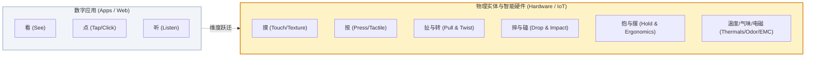
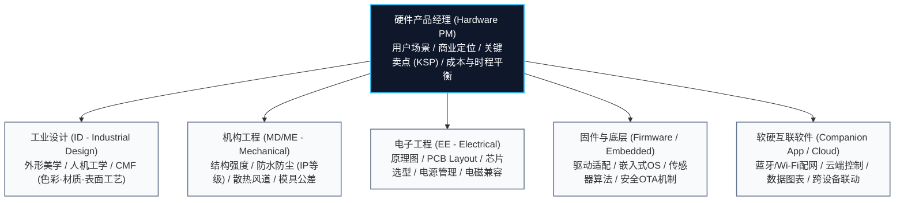
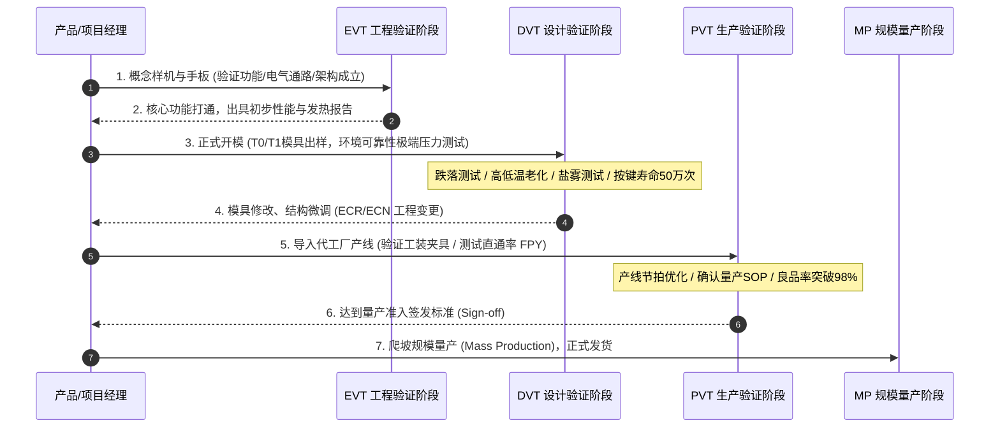
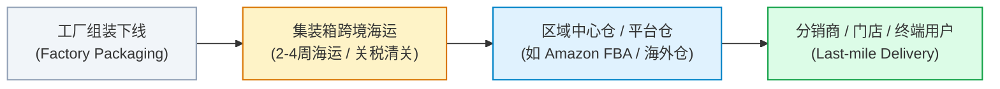
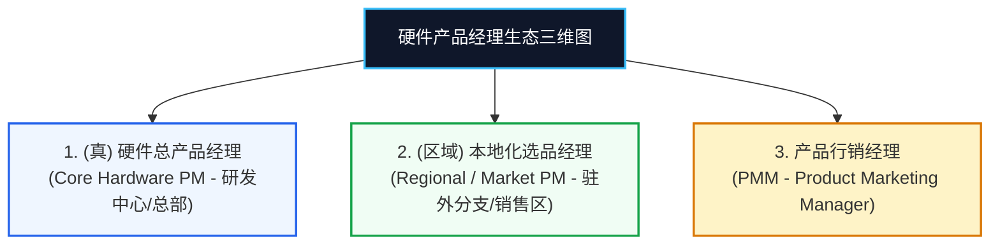

# 第24章：硬件产品经理实战：从消费电子到软硬结合 (Hardware Product Management)

在数字化与智能物联（AIoT）飞速发展的今天，硬件产品经理（Hardware PM）正经历着从“边缘人”到“核心指挥官”的价值重塑。然而，由于长期以来互联网圈对“产品经理”的定义默认局限在 App、Web 界面等纯数字产品领域，导致大量转型做硬件或负责软硬结合（IoT）项目的产品人踩坑无数。

做软件，一个 Bug 可以在几小时内热修复甚至静默发版；做硬件，一旦模具开错、芯片选型缺陷或产线组装公差失控，面临的将是数百万甚至数千万现金的物料报废与召回灾难。

本章融合消费级智能硬件（智能家居、生态链产品、可穿戴设备）的一线实战操盘心法，深度拆解硬件产品的开发工程矩阵、量产验证全流程、全球认证准入、供应链进销存以及硬件产品经理的三大细分物种。

---

## 1. 硬件与数字产品的本质差异：物理世界的多维交互

数字产品经理与硬件产品经理最大的认知鸿沟，始于**交互维度与产品交付属性**的根本差别：

### 1.1 交互体验的物理维度
- **感官的丰富度**：一个 App 界面无论多精致，用户只能在玻璃屏幕上“看、点、听”；但一个硬件产品，用户可以摸其材质细腻度（磨砂铝合金 vs 亲肤涂层）、感受物理按键的段落感与行程（Clicky Feedback）、旋转旋钮的阻尼感、甚至在不同温湿度环境下的握持体感。
- **不可撤销的交付成本**：
  - 软件产品：上线（Deploy）即发布，支持金丝雀发布、灰度测试与实时 A/B 测试；
  - 硬件产品：**部署（Deployment）＝ 试产 ＝ 出货发售（Product Launch）**。一旦出厂进入海运集装箱，任何严重的硬件 Bug 都无法通过网络召回，物理世界不相信“线上回滚”。

---

## 2. 硬件研发的核心学科与团队协同

硬件产品的诞生，绝非产品经理画几张线框图就能实现，而是高度依赖跨学科精密工程的交响乐：

### 2.1 CMF 与 DFM 的工程博弈
- **CMF（Color, Material, Finishing）**：
  - 定义产品的表面感官质感。例如阳极氧化铝的细腻喷砂目数（如 180 目与 220 目的手感差异）、高光倒角（Diamond Cutting）、高透 PC 材质的抗刮耐磨度。
- **DFM（Design for Manufacturing，面向制造的设计）**：
  - **硬件 PM 的核心成熟标志**。ID 设计师画出的“绝美造型”，在工厂可能存在无法开模、拔模斜度不足、注塑缩水、良品率极低等致命问题。硬件 PM 必须与 MD 结构工程师、模具厂师傅共同推演 DFM，在美学与量产良品率之间找到平衡。

---

## 3. 硬件量产落地三部曲：从 EVT 到 MP

硬件开发拥有世界制造业公认的里程碑验证阶段，任何试图跨越这些阶段的“揠苗助长”，都将被物理法则施以严厉惩罚：

### 3.1 三大测试阶段核心定义
1. **EVT（Engineering Validation Test，工程验证测试）**：
   - 重点验证“方案是否行得通”。采用 3D 打印或 CNC 手板件，装配验证 PCB 电路功能、传感器读数、天线射频与系统核心链路。
2. **DVT（Design Validation Test，设计验证测试）**：
   - 重点验证“设计在极限工况下是否稳固”。使用正式模具注塑出来的样机，进行极其残酷的环境可靠性测试：
     - **跌落与冲击测试**：大理石地面 1.2 米高多角度跌落测试；
     - **环境温湿度与盐雾**：-20℃ 至 60℃ 高低温循环箱冷热交替运转 48 小时；
     - **机械疲劳寿命**：转轴折叠 20 万次、微动按键机械按压 50 万次测试。
3. **PVT（Production Validation Test，生产验证测试）**：
   - 重点验证“代工厂（OEM/ODM）能否高效稳定地做出来”。测试工装夹具（Jig）、烧录校准设备、产线员工组装工时（Cycle Time）以及产线一次直通率（First Pass Yield, FPY）。
4. **工程变更控制（ECR / ECN）**：
   - 任何改动（即使是一个螺丝孔位位移 0.5mm 或电阻阻值变更）必须走正式的 **ECR（Engineering Change Request）$\to$ ECN（Engineering Change Notice）** 审批流，确保物料版本与图纸严丝合缝。

---

## 4. 全球市场准入与法规合规认证 (Global Compliance)

硬件产品销往全球，必须跨过各国政府的强制性准入法律门槛：

| 国家 / 地区 | 认证标志 | 监管领域与核心要求 |
| :--- | :--- | :--- |
| **美国** | **FCC** | 联邦通信委员会电磁辐射与无线射频（RF）合规（Part 15）；涉及消费安全的 UL 认证。 |
| **欧盟** | **CE** | 强制性安全认证，涵盖 RED（无线电设备指令）、EMC（电磁兼容）、LVD（低电压安全）、RoHS/REACH（环保与有害物质禁用）。 |
| **中国大陆** | **CCC (3C) / SRRC** | 国家强制性产品认证（安全与 EMC）；无线电发射设备型号核准（工信部 SRRC）。 |
| **中国台湾** | **NCC / BSMI** | NCC（通信与无线射频核准）；BSMI（经济部标准检验局安全与电磁兼容）。 |
| **日本** | **PSE / TELEC** | PSE（电气用品安全法，适配器与电池重点）；TELEC（无线电射频法规）。 |
| **物流运输** | **UN38.3 / MSDS** | 包含锂电池的带电产品，航空海运必须具备 UN38.3 危险品运输鉴定报告与化学品安全说明书。 |

> [!WARNING]
> 认证周期通常长达 4 至 8 周，且需消耗数十台测试工程机做破坏性实验。硬件产品经理必须将认证时间前置规划进关键路径，否则产品已在工厂下线打包，却因证书未下发导致海关扣关或电商平台强制下架。

---

## 5. 物流链路、PSI 进销存与生命周期管理

硬件产品在商业上的生死，70% 取决于供应链与库存管理：

### 5.1 笨重的物流时间差 (Fulfillment Lead Time)
- 从工厂下线到最终摆在海外零售货架，海运通常需要 3~5 周，再加上清关入仓，中间往往存在 **4 到 8 周的“在途延迟”**。这意味着硬件产品经理必须比软件团队提前 2 个月预判市场热度与黑五、双十一等大促节点的备货量。

### 5.2 PSI 动态平衡（Purchase, Sales, Inventory）
- **进（Purchase - 采购排产）**：根据销售预测向供应链下达长周期芯片（Long-lead Components）采购与整机生产计划。
- **销（Sales - 实际终端出货与 Sell-through）**：关注真实流向终端消费者的动销率，警惕只在渠道压货的虚假繁荣。
- **存（Inventory - 库存警戒）**：
  $$\text{库存周转天数 (DOI)} = \frac{\text{当前库存总量}}{\text{日均销售出库量}}$$
  硬件库存每多躺在仓库一天，就伴随着跌价损失、仓储成本与资金利息。

### 5.3 停产清库与生命周期终止 (EOL: End-of-Life)
- 当新一代产品上市或旧款芯片停产时，硬件 PM 需发起 **EOL 流程**：
  - 计算剩余安全库存与停产前最后一次大采购（LTB, Last Time Buy）；
  - 制定降价促销清库策略（Clearance）；
  - 依据法规要求，为已售出设备封存至少 1~3 年的售后维修备件（Spare Parts）。

---

## 6. 硬件产品经理的三大物种剖析

在成熟的国际硬件科技公司中，根据工作场域与核心责任界面，产品经理通常细分为以下三种生态角色：

### 6.1 （真）硬件总产品经理 (Core Hardware PM)
- **基地**：科技公司总部/研发中心（如北京、深圳、硅谷）。
- **职责**：深入研判用户场景、制定产品定义与核心卖点（KSP）、管理 BOM 成本与整机规格、主导 EVT/DVT/PVT 各阶段工程评审，对产品的从无到有、软硬结合体验和产品技术竞争力负总责。

### 6.2 （区域）本地化选品经理 (Regional PM)
- **基地**：派驻在特定海外区域市场（如欧洲、北美、拉美、东南亚）。
- **职责**：
  - **因地制宜选品**：深入当地用户生活习俗。例如在韩国，必须评估当地独有的“泡菜冰箱”冷藏需求；在欧美，需根据当地法规对电动滑板车的车速（如限制 20km/h 或 25km/h）、反射镜与刹车双制动提出定制需求。
  - **SKU 精简与本土化**：平衡当地特殊合规、插头制式（美标/欧标/英标）与多语言包装，向总部争取兼顾全球公版架构与区域特性的最优配置。

### 6.3 产品行销经理 (Product Marketing Manager, PMM)
- **基地**：市场与销售中台。
- **职责**：
  - **将硬核参数翻译为动人语言**：“能把复杂的芯片纳米工艺、光学传感器模组，转化为普通消费者一听就懂的购买心智”。
  - **争夺用户钱包份额（Share of Wallet）**：深谙竞品配置对比，制定上市 GTM 战略、终端渠道定价阶梯与促销方案，为主管销售的业务团队提供炮火支援。

---

## 7. 本章实战自测清单 (Checklist)

在操盘一款智能硬件或软硬结合项目时，请逐一评估以下硬核指标：

- [ ] 你的产品定义是否做到了 DFM（面向制造的设计）评估，还是停留于无法脱模、公差过紧的工程不可行方案？
- [ ] 硬件开发计划是否严谨保留了 EVT、DVT 与 PVT 三大阶段的完整周期，并为极限环境测试预留了整改时间？
- [ ] 模具、原理图与物料清单变更，是否建立了严格的 ECR / ECN 变更控制机制？
- [ ] 目标销售国家和地区的合规认证（FCC/CE/3C/SRRC/UN38.3 等）是否已提前规划并计入量产关键路径？
- [ ] 是否建立了包含海运周期（4-8周缓冲）、渠道库存监控与 DOI 周转率的动态 PSI 进销存预测模型？
- [ ] 软硬件互联的 Companion App 与固件 OTA 升级机制是否稳妥，是否具备防变砖（Anti-bricking）的双区备份自愈设计？
