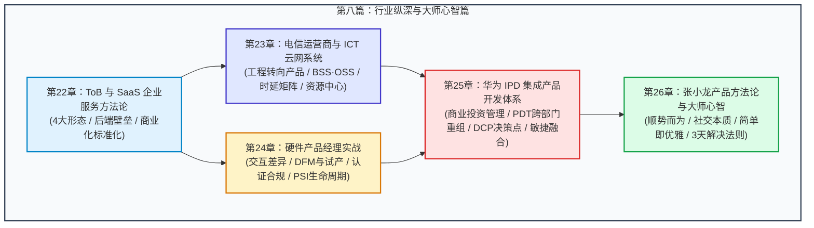

# 第八篇：行业纵深与大师心智篇 (Industry Depth & Master Mindsets)

欢迎来到《产品经理全书》的收官终卷——**第八篇：行业纵深与大师心智篇**。

在前七篇中，我们系统性地拆解了产品经理的认知底座、市场竞争分析、需求真伪刺破、精益 MVP 实验、敏捷研发交付、数据度量归因，以及复杂的跨职能协同与组织博弈。如果说前七篇构建的是产品经理在通用数字互联网世界里的“筋骨与血肉”，那么第八篇则是让你具备穿透复杂商业本质的“纵深行业实战认知”与“顶级产品哲学心智”。

现实商业世界从来不是单一的移动 App 或通用 Web 界面。产品形态跨越了 ToB 企业服务深水区、电信运营商百亿级云网底座、软硬件结合的物理世界、世界级巨头（华为 IPD）的矩阵投资流程，以及亿级国民级产品（张小龙微信方法论）的极致人性洞察。

---

## 篇章知识拓扑图 (Mental Topology)

---

## 章节导航 (Chapter Directory)

1. [第22章：ToB 与 SaaS 企业服务方法论 (ToB & SaaS Product Methodology)](./22-tob-product-methodology.md)
   - 梳理 ToB 的四种典型产品形态（定制外包、小前端大后端广告流、企业内部支撑系统 OA/CRM/ERP、通用 SaaS）。
   - 拆解 ToB 与 ToC 的根本分野：使用者与买单者分离、复杂的组织决策链、以 ROI 与组织降本增效为度量准绳。
   - 攻克 ToB 产品化的四大核心：商业价值量化、科学定价策略（Price Model）、标杆客户打法（Reference Cases）与业务场景抽象。

2. [第23章：电信运营商与 ICT 云网系统 (Telecom & ICT Cloud-Network Systems)](./23-telecom-and-ict-systems.md)
   - 深入剖析电信运营商从“通信网络工程项目制建设”向“以克服投资风险为核心的产品化经营”的历史性演进。
   - 掌握运营商产品立项的 8 大刚性决策要素与 BSS/OSS 全生命周期流转（Quote 售前报价 $\to$ Order 销售订购 $\to$ Order Records 报竣起租）。
   - 实战拆解骨干网（CN2 / CTGNet）时延矩阵（Latency Matrix）、Looking Glass 路由探测、云网协同（Cloud Exchange）及资源中心（管线/机架/端口）支撑体系。

3. [第24章：硬件产品经理实战：从消费电子到软硬结合 (Hardware Product Management)](./24-hardware-product-management.md)
   - 实体交互与屏幕交互的降维差别：从手机屏的“看点听”到物理世界的“摸、按、扯、转、摔、抱”。
   - 硬件开发的核心学科与协同：EE（电子）、ME（机构）、Firmware（固件）、ID（工业设计）与 DFM（面向制造的设计）。
   - 硬件量产落地三部曲：EVT $\to$ DVT $\to$ PVT、模具良率、全球准入合规（FCC/CE/NCC/PSE）、供应链排产与进销存（PSI）/生命周期管理（EOL）。
   - 硬件产品经理三大物种剖析：（真）总产品经理、（区域）本地化选品经理、产品（行销）经理（PMM）。

4. [第25章：华为 IPD 集成产品开发体系实录 (Huawei IPD: Integrated Product Development)](./25-huawei-ipd-system.md)
   - 华为 IPD 的变革底层逻辑：“变革就是利益的再分配”、“做两个亏一个”到“流程去个人化”。
   - 将产品研发视为商业投资来管理：ROI 投资回报率驱动、市场需求与技术演进双轮驱动。
   - PDT（产品开发团队）跨部门重装组织机制：打破职能接力棒，实现跨领域并行工程开发。
   - 结构化受控投入（DCP 决策检查点与 TR 技术评审点），以及 IPD 宏观投资框架与敏捷微观迭代（项目级/版本级/产品级）的融合艺术。

5. [第26章：张小龙产品方法论与大师心智 (Allen Zhang Product Methodology & Master Mindset)](./26-allen-zhang-methodology.md)
   - 顺势而为：产品演进方向必须迎合时代的洪流。
   - 社交的本质是“寻找同类”：从朋友圈、状态到短视频的内容与连接逻辑。
   - 终极定位是一盏灯塔：“微信是一个生活方式”，“视频号是一人人可创作的短内容平台”。
   - 从能用、到好用、再到好看：简单是美观、实用、合理、优雅的代名词。
   - 警惕加功能将产品推向平庸与垃圾；对抗团队内耗与敏捷判断力（3 天解决或放弃法则）。

---

> [!TIP]
> 读完这一篇，你将不仅掌握微观的功能设计，更能站在**商业投资人、系统架构师与大师哲学**的三维高度，审视所有产品的生死与演化。
