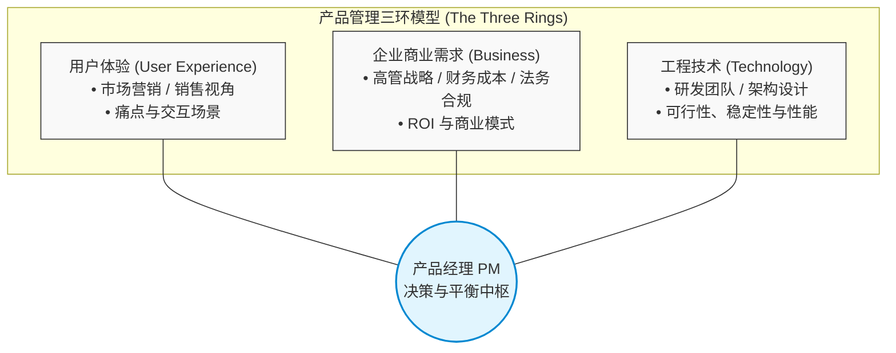
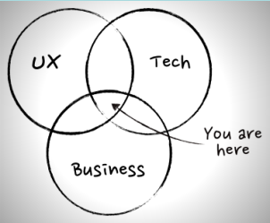
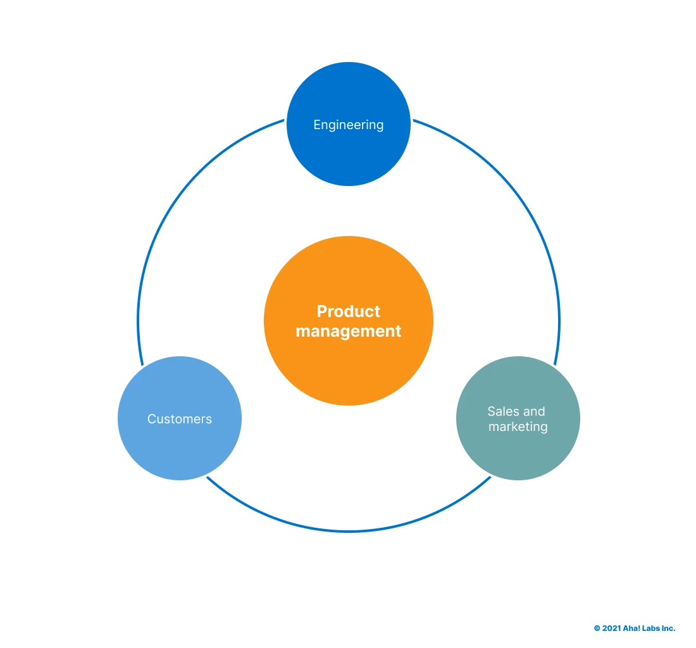
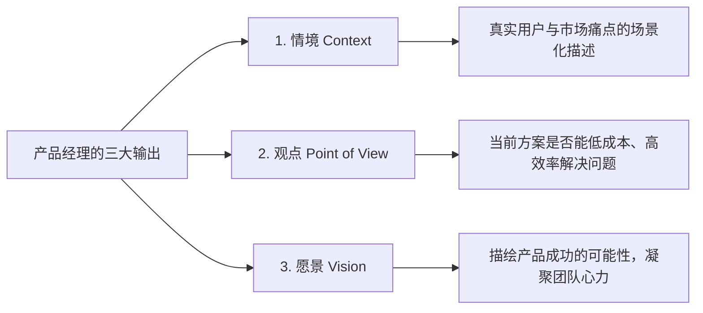
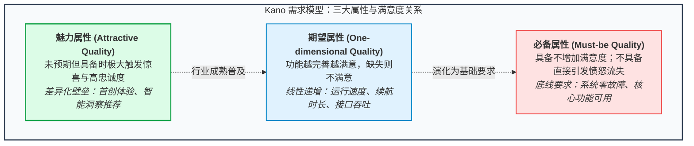
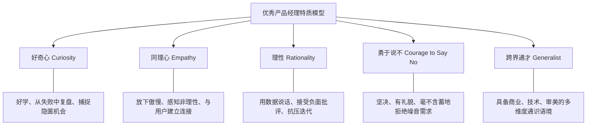
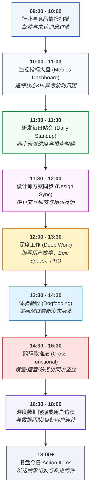

# 第 1 章：什么是产品经理 —— 三环交集、通才定位与避坑指南

> “产品经理是产品的首席执行官（CEO of the Product），但并不直接管理任何人。产品经理是一个沟通中枢、一个优先级决断者、一个敏锐的研究员，以及产品面对世界的首要布道者。”

---

## 1.1 重新定义产品经理：角色与使命

在现代商业与科技组织中，“产品经理”（Product Manager, 简称 PM）是一个最常被误解的角色。

许多初入行者容易走向两个极端：
- **自大狂陷阱**：误以为自己是拥有至高决策权的小老板，可以随意向研发和设计指派个人喜好的功能。
- **打杂人陷阱**：沦为“需求录入员”或“原型画图工具人”，谁提需求就接谁的需求，每天被琐碎的排期与催办淹没。

事实上，正如硅谷知名产品投资人 Josh Elman 所定义：
> **“A Product Manager helps their team ship the right product to their users.”**  
> （产品经理的核心使命，就是帮助团队将**正确的产品**交付到**目标用户**手中。）

### 核心定位特征

1. **对产品的终局成败负全责（Responsible for Success）**：
   无论遇到市场变故、研发延期、设计不符预期还是商业化受阻，产品经理不能归咎于外部环境或某个合作方，而必须承担最终业务指标（KPI / Metrics）的达成责任。
2. **无行政权力的沟通中枢（Communication Hub & Not a Manager of Anybody）**：
   在绝大多数矩阵式组织中，工程师向研发主管汇报，设计师向设计主管汇报，测试与运维各有归属。PM 手中没有直接的人事考核权或行政任免权。你必须**依靠逻辑、数据、同理心、沟通技巧与清晰的业务愿景来领导团队**。
3. **跨学科通才（Jack of All Trades）**：
   PM 不需要成为全团队最能写代码的人，也不需要成为视觉审美最高超的人，但必须是一个“跨多领域的通才”。你需要知道足够的行业、业务、技术与设计逻辑，从而在多方诉求冲突时做出正确的权衡与取舍。

---

## 1.2 产品管理“三环模型”与组织博弈

产品经理始终站在三个核心维度的交汇中心：**用户体验（User Experience）**、**企业商业需求（Business）** 与 **工程技术（Technology）**。

在真实的日常企业运转中，这三个圈层对应的部门往往存在天然的诉求偏差与认知盲区，PM 的核心价值正是在夹缝中寻找最优解：

| 圈层 | 对应组织部门 | 常见部门诉求与潜在偏差 | 产品经理的平衡抓手 |
| :--- | :--- | :--- | :--- |
| **用户体验 (UX)** | 市场推广团队、销售团队、前端业务部门 | • 市场团队倾向于放大优势，忽视阻碍信息传递的不利事实。 • 销售团队往往将单笔成单佣金看得比产品通用性更重要，渴望“来者不拒”的定制。 | 坚持做**普遍性**需求分析，将个别销售的客户承诺提炼为标准化产品能力。 |
| **企业需求 (Business)** | 管理层 (Execom)、财务部、法务合规部 | • 高管战略诉求可能过于宏观脱节。 • 财务部门极力压低研发与运营成本。 • 法务部门倾向于否决一切哪怕带有一丁点法律与合规风险的创新。 | 用精准的**投入产出测算 (ROI)**、合规规避预案和清晰的里程碑规划消除疑虑。 |
| **工程技术 (Technology)** | 研发部门、系统架构师、设计团队 | • 开发团队容易埋头于技术自嗨或重构，偏离业务主线。 • 设计团队可能追求过度精美却华而不实的高成本视觉方案。 | 用清晰的情境与用户故事驱动研发，设定明确的验收标准（AC），给设计留空间的同时锁定交互效率。 |

### 行业视界延伸：IT 互联网与电信 CT 的三环差异
在纯互联网（IT）场景中，产品经理重点平衡的是代码实现、商业变现与界面交互体验；而在传统通信/通信运营商（CT）领域，三环则进一步拓展为**运营商网络资源与架构（Technology）、政企大客户业务价值（Business）与通信业务支撑系统（BSS/OSS 交互体验）**的纵深融合。

*图 1-1：IT 场景下的产品经理三环结构（UX, Business, Technology）*

*图 1-2：通信（CT）与运营商场景下的产品经理多维交织*

---

## 1.3 产品经理必须给团队提供的“三样东西”

当一个团队面临繁杂的任务不知所措时，优秀的产品经理必须为研发、设计与管理层提供清晰的锚点：

1. **情境（Context）**：
   - 绝不要向团队扔下一句“我们要做一个导出 PDF 按钮”。
   - 团队需要知道：**谁在什么场景下会导出？导出的频率是多少？导出后要拿给谁看？如果不能导出，用户现在的替代方案是什么？**
   - 场景化描述才能赋予功能生命力，让工程师在编写异常逻辑时有据可依。
2. **观点（Point of View）**：
   - 面对纷繁复杂的市场建议，PM 必须有独立的理性质疑：企业现有的资源与产品架构，是否真的能有效解决那些问题？这个需求是解药，还是饮鸩止渴？
3. **愿景（Vision）**：
   - 用富有说服力的商业逻辑和用户价值蓝图来鼓舞团队。
   - 让工程师和设计师明确知道：他们今天写下的这行代码、画出的这个交互，正在为哪一群人解决怎样的痛苦，创造多大的商业回报。

> [!TIP]
> **真实需求黄金法则**：客户的欲望（Desire）与真实需求（Need）存在天壤之别。**只有用户真正肯为之买单（支付金钱、时间或注意力代价）的需求，才是真实的需求。** 其余绝大多数未经验证的想法，在被数据证实之前，皆为假设。

---

## 1.4 取悦客户的三类因素（Kano 演进法则）

产品经理在规划产品特性时，不能将所有功能等量齐观。日本质量管理专家狩野纪昭提出的模型揭示了产品特性取悦用户的本质规律：

1. **基本因素（Must-be Quality，必备属性）**：
   - **特点**：具备并不会提高满意度，但不具备会导致严重的不满与流失（例如：手机能打电话、牛奶盒不能漏奶、支付系统能准确扣款）。
   - **策略**：必须严格保证，高可靠性，零容忍差错。
2. **期望因素（One-dimensional Quality，一维属性）**：
   - **特点**：得到的越多，用户越满意；反之则越不满意（例如：电池续航时间、软件运行速度、存储空间大小）。
   - **策略**：持续优化，做性价比高的投入。
3. **魅力因素（Attractive Quality，兴奋属性）**：
   - **特点**：不具备时用户并不会感到不适（因为未曾预期），一旦具备，会极大激发惊喜感与用户忠诚度（例如：首创的隔空投送、超出预期的个性化智能建议）。
   - **策略**：作为颠覆市场或拉开竞品差异化竞争的秘密武器。

> [!WARNING]
> **动态退化法则**：随着时间的推移与行业技术的普及，**昨天的魅力因素会演变为今天的期望因素，并最终沦为明天的基本因素**。  
> 例如：智能手机的电容触摸屏在 2007 年是震撼业界的“魅力因素”，而在今天只是“基本因素”。产品经理必须持续审视自身功能所处的阶段，切莫把昨日的优越感当成永久的护城河。

---

## 1.5 优秀产品经理的核心特质

根据一线产品长期的实战复盘，一位卓越的 PM 通常具备以下五项核心软实力：

1. **好奇心（Curiosity）**：
   永远保持对商业模式演进、前沿技术边界和人类心理变化的探究欲；不仅从自身的试错中成长，更能从竞品和行业前辈的失败中汲取养分。
2. **同理心（Empathy）**：
   能够瞬间将自己切换到“白痴模式”或目标小白用户的视角。张小龙曾指出：“把自己变成小白用户，乔布斯需要 1 秒，马化腾需要 3 秒，我大概需要 5 秒，而大部分普通产品经理需要几天甚至永远做不到。”
3. **理性（Rationality）**：
   把产品当成一个科学实验。坦然面对用户的差评与残酷的转化数据，理性分析漏斗断裂原因，不为个人主观偏好自我感动。
4. **勇于说不（Courage to Say No）**：
   资源永远是有限的。平庸的产品经理试图满足所有人的所有请求，最终做成臃肿无章的拼盘；优秀的产品经理敢于坚决、礼貌、有据可依地对老板、销售、客户说不。
5. **通才（Generalist）**：
   具备商业财务、交互设计、软硬件技术、法务常识等多维语言体系，能够在跨部门沟通中无缝扮演“同传翻译器”。

---

## 1.6 产品管理“绝不能做清单”（Stop Doing List）

在团队协作中，踩雷的成本极其高昂。以下 12 条红线是技术研发与设计团队最痛恨的产品经理行为，切记自省并坚决规避：

> [!CAUTION]
> ### 🚨 产品经理高危禁忌红线（Stop Doing List）
> 1. **零技术认知且无学习意愿**：不懂基础原理，还不屑于理解前后端交互逻辑。
> 2. **需求描述含糊不清**：用“看着办”、“要高大上”、“科技感强”这种毫无验收标准的词汇应付文档。
> 3. **盲目低估任务难度**：在方案评审会上拍脑袋宣称“这不就是个简单的查询吗，明天应该能上线吧”。
> 4. **从不亲自深度使用自己的产品**：连核心流程都没跑通，全靠测试人员反馈。
> 5. **毫无预兆地随意更改需求**：朝令夕改，还理所当然地要求交付时间不能推迟。
> 6. **将产品失败的责任全部甩给技术团队**：上线数据不好就怪研发 Bug 多或上线慢。
> 7. **推不动事情时情绪失控**：像个任性的孩子一样在会议上拍桌子、喊叫跺脚施压。
> 8. **公布决策时永远不给出背景与原因**：下达命令式任务，让团队完全不知为何而战。
> 9. **对自己不懂的实现细节指手画脚**：跨过架构师直接命令工程师“这里用 Redis 存”、“改用那个数据库”。
> 10. **滥用自己根本不懂的行业术语与装腔黑话**：用一堆 buzzword 掩盖逻辑的空洞。
> 11. **做出技术相关的设计前从不找技术骨干商讨**：自己关门憋大招，评审时直接被架构推翻。
> 12. **从不与团队一起庆祝胜利**：产品上线或赢得关键大客户时只顾向上邀功，忘了和通宵作战的技术伙伴庆祝。

---

## 1.7 产品经理的一天（A Typical Day in the Life of a PM）

产品经理的一天从不是按部就班的单线程流水线，而是动态、高度协同与多线程并行运作的过程：

- **09:00 - 10:00【信息输入与行业脉搏】**
  查阅业界科技新闻、竞品最新发布动态。作为产品领航员，脱离行业上下文意味着盲目航行。
- **10:00 - 11:00【数据巡检与异常归因】**
  打开数据分析后台（Google Analytics, 神策, 日志监控），重点观察留存、跳出率、支付转化等核心 KPI。一旦出现断崖式下跌，立即调取漏斗排查。
- **11:00 - 11:30【敏捷站会与设计对齐】**
  15 分钟 Daily Standup，只讲三件事：昨天做了什么、今天计划做什么、有没有遇到阻碍（Blockers）。随后与 UI/UX 设计师推演交互细节。
- **12:00 - 13:30【午间修整与自由交流】**
  非正式午餐会议（Informal Meeting）是与研发骨干、销售同事拉近距离、私下收集真实反馈的最佳时机。
- **13:30 - 15:00【版本测试与文档编写】**
  亲自测试即将上线的 Release 构建版本（Dogfooding），体验交互流畅度；随后进入高专注状态，编写下一个 Sprint 的 Feature Specs 与 Acceptance Criteria。
- **15:00 - 17:30【利益相关者博弈与用户开发】**
  每周跨部门排期会、Sprint Retrospective，或与潜在客户连线进行 20 分钟的探索性访谈。
- **17:30 - 18:30【闭环复盘与收尾】**
  梳理当天产生的 Action Items，更新 Jira/看板卡片，输出规范的 Meeting Minutes。

---

## 1.8 本章自检 Checklist

在开启下一个产品迭代前，请用以下 5 个问题完成自检：

- [ ] 针对正在负责的核心特性，我能否用清晰的一句话讲清它的用户是谁、使用场景是什么，以及解决的商业痛点是什么？
- [ ] 我所提议的这个特性，属于 Kano 模型中的基本因素、期望因素还是魅力因素？它是否已被竞品做成了基本属性？
- [ ] 当团队对该特性的实现产生分歧时，我是凭借“我感觉”还是“真实客户访谈与指标数据”来下决断？
- [ ] 我今天是否做到了倾听研发与设计专业意见，是否违背了“Stop Doing List”中的任意一条？
- [ ] 面对来自高管或业务端纷至沓来的新增请求，我今天是否有勇气且有据可依地对伪需求说出了“不”？
