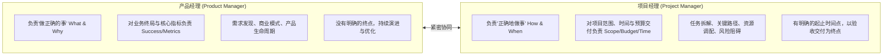
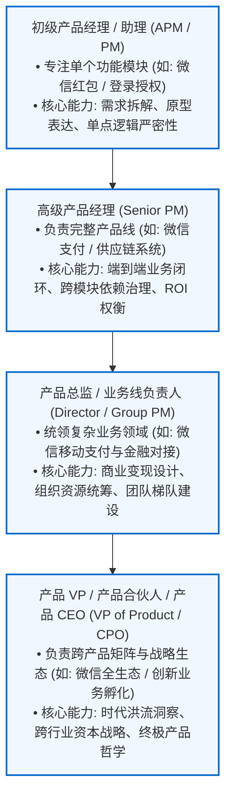
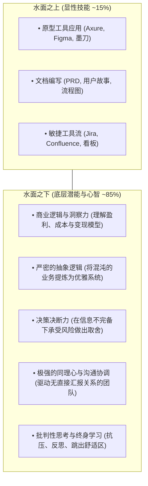
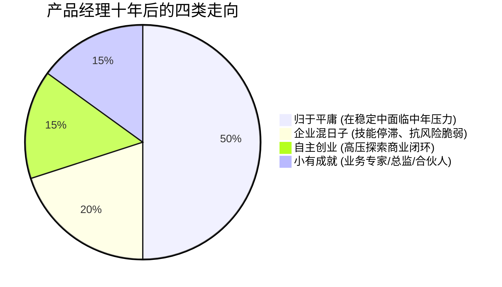
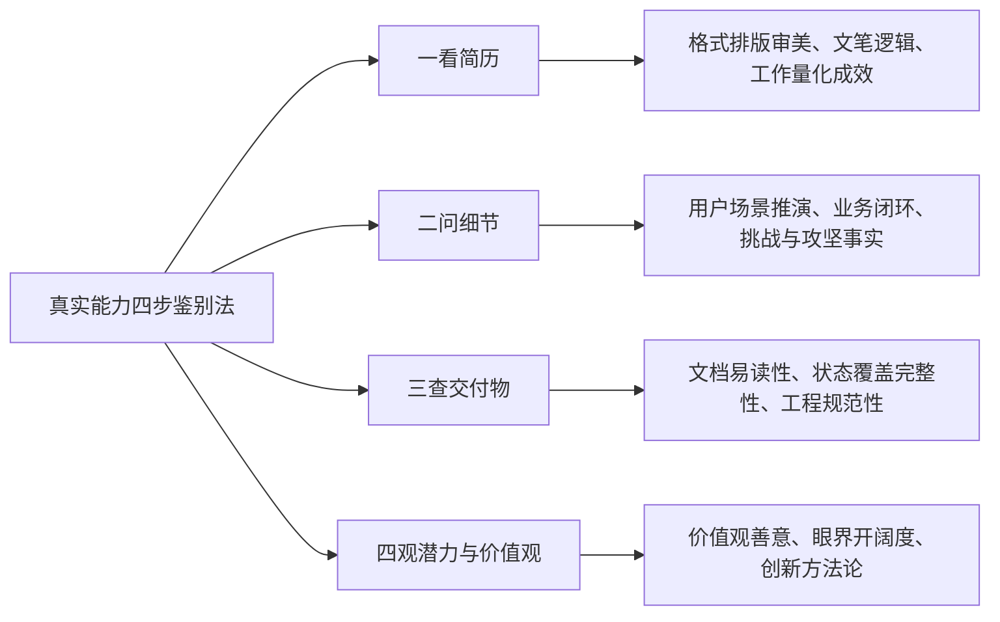

# 第 2 章：职业发展路径与核心竞争力 —— 从功能模块到商业闭环

> “刚入行时，很多人觉得自己会画线框图、会写 PRD、会用 Jira 提工单，就算是产品经理了。但这只是水面之上的冰山一角。真正的门槛，在于做这些动作之前的思考、判断、决断与跨领域统筹能力。”

---

## 2.1 角色边界的本质厘清

要看清产品经理的进阶之路，首先要彻底肃清“把产品经理当做项目经理”或“把产品经理当做原型设计员”的认知混淆。

### 2.1.1 产品经理 (PM) vs 项目经理 (PjM)

很多人将产品管理（Product Management）与项目管理（Project Management）混为一谈，这是极大的误区：

| 维度 | 产品经理 (Product Manager) | 项目经理 (Project Manager) |
| :--- | :--- | :--- |
| **核心使命** | 解决用户痛点，实现商业价值（做正确的事） | 确保既定项目按时、保质、保量交付（正确地做事） |
| **考核指标** | 业务指标（如 MAU、留存率、GMV、ROI、LTV） | 交付指标（如延期率、工时预算消耗、燃尽图斜率） |
| **生命周期** | 从概念孵化到衰退退市，贯穿产品全生命周期 | 从项目立项启动到项目验收闭环，生命周期相对离散 |
| **技能要求** | 商业嗅觉、用户洞察、优先级决断、数据分析 | WBS 任务分解、关键路径法（PERT/甘特图）、风险管理 |

> [!NOTE]
> **PM 需要具备 PjM 的技能，但 PjM 的技能不足以成就优秀的 PM**。在中小型团队中，产品经理往往身兼项目经理；但随着团队规模扩大，两者的专业分工会越来越清晰。

### 2.1.2 产品经理 vs 研发架构师与 UI/UX 设计师

- **PM 与技术架构师**：
  - PM 定义**功能输入、业务边界与业务规则**；
  - 架构师决定**系统架构、数据模型设计、高并发应对与微服务划分**。
  - 卓越的合作状态是：PM 给出清晰的业务情境与未来的业务扩展预期，架构师据此设计兼具灵活性与稳定性的技术底座。
- **PM 与 UI/UX 设计师**：
  - PM 梳理的是**业务逻辑、信息流向、操作闭环与核心字段**；
  - 设计师赋予其**顺畅的情感化交互体验、视觉层级与审美张力**。
  - PM 绝不应该替代设计师画高保真 UI，而应给予设计师充分的设计自由度，共同围绕用户体验目标迭代。

---

## 2.2 职业晋升天梯：由点及面的四层跨越

以行业标杆人物（如张小龙从程序员转为 Foxmail 独立开发者，再到腾讯副总裁、微信生态掌舵人）的发展历程为例，产品经理的进阶是一条典型的**“从点状功能，到线性产品，再到网状业务与生态”**的跃迁路径：

### 各阶段进阶核心标志

1. **第一阶段：功能模块级（0 - 2 年）**
   - **典型场景**：负责一个具体的子功能或小工具（如注册登录、评论列表、搜索筛选、微信红包模块）。
   - **能力焦点**：需求描述准确无歧义、逻辑边界覆盖（各种异常状态、弱网、空数据）、Axure/Figma 原型清晰、与研发顺畅沟通。
2. **第二阶段：产品线闭环级（3 - 5 年）**
   - **典型场景**：独立负责一条完整的业务主线（如整个支付体系、CRM 客户管理系统、移动端核心交易链路）。
   - **能力焦点**：具备前后端系统架构通识，熟练处理复杂业务流与数据流，掌控版本发布节奏，背负明确的运营数据 KPI。
3. **第三阶段：业务领域级（5 - 8 年）**
   - **典型场景**：担任产品总监，对整块业务的盈亏（P&L）负责。不仅处理对内协调，还深度参与外部资源对接（如金融牌照对接、核心供应商选型谈判）。
   - **能力焦点**：敏锐的商业机会识别、产品路线图（Roadmap）长期布局、建立产品体系化规范与人才梯队。
4. **第四阶段：商业与生态级（8 年以上）**
   - **典型场景**：企业核心产品决策者（CPO / 事业群总裁）。
   - **能力焦点**：把握时代洪流与技术浪潮的变革红利（顺势而为），决定产品该进入哪个市场、该关停哪个业务，塑造企业的文化与产品价值观。

---

## 2.3 核心能力结构：“冰山模型”解析

为什么许多看似通过一个月速成班掌握了画图写文档技能的候选人，在实际工作中却漏洞百出？答案就在于**冰山模型**：

- **水面之上的硬技能**：
  只要智力正常、有人指导，任何人花 1~2 个月都能熟练掌握基本原型绘制和 PRD 撰写规范。这属于**入行门槛，而非核心壁垒**。
- **水面之下的隐性潜能**：
  决定一个产品经理能否走远并跨越职业瓶颈的，是水面之下的结构化思考、商业洞察力、抗挫力与价值观。这些能力不仅适用于产品岗位，更是卓越商业领袖的通用底层操作系统。

---

## 2.4 产品经理十年后的四种宿命与“护城河”法则

在一线互联网与科技行业，工作 10 年以上的产品经理最终通常会走向四种典型状态：

1. **归于平庸（大多数人的常态）**：
   逐渐离开一线核心战区回到宜居城市，或辗转于各家中小企业，薪资尚可但伴随房贷、家庭等现实压力。主要原因在于早期缺乏清晰的长期规划，随着年龄增长，技能溢价逐渐被年轻一代追平。
2. **混日子（高危脆弱状态）**：
   依赖早期大厂光环或人际关系留在体系内，多年没有经历过新业务挑战，眼界单一、能力退化。一旦遭遇企业战略转型或裁员风暴，在市场上缺乏二次议价能力。
3. **自主创业（高压历练）**：
   走出舒适区，利用过往的资源和产品嗅觉成为创始人或合伙人。承受极大的资金与生存压力，无论成败，其视野与商业综合能力都会实现质的突破。
4. **小有成就（成为标杆）**：
   在能力层面出类拔萃，在特定垂直行业深入扎根，成为兼具业务认知与落地实操的专家型管理层，享有年薪与股权激励。

### 如何构建产品经理的不可替代性（职业护城河）？

> [!IMPORTANT]
> ### 🛡️ 打造个人护城河的四大法则
> 1. **拒绝做纯粹的“功能型 PM”，全力转型为“业务型 / 领域型 PM”**：
>    纯粹的功能交互设计极易被替代或被 AI 工具自动化；而深度的行业 Know-How（如医疗合规、通信网络调度、跨境供应链结算、高并发金融风控）需要长周期的浸泡。
> 2. **建立属于自己的实战方法论体系**：
>    不仅知道“怎么做”，更能将过往解决复杂难题的经验抽象为可复用、可迁移的思维框架。
> 3. **结果导向，用商业回报证明价值**：
>    在简历与复盘中，永远不要只列举“上线了哪些功能”，而要展示“提升了多少转化率、节省了多少交付成本、拉动了多少业务增量”。
> 4. **保持终身学习，不依恋公司光环**：
>    公司平台的光环属于公司，个人的能力边界才属于自己。

---

## 2.5 怎么判断一个产品经理的真实能力？（面试官级拆解）

无论是团队搭建面试，还是个人自省评估，可以通过**“四步鉴别法”**穿透浮夸的包装，洞察 PM 的真实水准：

### 一、 看简历（审美与逻辑呈现）
- **简历样式**：是否随大流套用花哨但难读的模板？能否做到信息层级分明、视觉清爽？连自己的简历都无法优雅设计的人，很难对复杂产品具备掌控力。
- **文笔功底**：表达是否精炼通顺？文字是逻辑思考的最终映射，如果简历充斥着含糊的专业词汇堆砌，说明思维混乱。
- **成效量化**：是否具备“结果导向”意识，用明确的数据指标（如留存提升、成本压降）展示交付结果。

### 二、 问细节（穿透理论套话）
针对候选人过往宣称的核心项目，连续下钻 4~5 层：
- *“这个产品的目标用户第一画像是什么？主要解决哪个高频痛点？”*
- *“你在项目中到底承担什么角色？哪些决策是你主导的？哪些是老板硬性要求的？”*
- *“整个业务闭环是怎样的？如果上游数据缺失，你的系统如何容错？”*
- *“上线后核心数据与预期是否有偏差？如果现在让你重做一次，你会推翻哪个决定？”*
> 如果项目是真实深度操盘的，回答必定条理清晰、有血有肉；若是挂名参与或背诵理论，遇到边界条件细节必定支支吾吾。

### 三、 查交付物（工程与落地严谨度）
要求审阅候选人过去脱敏后的 PRD 或原型作品：
- **易读性**：目录结构是否合理？开发和设计能否在 30 秒内定位所需信息？
- **逻辑性**：是否存在业务规则漏洞？前后逻辑是否自洽？
- **规范性**：是否有修订历史版本记录、字段类型定义、异常交互说明？

### 四、 观潜力与价值观（决定发展上限）
- **价值观取向**：是否具备同理心与善良底线？是否具备担当精神？绝不能选拔为了 KPI 不择手段牺牲用户利益或随意甩锅团队的人。
- **眼界与宏观认知**：是否能“既低头拉车，又抬头看路”？对行业变局、上下游生态是否有自己的独立见解。
- **反思与抽象能力**：是否能将过去的教训沉淀为自己的方法论，还是每一次都是盲目的经验重复。

---

## 2.6 本章自检 Checklist

- [ ] 面对一个新需求，我是否能跳出项目经理的“进度时间”视角，站在商业和用户角度反问“我们为什么要做它”？
- [ ] 我当前的工作重心是停留在水面之上的“画图和提工单”，还是在主动锻炼水面之下的“业务逻辑与决策能力”？
- [ ] 我是否在某个特定的业务或行业领域（ToB、电商、通信、SaaS 等）建立了难以被跨行业新人快速复制的业务护城河？
- [ ] 如果今天去应聘高一级的岗位，我能否拿出逻辑严密、排版规范、具备完整业务闭环的代表性交付物？
- [ ] 我对于未来的职业规划是否具备 3~5 年的延展预期，避免陷入“十年温水煮青蛙”的被动状态？
