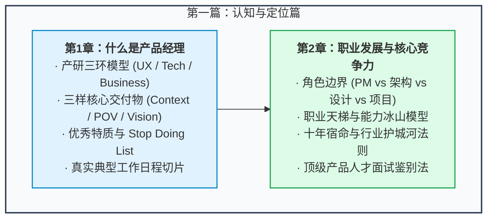

# 第一篇：认知与定位篇 —— 探寻产品经理的本质

> “许多人以为产品经理就是那个拥有奇思妙想、随时给团队下指令的‘点子王’；或者反过来，认为产品经理只是一个整天画线框图、催进度的‘跟单员’。这两种认知，都在入行的第一天就埋下了职业天花板的种子。”

---

## 篇章导读

在进入复杂的市场分析、需求挖掘、敏捷研发和数据指标之前，每一位产品从业者都必须首先完成一次**底层心智的校准**：
- 什么是产品经理？
- 产品经理的核心职能边界在哪里？为什么说“PM 是产品的第一责任人，却不是任何人的直接管理者”？
- 产品经理与项目经理、UI 设计师、研发架构师之间的区别究竟是什么？
- 在长达 5 年、10 年的职业长跑中，如何跨越“功能型画图工具人”的陷阱，建立起属于自己的专业护城河？

本篇将依托业界经典理论与一线实战专家的真实思考，解构产品经理的三环模型、核心能力特质、典型工作日常、不要做清单（Stop Doing List），并全面揭示从助理到产品 CEO 的成长天梯与面试鉴别法则。

---

## 本篇知识图谱

---

## 章节导航

- **[第 1 章：什么是产品经理 —— 三环交集、通才定位与避坑指南](./01-what-is-pm.md)**
  - 深度解析产品经理的角色定义、三环交集、三样核心产出、优秀产品经理的五大特质、Stop Doing List 以及一位 PM 的典型一天。
- **[第 2 章：职业发展路径与核心竞争力 —— 从功能模块到商业闭环](./02-career-growth.md)**
  - 厘清产品经理与项目经理的本质界限，剖析由助理到产品 CEO 的晋升路径、冰山模型、产品人十年发展四大归宿及真实专业能力的评估维度。
