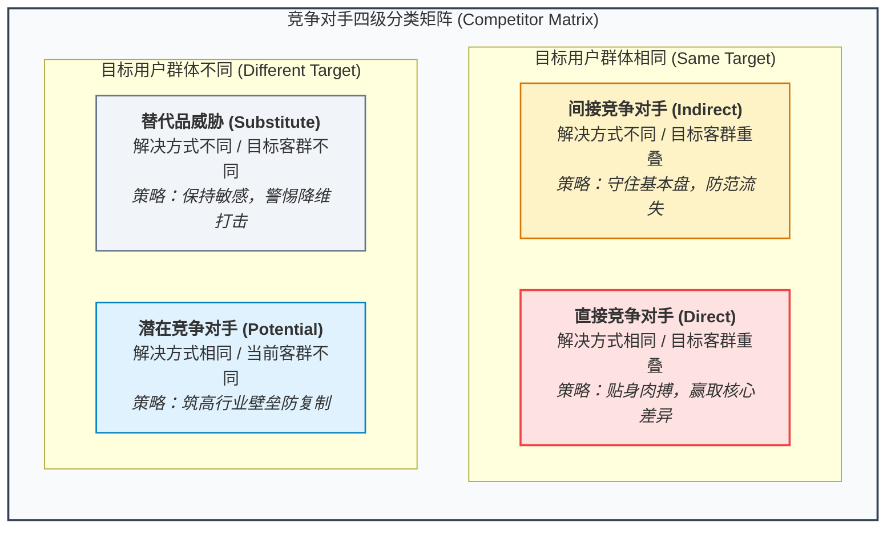
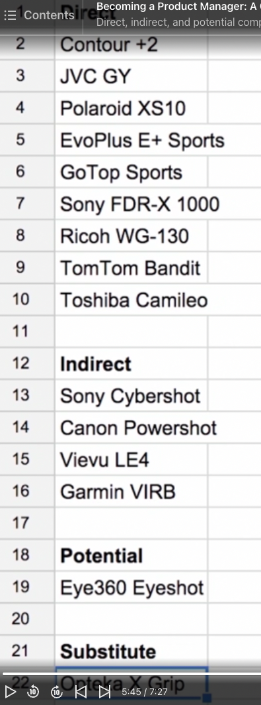
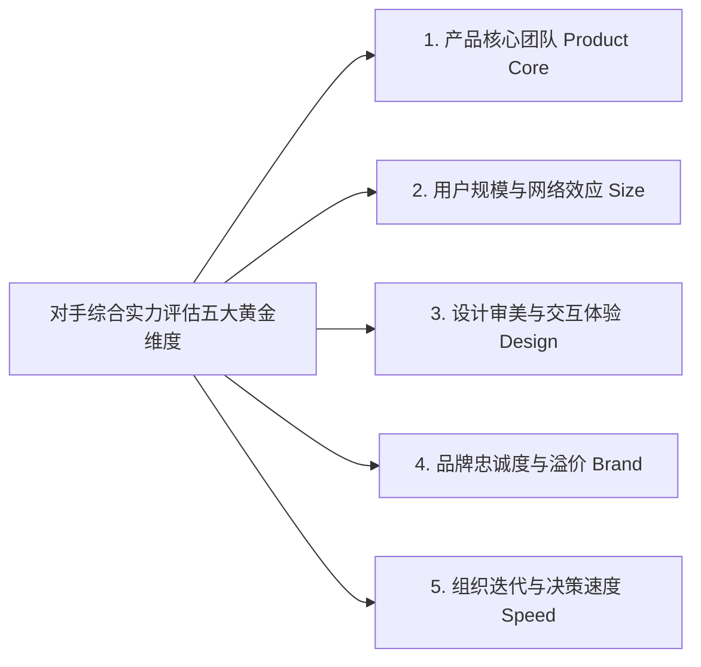
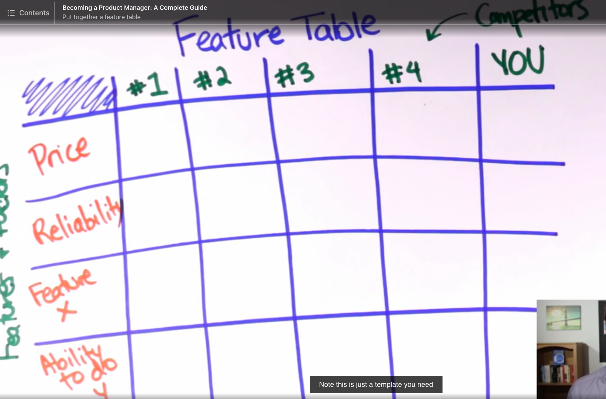
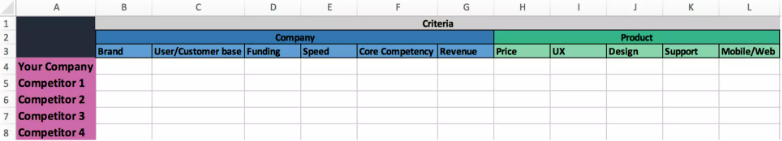
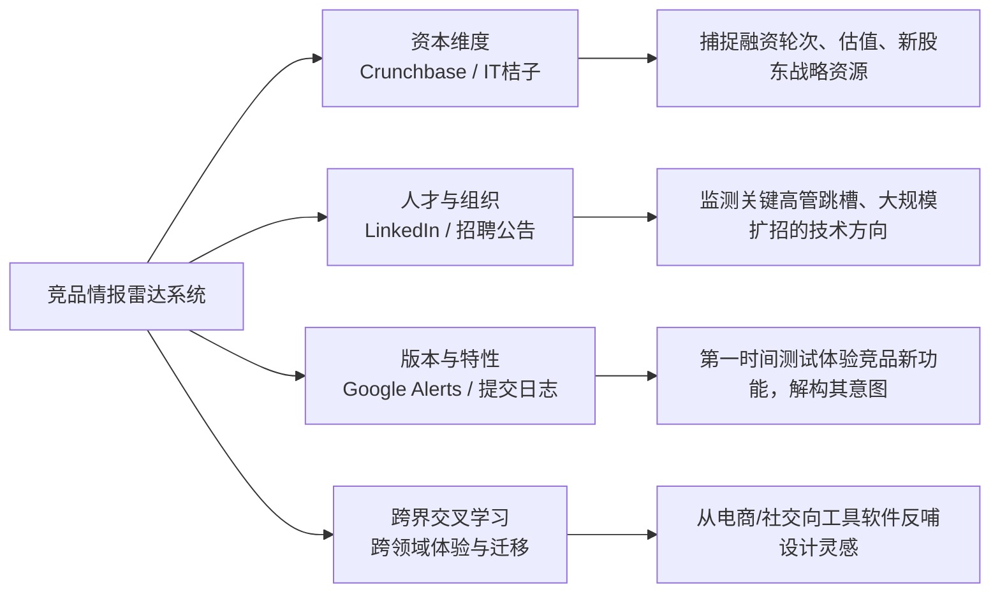

# 第 4 章：全方位竞争情报与对手监控 —— 织密情报网与构筑比较优势

> “知己知彼，百战不殆。在现代商业战争中，你绝不能在不知道对手长什么样、在做什么、推出了什么特性的情况下盲目拍脑袋决策。产品经理必须像一位情报官一样，建立一套全天候自动运转的情报雷达系统。”

---

## 4.1 挖掘隐形对手的检索心法

许多新手产品经理在调研竞品时，往往只知道去应用商店或百度/谷歌直接搜索品牌名称。但这只能搜到“已知对手（Known Competitors）”，真正致命的往往是那些潜藏在水面之下的“隐形对手（Unknown Competitors）”。

```mermaid
graph TD
    Search["发现隐藏竞品的三大情报搜索术"]
    Search --> S1["1. 置身用户吐槽现场 Channel the User"]
    Search --> S2["2. 垂直社群穿透检索 Site: Operator"]
    Search --> S3["3. 核心卖点双引号精准轰炸 Exact Pitch Phrase"]

    S1 --- S1_d["在搜索框输入用户具体的抱怨语句，例如: '为什么某某软件不能同时导出PDF'"]
    S2 --- S2_d["''site:v2ex.com [问题痛点"]' 或 'site:reddit.com [诉求]' 挖掘自发讨论"]
    S3 --- S3_d["用双引号搜索产品一句话 Pitch，看谁打出了完全相同的口号"]
```

### 1. 穿透隐形对手的三大情报搜索术

1. **置身用户吐槽现场（Channel the Type of User）**：
   - 用户遇到痛点时绝对不会搜索抽象的商业名词（如“跨平台协同管理平台”），而是会用最直白的大白话在网上抱怨：*“为什么 Mac 上没有一个好用的批量改名工具？”*、*“有什么办法能把微信聊天记录自动导出成表格？”*
   - 将用户的具体抱怨短句直接输入搜索引擎，往往能瞬间挖出正在用类似措辞获客的小众独立开发软件或冷门团队。
2. **“Versus” 关联联想技巧**：
   - 搜索 `"[头部公司名称] versus "` 或 `"[主要竞品] 对比 "`，各大搜索引擎的自动补全算法和广告竞价位会直接将该领域最焦灼的对标竞品推送给你。
3. **垂直高频社群穿透（Site: Search）**：
   - 熟练使用高级搜索语法：`site:reddit.com "product name"`、`site:v2ex.com [痛点关键词]`、`site:zhihu.com "替代工具"`。
   - 在高互动问答平台中，经常潜伏着大量竞品团队的自荐贴或真实用户的弃用换新吐槽，信息密度极高。

---

## 4.2 竞争对手的四级分类与攻防策略

并非所有对手都具有同样的威胁。产品经理必须建立清晰的象限坐标，将对手精细化划分为四种层级，并匹配不同的竞争战略：




*图 4-1：以运动相机 GoPro Hero 4 为例的竞争四级象限演练（涵盖索尼运动相机、智能手机、传统单反等）*

### 四类对手特征与作战指南

| 竞品类型 | 定义与特征 | 典型案例 | 产品经理的核心攻防策略 |
| :--- | :--- | :--- | :--- |
| **直接竞争 (Direct)** | **同样的目标用户，解决同样的核心问题，采用相似的产品形态。** 用户必须二选一。 | 滴滴 vs 快的一开始的肉搏；飞书 vs 钉钉。 | **具备强竞争力（Be Competitive）**。<br>在核心体验上不能有明显代差，在细分场景上形成压倒性优势。 |
| **间接竞争 (Indirect)** | **解决同样的问题，但采用了不同的方式，或者目标群体存在交集但侧重点不同。** | 共享单车 vs 短途出租车；视频会议工具 vs 高铁商务座。 | **守住基本盘，防范流失（Don't Lose Too Many）**。<br>突出自身方案在时间成本、资金成本或便捷度上的不可替代性。 |
| **潜在竞争 (Potential)** | **面对同样的用户群体，但当前解决不同的问题。** 拥有庞大的用户与流量沉淀。 | 微信对于所有办公沟通工具；电商平台对于本地生活服务。 | **筑高进入壁垒（Make it Hard to Copy）**。<br>积累垂直专业数据、行业重资产闭环或复杂工作流黏性，让潜在对手无法随手一抄就取胜。 |
| **替代品 (Substitute)** | **以截然不同的形态、角度与交付方式，消解了原本的底层问题。** | 智能手机摄像头 vs 消费级数码卡片机；AI 自动生成 PPT vs 传统模板网。 | **保持认知敏感，寻求超越（Significantly Better）**。<br>不能埋头在原有赛道内卷，必要时果断主动拥抱新范式实现自我颠覆。 |

---

## 4.3 评估对手实力的五大黄金维度

知己知彼的关键，在于用客观、量化的标准来拆解竞争对手的核心底牌。资深产品经理通常围绕以下五大维度展开立体评估：



1. **产品核心团队（The Product Core）**：
   - 决定产品上限的不是公司规模，而是操盘团队的工程水准与产品直觉。硅谷名言：*“一个顶尖工程师的产出，胜过 100 个平庸工程师。”*
   - 调研竞品团队的核心背景：核心创始人是谁？技术合伙人来自哪里？过去的交付战绩如何？如果对手拥有一支极具极客精神的高执行力小团队，他们随时可能在执行力上碾压你。
2. **用户规模与网络效应（Size of User Base）**：
   - 拥有庞大活跃用户池的竞品拥有天生特权：每次上线新特性都能免费享受海量冷启动曝光；更容易与第三方大客户达成战略合作；容错率极高。
3. **设计审美与交互体验（Design）**：
   - 优秀的设计是极致的护城河。苹果的 MacBook Air 和 iPhone 之所以能享受超高溢价，很大程度源自其将工业设计、软硬件一体化交互打磨到了极致。
   - 评估竞品：他们的产品是简陋拼凑的工业品，还是具备让人爱不释手的情感化艺术品？
4. **品牌号召力与信任红利（Brand）**：
   - **品牌是消费者体验的综合记忆沉淀**。商业世界中普遍存在“20% 的强势品牌占据 80% 市场”的定律。
   - 强势品牌享有“疑罪从无（Benefit of the doubt）”的特权：即使早期版本有些许 Bug，忠实粉丝也会包容并自发维护；而弱势品牌的一点小失误就会引发灾难性差评。
5. **组织迭代与决策速度（Speed）**：
   - **体量越大，往往转身越慢**。跨国企业或大型集团受制于繁琐的层层审批、合规审查与内部利益内耗，其一个特性的上线周期可能长达数月乃至半年。
   - 敏捷小团队最核心的致命武器，就是**天下武功唯快不破（Ship Fast & Iterate Fast）**。

---

## 4.4 竞品对比利器：特性矩阵图（Feature Table）实操

特性矩阵图（Feature Table）是产品经理在立项推演、版本规划及售前支持中不可或缺的分析工具。


*图 4-2：特性对比分析矩阵（Feature Table）实操标准构架*


*图 4-3：全方位多维度竞品综合评估表模板*

### 绘制特性矩阵图的核心法则

1. **横纵轴设计逻辑**：
   - **横轴（X 轴）**：放置我方产品与选定的 2~4 个最核心**直接竞品**。
   - **纵轴（Y 轴）**：严格按照目标客户最为关切的决策因子排序，包含：基础硬指标（价格、部署周期、并发性能）、核心功能模块（特性 A、特性 B）、服务保障（SLA 级别、售后支持）等。
2. **拒绝“为了自嗨而作图”**：
   - 平庸的产品经理制作 Feature Table 时，往往故意罗列一堆自己有而别人没有的边缘细枝末节，给所有竞品打红叉，给自己打满绿勾。这不仅自欺欺人，还会误导战略判断。
3. **构筑鲜明的“比较优势”（Clear Differentiation）**：
   - 必须客观承认对手的强项。如果对手在品牌和规模上占优，我方必须在**响应速度、定制灵活度、特定垂直场景深度或极致性价比**上形成不可忽视的“非对称优势（Unfair Advantage）”。

---

## 4.5 搭建自动化运行的竞争情报雷达

情报收集绝不是一次性的偶发任务，而是一项持续贯穿产品全生命周期的自动化工程：



1. **资本与融资动态（Funding & Crunchbase）**：
   - 关注竞品的新一轮融资事件、领投基金背景与估值变化。资本进场意味着对手即将获得在市场投放或产研扩招上的充沛弹药。
2. **并购动机解析（Acquisitions）**：
   - 当大厂或竞品发起收购时，务必深入反思其核心动机：他们究竟是看重了被收购标的的**顶尖技术团队（Talent Acquisition）**、**现存用户规模（User Base）**、**专利牌照资质**，还是为了补齐自身的**移动端/生态短板**？
3. **版本更新与特性监控（Alerts & Release Notes）**：
   - 利用 Google Alerts、Mention 或第三方工具订阅对手品牌关键词。
   - 养成每周阅读竞品 App Store / Web 端 Release Notes 的习惯，甚至抓包分析其网络请求，洞悉其底层技术重构动向。
4. **跨界交叉学习（Cross-industry Inspiration）**：
   - 顶尖产品经理不仅关注同行，更擅长跳出本行业跨界汲取营养。例如：做企业级电子书阅读工具的 PM，除了参考其他电子书软件，更应该去参考 Twitter 的信息流交互、Notion 的模块化编辑器或 Airbnb 的卡片化视觉呈现。

---

## 4.6 本章自检 Checklist

- [ ] 我所梳理的竞品清单中，是否仅仅包含了“名字响亮的已知对手”，还是通过用户吐槽搜索挖出了“隐形对手”？
- [ ] 面对直接竞品、间接竞品、潜在竞品与替代品，我是否分别制定了截然不同的应对战术？
- [ ] 在评估最主要的竞争对手时，我是否客观剖析了其核心团队、用户规模、设计水准、品牌忠诚度与组织迭代速度这五大黄金维度？
- [ ] 我们的特性矩阵图（Feature Table）是否真实客观，我方是否具备足以让用户买单的清晰比较优势？
- [ ] 我是否搭建了常态化的竞品情报雷达（新闻告警、融资追踪、版本更新订阅），确保不漏掉行业的重大风吹草动？
