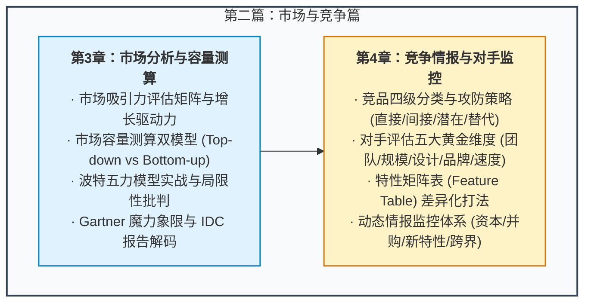

# 第二篇：市场与竞争篇 —— 站在宏观视角看机会

> “做产品绝不能‘闭门造车’。在写下任何一行产品需求之前，你必须先看清楚赛道：这个市场有多大？蛋糕在增长还是萎缩？谁在跟我们争抢用户的注意力和钱包？我们的比较优势究竟在哪里？”

---

## 篇章导读

任何一个商业产品的诞生，都不是孤立存在的实验，而是置身于极其复杂的市场与竞争生态之中：
- **市场足够大吗？** 如果赛道本身只有几百万的体量，哪怕做到垄断，也无法支撑一个高成长的商业组织；
- **增长动力在哪里？** 是人口红利、基础设施升级，还是政策与技术周期的变革？
- **谁是真正的对手？** 很多时候，杀死你的往往不是身边的同类产品，而是跨界替代品（正如智能手机的普及重创了数码相机，微信的兴起冲击了短信与通话）；
- **如何动态建立壁垒？** 怎样构建一张持续更新的“特性矩阵图（Feature Table）”，并在团队核心、规模、设计、品牌与迭代速度五个维度上拉开代差？

本篇将系统解构**市场容量测算的双模型（Top-down vs Bottom-up）**、经典战略工具**波特五力分析**在产品决策中的实战落地、**四级竞争对手分类与应对策略**，以及如何搭建一套自动化运行的**竞品情报雷达系统**。

---

## 本篇知识图谱

---

## 章节导航

- **[第 3 章：市场分析与容量测算 —— 从宏观大盘到微观切入](./03-market-analysis.md)**
  - 详述市场定义方法、驱动增长的三大动能、Top-down 与 Bottom-up 测算模型实操对比、波特五力在产品战役中的推演与 Gartner/IDC 分析报告的应用。
- **[第 4 章：全方位竞争情报与对手监控 —— 织密情报网与构筑比较优势](./04-competitive-intelligence.md)**
  - 拆解四级竞品分类与攻防战术、评估对手的五大黄金维度、Feature Table 特性矩阵构建实战，以及建立日常情报雷达系统的全套工具链。
