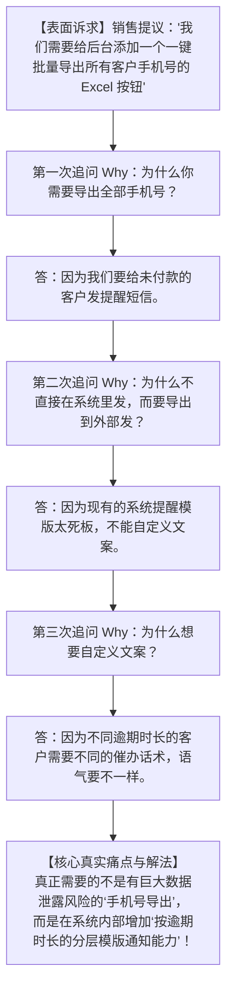
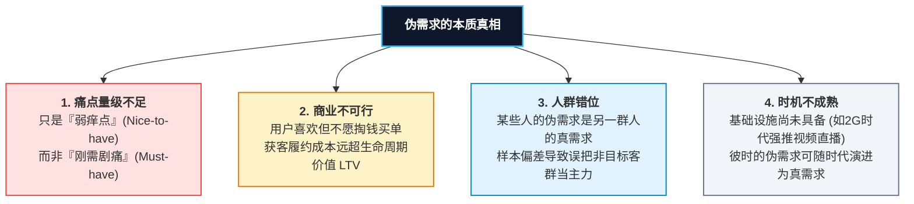
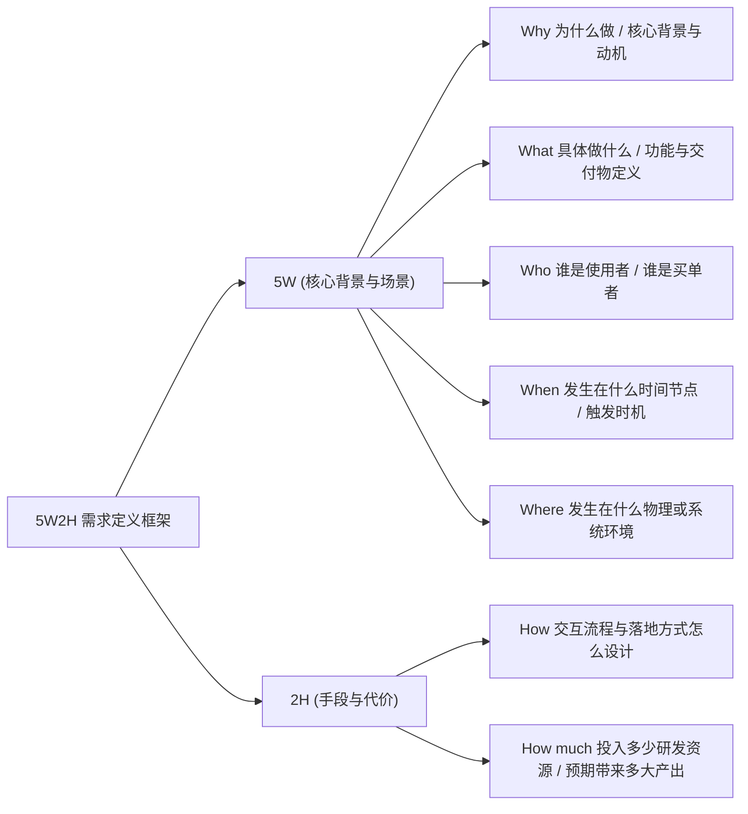
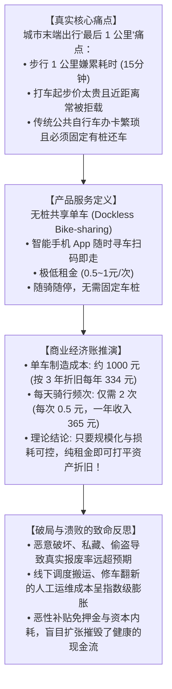

# 第 6 章：需求分析与伪需求粉碎机 —— 5 次 Why 与 OFO 实战推演

> “用户经常向你描述他们想要的‘解决方案’，而不是他们面临的‘核心问题’。亨利·福特曾说：‘如果我当年去问顾客想要什么，他们一定会告诉我：一匹更快的马。’合格的产品经理必须拥有像手术刀一样的洞察力，剖开表层的诉求，直击隐藏在背后的真实痛点。”

---

## 6.1 黄金穿透法则：连续 3~5 次追问“Why”

当用户、销售甚至老板向你提出一个功能开发请求时，直接动手开发是最轻率的做法。挖掘真实痛点最直接、最有效的方法，就是**连续追问“Why”（为什么）**：

### 追问 Why 的三大心法
1. **区分“问题（Problem）”与“方案（Solution）”**：
   需求提出者给出的往往是一个粗糙的初步方案（“我要一个按钮”）。PM 的任务是将方案还原为问题（“遇到什么阻碍”）。
2. **警惕“伪相关”与“表面因果”**：
   多问几次“为什么发生”，往往会发现根因根本不在产品功能本身，而是在业务流程规范、员工激励或操作指引的缺失。
3. **消除次生风险**：
   直接满足表面诉求，往往会引入极其严重的副作用（例如盲目导出敏感客户信息会导致法务与数据资产流失风险）。

---

## 6.2 深度剖析：“伪需求”的本质与四大判定法则

什么是伪需求？在产品圈，这个词常被滥用。根据一线长期实践，**伪需求绝不是“用户凭空胡说”**，其本质规律如下：

> [!NOTE]
> ### 💡 伪需求的核心定义
> **伪需求要么是无法找到足够规模的用户群体，要么是用户不愿意为之频繁使用或买单。俗称“无痛点（没需求）”或“弱痒点”。**  
> 伪需求并非不是用户的需求，它只是**在当前的时间、成本和商业模式约束下，不足以支撑一个正向健康的商业闭环**！

### 判定伪需求的四把刻度尺

1. **痛点强度是否达到“止痛药（Painkiller）”级别？**
   - **维生素（Vitamin）**：有了挺好，没有也完全不影响生活或工作（可替代性极强，往往沦为伪需求）。
   - **止痛药（Painkiller）**：不解决就会流血、损失收入、产生合规处罚（真实刚需）。
2. **用户是否愿意支付“代价”？**
   - 口头说“我非常想要”毫无意义。真正的真实需求，用户一定愿意付出**金钱、个人隐私让渡、学习成本或时间代价**来换取。
3. **人群规模与集中度（Market Scale）**：
   - 需求是否具备普遍性？还是仅仅是一家特定客户特立独行的非标畸形流程？如果为了 1% 的特异需求破坏了 99% 用户的标准体验，那就是伪需求。
4. **时代环境与技术时机（Timing）**：
   - 许多伟大的点子死在了错误的时间点。例如在 2000 年 PC 互联网萌芽期做在线买菜是彻底的伪需求；而在移动支付普及、冷链物流成熟的今天，它演变成了万亿赛道。

---

## 6.3 5W2H 分析法在需求定义中的标准化应用

5W2H 分析法（又称“七何分析法”）最早由美国陆军兵器修理部提出，是一种以理性、缜密和结构化著称的思考工具。产品经理在面对任何正式立项的需求时，必须完整回答以下 7 个维度：

### 5W2H 需求描述卡片标准模板

| 要素 | 核心思考提问 | 标准需求卡片示例（以“企业合同电子签署”为例） |
| :--- | :--- | :--- |
| **Why（为什么）** | 为何会有这个需求？解决什么业务痛点？ | 线下纸质合同邮寄周期长达 5~7 天，成单流失率高且邮寄成本高昂。 |
| **What（何事）** | 产品的具体功能定义与交付物是什么？ | 在系统内集成电子签章模块，支持在线生成具备法律效力的合同并完成签署。 |
| **Who（何人）** | 谁是发起者？谁是签署者？谁是管理审核者？ | 发起方为一线销售人员，签署方为外部客户企业法定代表人，内部法务拥有审核权限。 |
| **When（何时）** | 在整个业务流的哪一个节点触发？ | 客户在报价单确认无误后、生成正式订单前触发。 |
| **Where（何地）** | 涉及哪些客户端与系统交互环境？ | 销售在 PC 端 Web 控制台发起，客户在微信移动端 H5 接收短信通知并完成人脸识别签署。 |
| **How（怎么做）** | 具体的交互链路与技术落地方案是什么？ | 引入第三方合规 CA 电子认证中心 API 对接，通过短信验证码 + 人脸活体检测完成身份核验。 |
| **How much（多少）** | 投入多少成本？带来多大商业收益？ | 预估研发成本 2 人月（约 8 万元），第三方签署费用 3 元/次；预计将合同签署周期从 5 天压缩至 2 小时，年均节省邮寄与人工成本 30 万元以上。 |

---

## 6.4 经典案例复盘：以 OFO / 摩拜 为例的需求与商业模型剖析

共享单车是近年来移动互联网与物联网领域最典型的现象级产品。从最初被精英阶层质疑为“人傻钱多的资本泡沫”，到成为数亿人不可或缺的基础设施，再到最终走向资本破局与押金溃败，其全过程为产品经理提供了极其深刻的需求与商业推演教材。

### 1. 服务定义与痛点定位
- **痛点场景**：大城市地铁和公交覆盖面广，但无法延伸至毛细血管。居住地与地铁站、公司与地铁站之间的“最后 1 公里”，步行嫌慢（15分钟），打车性价比极低。
- **定位优势**：共享单车不是取代地铁和出租车，而是作为**城市公共交通系统的最后一公里补充**。相比传统有桩公共单车，首创“无桩化”彻底解放了借还场景。

### 2. 商业模式与单元经济（Unit Economics）测算
市场上最初充斥着“骑一次 5 毛钱怎么可能赚钱”的质疑。但从严谨的产品经理财务模型来看，它具备理论成立的基础：

$$\text{单车年折旧成本} = \frac{1000 \text{ 元}}{3 \text{ 年}} \approx 334 \text{ 元/年}$$

$$\text{年保本骑行收入} = 365 \text{ 天} \times 2 \text{ 次/天} \times 0.5 \text{ 元/次} = 365 \text{ 元/年} > 334 \text{ 元}$$

- **结论**：在理想状态下，一辆车只要每天被骑行 2 次，单凭微薄的租金就完全能够覆盖硬件折旧。如果叠加规模效应，供应链成本还能进一步压缩。

### 3. 为什么真实商业闭环最终崩塌？（产品与运营的深刻教训）
- **忽视了人性的弱点与公地悲剧（Tragedy of the Commons）**：
  早期 OFO 采用廉价机械锁，密码固定且极易被破解私占，损耗报废率高达 40% 以上，实际使用寿命甚至不足 6 个月。
- **隐形成本的吞噬（运维成本远超研发与制造成本）**：
  单车不会自己流动。早晚高峰潮汐效应严重，必须依赖大量卡车与人工将单车从居民区运回地铁口。**线下的调度、转运、寻修、合规罚款成本，彻底击穿了单元经济模型**。
- **产品启示**：
  **需求是千真万确的痛点，但如果产品的生命周期成本（LCC）无法被商业收益覆盖，再刚需的产品也会沦为资本的祭品。**

---

## 6.5 本章自检 Checklist

- [ ] 面对业务方提出的具体功能诉求，我是否做到了至少连续追问 3 次“Why”直到探寻到底层动机？
- [ ] 我所评估的需求，是属于刚需“止痛药”，还是可有可无的“弱痒点”？
- [ ] 目标客户群体是否真正愿意为了这项特性付出金钱、时间或注意力代价？
- [ ] 撰写需求卡片时，我是否完整覆盖了 5W2H 的全部要素，特别是量化评估了“How much”的成本收益比？
- [ ] 针对看似完美的商业逻辑，我是否充分考虑了上线后的隐性维护成本、线下执行成本与人性滥用的风险？
