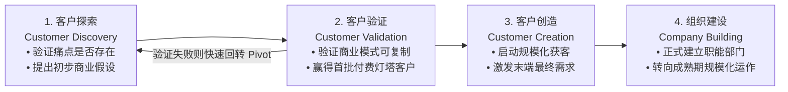
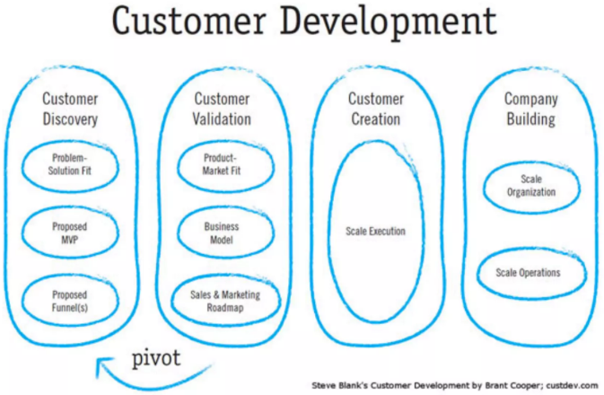
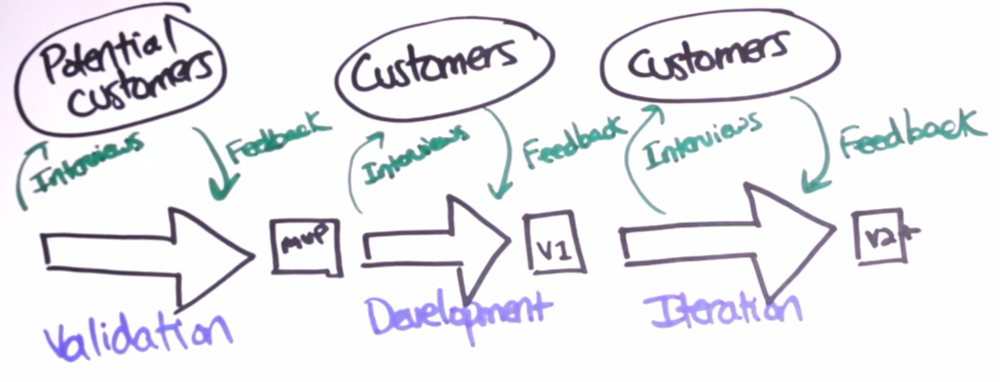
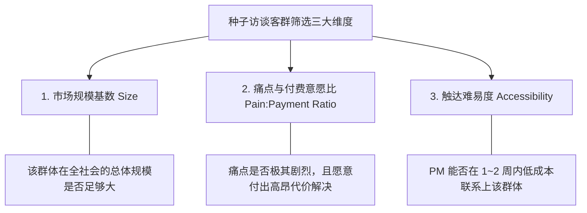
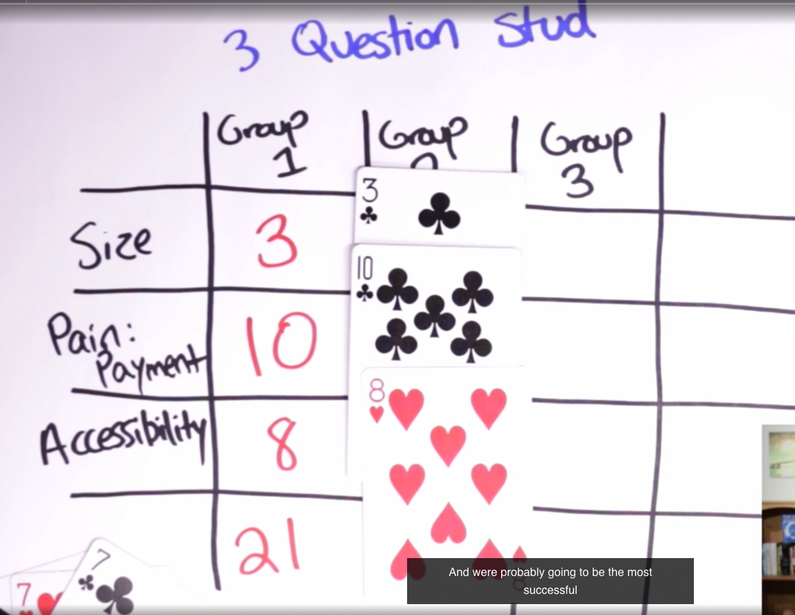
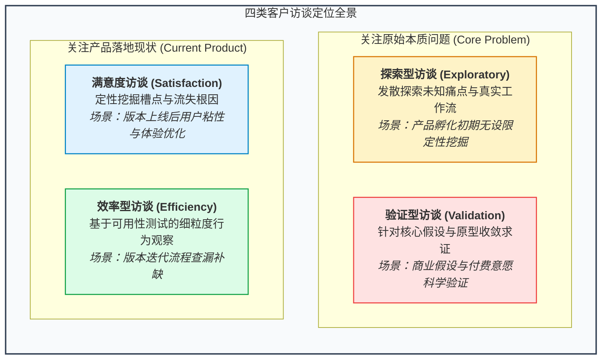
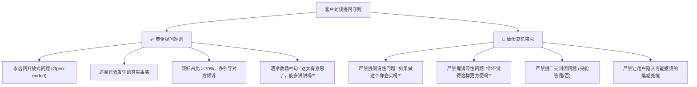
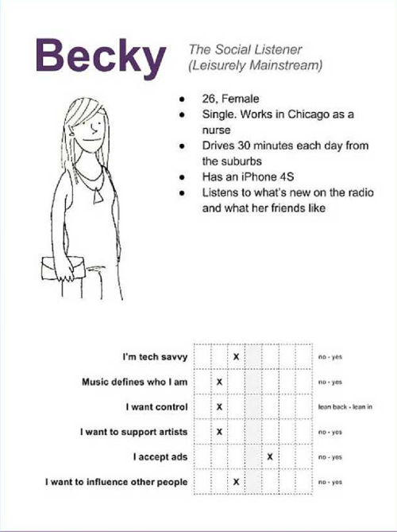

# 第 7 章：客户开发与用户访谈全流程 —— 从冷启动到精准画像

> “走出大楼！（Get out of the building!）在初创团队和新业务的办公室内部，根本不存在任何客观事实，充其量只有你和团队的主观臆想与偏见。事实只存在于大楼之外，存在于真实的客户日常场景中。”  
> —— 史蒂夫·布兰克（Steve Blank，精益客户开发理论奠基人）

---

## 7.1 客户开发模型（Customer Development）的本质

科技行业有一个残酷的统计规律：**绝大多数产品的夭折，从来不是因为研发团队写不出代码，而是因为缺乏真实买单的客户**。

多年来，企业建立了一整套成熟的软件研发流程（瀑布、敏捷、CMMI），却长期缺乏一套科学验证客户与市场的管理体系。Steve Blank 提出的客户开发模型正是为了弥补这一致命缺陷：




*图 7-1：客户开发四大核心阶段（探索、验证、创造与组织建设）*


*图 7-2：客户开发微观双环（客户访谈驱动的假设迭代闭环）*

### 产品生命周期两个阶段的客户开发差异

| 维度 | 产品诞生前（Pre-product） | 产品上线后（Post-product） |
| :--- | :--- | :--- |
| **受访者状态** | 潜在潜在目标客户，对你的品牌毫无认知。 | 现存注册或活跃客户，已有一定的信任基础。 |
| **触达难度** | **极高**。需要陌生冷启动（Cold Outreach）。 | **较低**。可通过客服聊天记录、社群、邮件列表轻松触达。 |
| **调研重心** | **痛点强度与真实度校验**（他们真有这困扰吗？）。 | **满意度、易用性、流失归因与留存障碍**。 |

---

## 7.2 评估目标访谈群体的三大黄金标准

在资源有限的情况下，产品经理绝不能“眉毛胡子一把抓”地四处拉人访谈。必须建立一个 3x3 评分模型，精准选定第一批最有价值的种子访谈对象：




*图 7-3：种子目标客群多维评分决策矩阵*

- **实操方法**：列出 3 个候选人群（如：自由职业设计师、传统外贸中小企业主、大厂初级研发）。针对每个维度打分（1~10 分），三项总分最高的人群，就是你的第一突破口！
- **最理想的画像**：**痛点极深、迫切寻找替代方案、且你能直接接触到的人（High Pain, High Willingness to Pay, High Accessibility）**。

---

## 7.3 四大类客户访谈全景与实施心法

不同产品研发阶段，所需要的访谈类型截然不同。千万不要用同一种提问方式贯穿始终：



### 1. 探索型访谈（Exploratory Interview）
- **核心目标**：纯粹挖掘未知洞察。探寻目标人群的日常工作生活习惯，看他们自发吐槽什么。
- **对话方式**：最自由开放的形式。*“能跟我讲讲你上周在处理报销时，最让你头疼的一件事是什么吗？”*
- **原则**：绝口不提你自己的产品，多让对方倒苦水。

### 2. 验证型访谈（Validation Interview）
- **核心目标**：科学检验一个既定的商业假设（Hypothesis Testing）。
- **心法**：**极度敏感于主观偏见（Hyper-sensitive to bias）**。
- **关键技巧**：在访谈的最后 5 分钟之前，绝不能透露你的解法。先引导对方谈论该场景，看对方是否会**主动提及该痛点**；如果对方从头到尾都没觉得这是个事，说明你的假设彻底落空。

### 3. 满意度访谈（Satisfaction Interview）
- **核心目标**：找出产品哪些地方做得好，哪些地方做得极差。
- **经典提问**：*“如果明天我们关闭了这项功能，你的工作会受到多大影响？”*、*“为了让你的体验更好，我们最应该停止做什么？”*
- **建议**：最好由第三方用研人员或非主创 PM 实施，因为用户面对产品创造者本人往往会礼貌性地夸大满意度。

### 4. 效率型访谈（Efficiency Interview）
- **核心目标**：探寻人机交互中的摩擦点与认知阻碍。
- **观察模式**：不要只是听他说，而是**看他操作（可用性测试）**。*“假设你想把这个报表分享给你的财务同事，你现在在界面上会点哪里？”*

---

## 7.4 访谈提问的黄金守则与高危禁忌

好的提问能还原客观真相，坏的提问会制造虚假繁荣：



> [!CAUTION]
> ### 🛑 为什么严禁问假设性问题（Hypothetical Questions）？
> 问用户：*“如果我们做了一个按月付费自动备份功能，你每个月愿意付 20 块钱吗？”*  
> 90% 的用户都会轻描淡写地回答：*“会啊，挺好的。”*  
> **真相是：人类根本无法预测自己在未来虚拟情境下的真实行为。在没有真实掏出信用卡的那一刻，所有的口头承诺都是廉价的客套话。**  
> 正确的问法是追溯过去事实：*“在过去的六个月里，你的数据丢失过吗？当时造成了多大损失？你曾经花钱买过任何备份硬盘或云盘会员吗？花了多少钱？”*

---

## 7.5 访谈邀约实战技巧与高转化邮件模板

如果你在产品冷启动期给陌生潜在用户发冷邮件（Cold Outreach），响应率往往低于 10%。如何编写一封让对方愿意抽出 15 分钟畅谈的邀约信？

### 邀约信三大铁律
1. **短小精悍（Be Short）**：正文必须严格控制在 4~7 句话以内。没有人会阅读陌生人发来的长篇大论。
2. **极具个人感（Be Personal）**：必须有一句话证明你认真研究过他的背景（如提及其博客的一篇文章、在某社区的具体求助帖），严禁群发模版套话。
3. **提供价值与尊重，申明非销售（Be Valuable & Not Sales）**：明确说明“我不是销售，我是产品研发，我想解决困扰你的问题，并向你请教”。

### 实战邀约邮件模板（中英双语版）

```markdown
主题：关于 [您提到的具体痛点/工具体验] 的一点请教与交流

[对方姓名] 您好：

我在 [具体来源，如：V2EX/小红书/知乎] 上拜读了您关于 [具体业务场景/痛点] 的分享，您对 [某个细节] 的洞察让我深受启发。

我目前正在负责一个专注于解决 [该具体痛点] 的工具研发（我不是销售人员，不推销任何产品）。我们发现许多像您一样优秀的 [职业/角色] 都在饱受该流程低效的困扰，因此特别希望向您深度请教真实的使用痛点。

不知本周三或周四上午 10:30，您是否有空进行一个 10~15 分钟的线上简短连线？为感谢您的专业时间，我们非常乐意为您提供 [特定行业报告 / 咖啡券 / 终身内测特权]。

期待您的回复，祝工作顺意！

[你的名字]
[产品经理 / 团队身份]
```

---

## 7.6 构建精准的用户画像（User Persona）

在完成了 15~20 场深度访谈之后，产品经理必须将散落在各处的定性信息进行结构化萃取，凝聚为 1~2 个具象的**用户画像（User Persona）**：


*图 7-4：标准产品用户画像（User Persona）模板构成*

### 用户画像的四个核心构建模块

1. **基本身份与标签（Identity & Demographics）**：
   - 虚构姓名、年龄、职业头衔、年薪范围、家庭状况与一张具有代入感的照片插画。
2. **核心目标与愿望（Goals & Motivations）**：
   - 他在当前岗位上最渴望达成的成果是什么？他想在同事面前证明什么？
3. **核心挫败感与阻碍（Frustrations & Pain Points）**：
   - 每天最让他耗费心力、感到沮丧的具体事件是什么？现有替代方案的致命缺陷是什么？
4. **决策习惯与媒介触点（Behavior & Media Channels）**：
   - 他最常使用哪些软硬件工具？从哪里获取行业新资讯？谁能影响他的采购与使用决策？

> [!TIP]
> **画像的真正用途**：用户画像不是用来贴在会议室墙上当装饰的。它的核心价值在于**凝聚共识、消除分歧**。在后续团队发生特性争论时，大家不再争论“我觉得如何”，而是问：*“我们设定的典型用户‘老张’在处理紧急出差时，他真的会用这个复杂的多级折叠菜单吗？”*

---

## 7.7 本章自检 Checklist

- [ ] 在团队启动研发之前，我是否真正做到了“走出大楼”，面对面访谈了至少 10 位真实目标客户？
- [ ] 在客户访谈过程中，我的发言倾听比例是否做到了倾听占 70% 以上，克制住了自夸产品方案的冲动？
- [ ] 我的访谈提问中，是否彻底杜绝了“如果有了这个功能，你会不会用”这类的误导性假设问题？
- [ ] 针对冷启动阶段的受访者触达，我的邀约信息是否短小、真诚、个性化且明确申明了“非销售”属性？
- [ ] 团队是否建立了清晰、统一的用户画像（Persona），并在日常产品评审中用其作为体验裁决的核心参照物？
