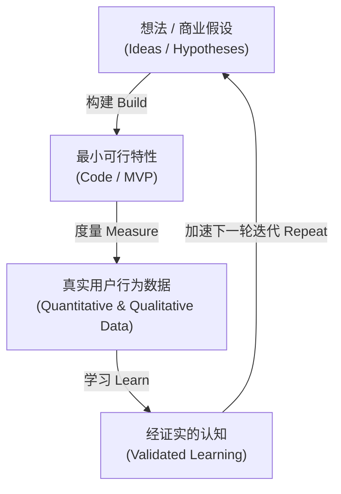
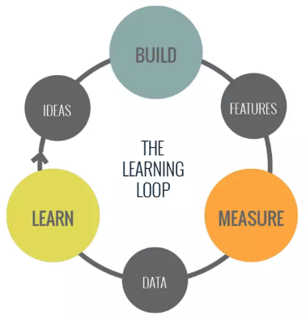
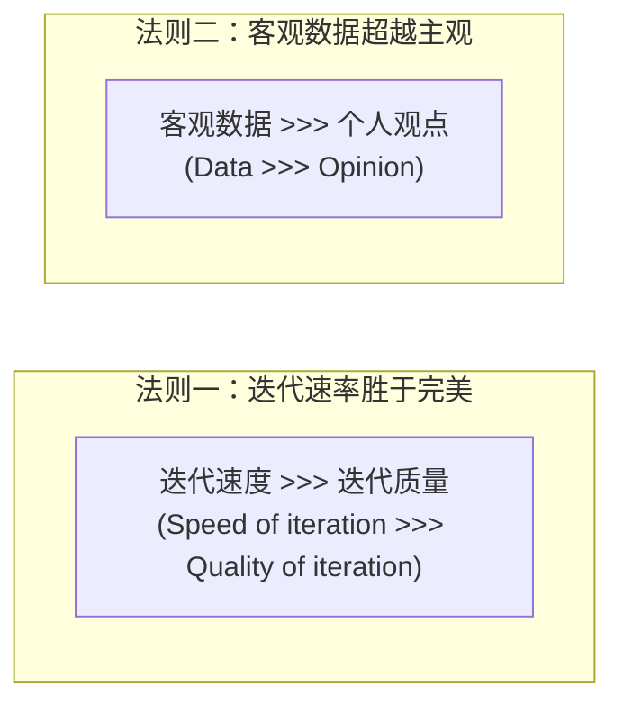
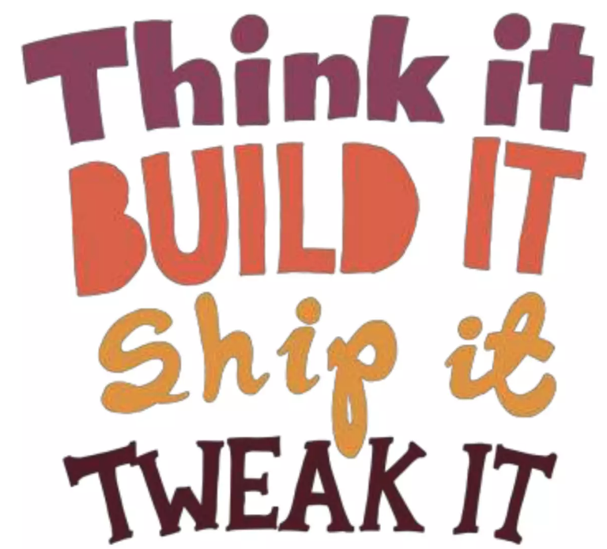
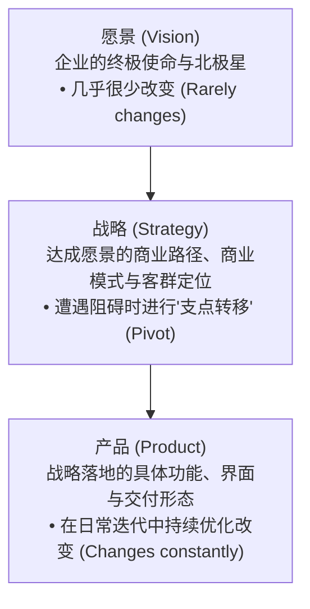
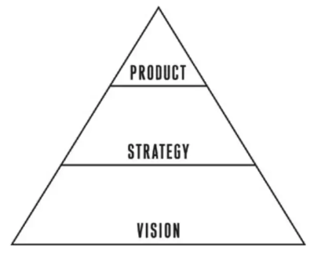
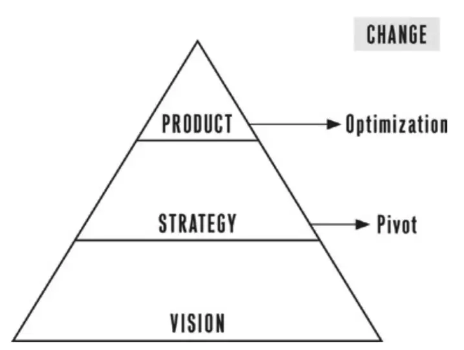
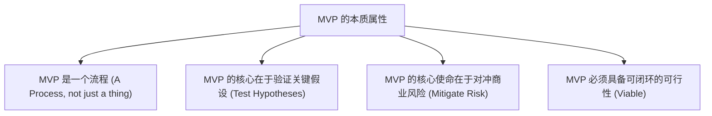

# 第 8 章：精益思维与 MVP 哲学 —— 速度、认知与战略支点

> “传统企业死于缺乏执行力，而科技创新往往死于‘高效地生产出了完全没人要的东西’。精益创业不是教你偷工减料，而是教你如何用最科学、最经济的手段，快速获取‘经证实的认知（Validated Learning）’。”

---

## 8.1 精益创业的核心哲学：构建-度量-学习循环

在传统的工业时代，生产一款汽车或一台电视机需要严格的流水线、漫长的开模和层层验收；但在软件与数字服务时代，需求与市场的变化以周甚至以天为单位演进。

硅谷创业家埃里克·莱斯（Eric Ries）在《精益创业》中指出：
> **创业团队的根本使命，是以尽可能快的速度搞清楚‘到底什么是客户真正想要且愿意买单的正确产品’。**

实现这一使命的核心引擎，就是**构建 - 度量 - 学习（Build - Measure - Learn）循环**：

*图 8-1：精益反馈回路（构建、度量、学习的飞轮运转）*

### 什么是“经证实的认知”（Validated Learning）？
很多团队在季度复盘时会汇报：“我们这个季度上线了 15 个功能，写了 3 万行代码，开了 20 次评审会。”但这只是**产出（Output）**，而不是**认知（Outcome）**。

> [!NOTE]
> **经证实的认知**：是指团队通过严密的、可量化实证的实验，客观证明或证伪了某条关乎产品商业未来的核心假设。  
> 哪怕实验结果证明“用户根本不需要这个功能，转化率为 0%”，只要该结论阻止了团队在未来半年浪费数百万研发资金去盲目推进，这同样是一次**极具价值的经证实的认知**！

---

## 8.2 精益双法则：速度与数据的辩证关系

在精益产品管理的日常实践中，有两条必须刻进每一位产品经理 DNA 的黄金法则：

*图 8-2：速度与数据的象限博弈*

### 为什么说“速度”与“数据”缺一不可？
1. **拥有速度却缺乏数据（Speed without data）**：
   意味着团队在闭着眼睛狂奔。代码发布得极快，每天发版两次，但从不埋点、从不看转化漏斗、从不与用户深度交流。你发布得越快，在错误方向上死得越快，**你根本没有学到任何东西**。
2. **拥有数据却缺乏速度（Data without speed）**：
   团队拥有极其完善的报表，每天花数小时开会分析指标波动，但设计一个改动需要审批三个月，上线一个 A/B 测试需要排期半年。**你学习得太慢，竞争对手早已在更快的迭代中占领了市场**。
3. **精益的最优状态（Speed with Data）**：
   以最高频次将最小可测的改动推向真实用户，在第一时间内通过客观指标观察反馈，并据此决定下一步走向。

---

## 8.3 愿景、战略与战略支点（Pivot）

一个产品的存在，由三个由深至浅的层级构成：**愿景（Vision）**、**战略（Strategy）** 与 **产品（Product）**。

*图 8-3：愿景、战略与产品的分层金字塔*

*图 8-4：战略支点（Pivot）——一只脚立足已有认知，另一只脚迈向新方向*

### 什么是战略支点（Pivot）？
- **产品的日常调整（Optimization）**：改版按钮颜色、重构登录流程、增加快捷筛选。这只是战术层面的小修小补。
- **战略支点（Pivot，转型）**：当现有的商业假设被彻底推翻、产品遭遇增长天花板时，团队**在坚守原有核心愿景的前提下，彻底改变商业策略或目标客群**。
  - *典型案例*：
    - **Slack** 最初是一家大型在线游戏公司内部开发的聊天工具。游戏失败后，团队敏锐地发现企业内部沟通工具的痛点，迅速 Pivot 转型为独立的企业协同软件；
    - **YouTube** 最初是一个视频在线约会相亲网站，在发现用户极度渴望自由上传生活日常视频后，果断 Pivot 为全品类视频分享平台。

---

## 8.4 重新定义 MVP：它不仅是一个东西，更是一个过程

对于“最小可行产品（Minimum Viable Product, MVP）”，业界存在广泛的误解：
- 误解 1：*“MVP 就是一个极其粗糙、充斥着 Bug 的半成品原型。”*
- 误解 2：*“MVP 是功能列表的缩减版（V1.0 去掉一半功能就是 MVP）。”*

### MVP 的严谨定义
> **MVP 是能够让团队‘以最少的人力、最小的资源投入，完成一轮完整的构建-度量-学习循环，并最大化获取经证实的认知’的最小产品载体。**

- **不是砍掉质量，而是缩小范围**：MVP 必须能完整跑通某一个核心价值闭环。如果一个产品宣传能解决代客泊车问题，哪怕它后台是人工手动的，用户在前端也必须能真正享受到车被安全停好的结果。
- **MVP 是对冲风险的工具**：如果一个想法被证明是行不通的，MVP 能确保团队只损失了两周的调研工时，而不是两年的研发薪酬与机会成本。

---

## 8.5 初创企业 vs 成熟大厂做 MVP 的思维差异

初创企业与成熟大型集团在推行 MVP 实验时，由于资源禀赋与品牌承受力不同，其策略存在显著差异：

| 维度 | 初创企业（Startups） | 成熟大厂（Established Enterprises） |
| :--- | :--- | :--- |
| **风险承受力** | **业务生存风险极高，品牌顾虑几乎为零。** 没有人认识你，发错版无人苛责。 | **品牌声誉风险极高，资源垫子厚（High Cushion）。** 一次劣质体验可能引发公关危机。 |
| **实验风格** | **Scrappy（野蛮生长、不拘小节）。** 怎么快怎么来，哪怕用手工表格和人工代发。 | **谨慎严密，灰度受控。** 必须经过法务审查、安全审计与白名单灰度测试。 |
| **实验位置** | 围绕公司生死存亡的**主核心业务**展开。 | 往往在**远离核心营收主线的探索性边缘业务**展开（如谷歌的 Google Glass、X 实验室项目）。即使探索失败，也绝不会动摇企业基本盘。 |

---

## 8.6 本章自检 Checklist

- [ ] 我们当前正在规划的“MVP”，是一个真正能在 1~2 周内跑通闭环的最小实验，还是一个被包装成 MVP 的臃肿 V1.0？
- [ ] 团队是否明确了本次实验希望获取的“经证实的认知”（Validated Learning）究竟是什么？
- [ ] 我们是否为即将上线的实验配置了客观的数据采集埋点，避免陷入“拥有速度却没有数据”的盲目自嗨？
- [ ] 当实验数据与预期产生巨大差距时，我们是否做好了在战略层面进行“支点转型（Pivot）”的心理准备，而不是固执地继续空耗资源？
- [ ] 针对我们所处的企业阶段（初创 vs 大厂），我们的 MVP 实验是否充分平衡了迭代速度与品牌合规风险？
