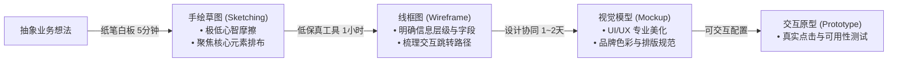
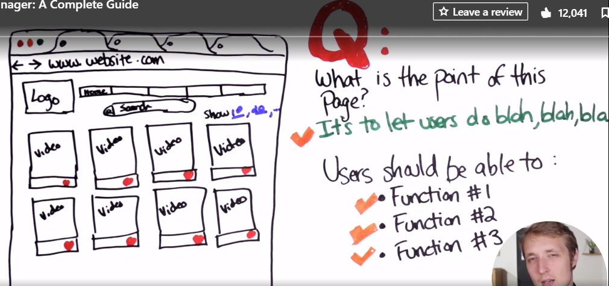
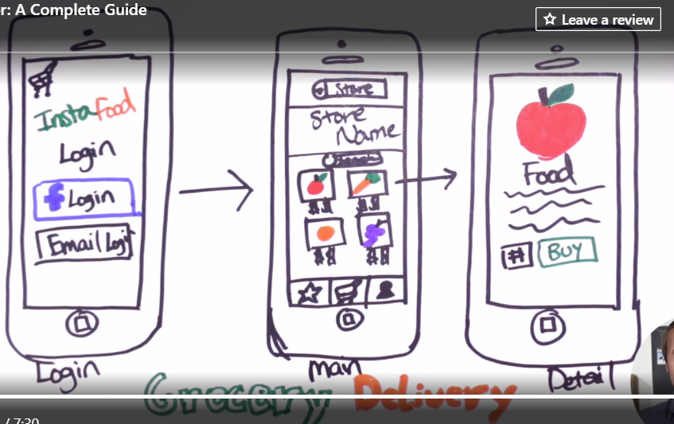
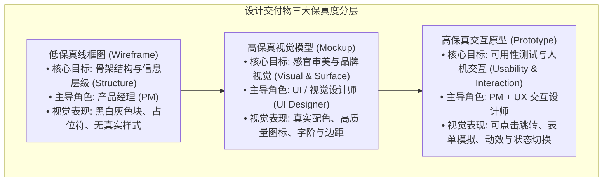
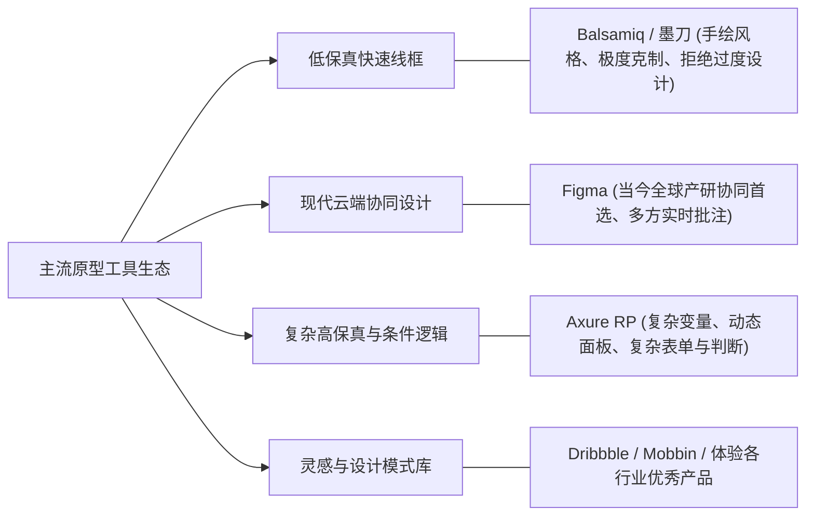

# 第 11 章：原型设计与概念可视化 —— Wireframe, Mockup 到 Prototype

> “一图胜千言。对于抽象复杂的商业逻辑与交互逻辑而言，一份几十页满是文字的文档，往往不及一张清晰的线框图和可点击的原型来得直接。但产品经理切忌‘越俎代庖’，你的核心职责是定义信息架构与业务流向，而不是代替设计师去调色盘里纠结配色。”

---

## 11.1 从手绘草图（Sketching）开始：低成本构思的威力

在打开任何昂贵、复杂的专业设计软件之前，最优秀的产品经理往往会拿起一张白纸和一支黑色签字笔，或者站在白板面前。

*图 11-1：从纸笔手绘草图快速捕捉产品灵感*

*图 11-2：移动端界面布局的手绘推演*

### 为什么纸笔草图依然不可替代？
1. **消除软件工具的摩擦阻碍**：
   在电脑软件中，人们很容易被“对齐辅助线”、“圆角半径设置”、“字体大小”分散注意力，而在白纸上，你的大脑百分之百聚焦在**“核心元素是什么、用户的眼睛先看哪里、下一步点击哪里”**。
2. **极低的沉没成本带来真正的推翻自由**：
   花了 3 个小时在 Axure 里画的原型，即便发现逻辑有硬伤，人也会本能地抗拒推倒重来；而在纸上画了 3 分钟的草图，揉成纸团扔进垃圾桶毫无心理负担。

---

## 11.2 三大保真度分层：Wireframe, Mockup 与 Prototype

在产研团队协作中，经常有人将线框图、效果图和原型混为一谈。事实上，三者在设计目标、保真度（Fidelity）与主导角色上有着森严的界限：

### 三大产出物核心差异对照表

| 维度 | 低保真线框图（Wireframe） | 视觉模型（Mockup） | 可交互原型（Prototype） |
| :--- | :--- | :--- | :--- |
| **关注核心** | **内容骨架与业务流向**。 界面有哪些核心字段？按钮放在哪里？ | **视觉美感与品牌一致性**。 界面好不好看？是否符合设计规范？ | **动态交互与可用性体验**。 流程顺不顺畅？异常状态如何反馈？ |
| **保真度** | 低保真（Low Fidelity），纯线条与灰度块。 | 高保真静态（High Fidelity Static）。 | 高保真动态（High Fidelity Interactive）。 |
| **主要用途** | 团队早期对齐功能范畴、梳理逻辑、PRD 配图。 | 视觉定稿、向高管与客户做视觉演示。 | 内部产品评审、开发前可用性测试、用户访谈路演。 |
| **主导角色** | **产品经理（PM）必须百分之百掌控。** | UI / 视觉设计师主导，PM 辅助把关。 | PM 与 UX 交互设计师深度协同。 |

---

## 11.3 主流原型工具生态全景

工欲善其事，必先利其器。根据不同的阶段目标，选择最趁手的兵刃：

1. **Balsamiq（低保真线框图神兵）**：
   - 特色是“手绘涂鸦风”。它刻意限制了用户使用花哨颜色和高级字体的能力，逼迫产品经理将全部注意力放在**“业务信息架构与布局”**上，是防止过早陷入视觉细节的最佳工具。
2. **Figma（现代产研云端协同霸主）**：
   - 彻底改变了产研协作范式。PM、设计师与工程师同在一个画布上，支持设计组件库共享、像素级标注查看与实时评论沟通。
3. **Axure RP（复杂逻辑与中后台重型武器）**：
   - 在处理拥有复杂中继器表格、多级联动下拉、动态权限判断的中后台系统时，Axure 的条件逻辑与状态机依然具备极强的生命力。

---

## 11.4 产品经理在原型阶段的健康边界与守则

很多新人产品经理常犯两个极端错误：要么画出的线框图只有粗制滥造的几个方框，研发完全不知所云；要么花三整天时间把原型调得跟真实 App 一模一样，甚至自己去挑渐变色与阴影。

> [!CAUTION]
> ### 🛑 产品经理原型设计的四大天条
> 1. **严禁越俎代庖替代设计师**：
>    PM 的核心是功能（Function），而不是形式（Form）。告诉设计师“这里需要向用户警示账户余额不足”，而不是命令设计师“这里必须用 #FF0000 红色加粗并闪烁”。
> 2. **重点展示异常状态与边界条件（Edge Cases）**：
>    平庸的原型只画“理想状态（Happy Path）”；优秀的原型会详尽标注：**加载中（Loading）、空数据（Empty State）、网络错误（Offline）、超长文字截断、操作失败报错**。
> 3. **保持流程图（Flowchart）与原型相互映照**：
>    页面不是孤立的岛屿。必须在原型旁边附带全局业务流程图，让技术架构师一眼看清数据从哪里来、到哪里去。
> 4. **拿原型当沟通媒介，而非炫技艺术品**：
>    原型的唯一目的，是以最低成本让研发、设计和测试达成 100% 的共识。

---

## 11.5 本章自检 Checklist

- [ ] 在开启正式工具画图之前，我是否至少在白板或纸面上完成了一轮快速手绘草图推演？
- [ ] 我所提交的原型，是否清楚地区分了“低保真线框图”与“高保真视觉”，没有陷入为颜色和视觉纠结的死胡同？
- [ ] 我的线框图中，是否不仅覆盖了顺畅的理想路径，还完整覆盖了空状态、错误状态与弱网加载等极端场景？
- [ ] 我是否给 UI/UX 设计师留下了充分的专业创作自由度，做到了“只提体验目标与规则，不限视觉解法”？
- [ ] 研发与测试团队在审阅我的原型时，能否无需过多口头解释，仅凭线框图与批注即可准确理解 90% 以上的业务流程？
