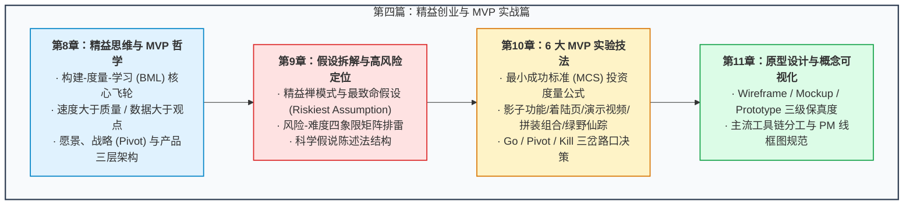

# 第四篇：精益创业与 MVP 实战篇 —— 用最小代价验证商业假设

> “软件工程领域最大的风险，从来不是‘我们能不能把它做出来’，而是‘我们辛辛苦苦花了大半年把它做出来后，却发现根本没有人需要它’。精益的精髓，在于用最少的时间、最小的资源消耗，完成一轮完整的认知闭环。”

---

## 篇章导读

在传统研发理念中，许多团队习惯于“大干快上”：关起门来憋大招，规划长达 6 个月甚至 1 年的庞大版本，试图在第一天就把系统做得很完美。然而在市场剧烈变动的时代，这种做法的试错成本极其致命。

精益创业（The Lean Startup）彻底颠覆了这种瀑布式思维：
- **迭代速度远重于迭代质量**（Speed of iteration >>> Quality of iteration）；
- **客观数据远胜于个人主观观点**（Data >>> Opinion）；
- 没有数据的速度是在盲目狂奔，而没有速度的数据则是在原地等死。

本篇将带领大家深度拆解**精益循环（构建-度量-学习）**的底层运转机制、如何在立项之初进入“精益禅模式”挖掘**最致命假设（Riskiest Assumption）**、掌握**风险-难度四象限**与假说陈述法、实战演练**6 大经典 MVP 验证打法**（从邮件、影子按钮、404落地页，到 Dropbox 视频演示与绿野仙踪），并建立产品概念从**手绘草图到低保真线框图（Wireframe）与可交互原型（Prototype）**的工业化落地流程。

---

## 本篇知识图谱

---

## 章节导航

- **[第 8 章：精益思维与 MVP 哲学 —— 速度、认知与战略支点](./08-lean-mindset-and-mvp-philosophy.md)**
  - 剖析构建-度量-学习循环、迭代速度与数据驱动的辩证关系、愿景/战略/支点三层模型，以及初创与成熟企业做 MVP 的风险考量。
- **[第 9 章：假设拆解与高风险定位 —— 风险-难度四象限与科学假说](./09-identifying-assumptions-and-hypotheses.md)**
  - 详解精益禅模式、全量假设梳理、以智能泊车（Zirx）为例的最致命假设定位，以及“风险-难度”四象限打法与假说编写公式。
- **[第 10 章：MVP 实验的 6 大实战技法与落地 —— 极简验证与成功阈值](./10-mvp-experiment-techniques.md)**
  - 测算最小成功标准（MCS）与投入产出比，深度剖析邮件、影子按钮、404预售页、演示视频、拼装组合与绿野仙踪等 6 类战法的实操细节。
- **[第 11 章：原型设计与概念可视化 —— Wireframe, Mockup 到 Prototype](./11-prototyping-and-wireframing.md)**
  - 厘清线框图、模型与原型的界限与分工，从纸面草图到高保真交互原型的工具链推荐，以及 PM 在原型设计中的边界守则。
