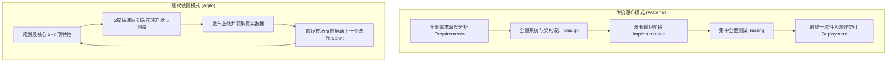
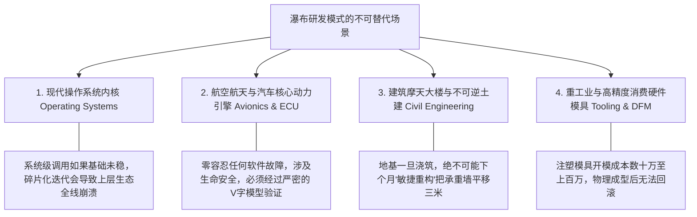
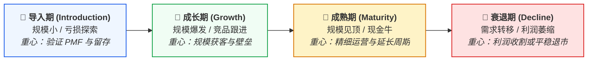
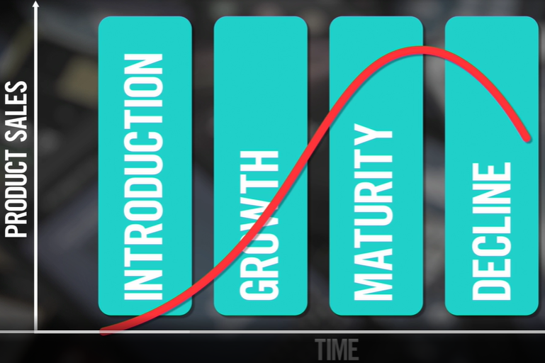

# 第 12 章：研发模式对比：敏捷 vs 瀑布与产品生命周期

> “敏捷不是一种玄学仪式，而是精益思想在软件工程中的具体映射。在数字化浪潮中，我们崇尚敏捷的小步快跑；但在物理硬件与不可逆系统工程中，严密的阶段性瀑布依然不可替代。优秀的产品经理从不搞教条主义，而是根据业务物理规律选择最匹配的研发范式。”

---

## 12.1 敏捷（Agile）与瀑布（Waterfall）的本质对立

在软件开发的历史演进中，敏捷与瀑布代表着两种截然相反的哲学世界观：

### 两种模式的核心维度对照

| 维度 | 敏捷研发模式（Agile） | 传统瀑布模式（Waterfall） |
| :--- | :--- | :--- |
| **交付批次** | **小批量切片（Small Batches）**，两周一个可工作的增量。 | **大批量集中（Big Bang）**，数月甚至数年后一次性交付全部功能。 |
| **变更成本** | 拥抱变化，每个 Sprint 结束后皆可根据数据调整优先级。 | 变更成本极高，后期推翻早期设计会导致整个项目灾难性返工。 |
| **市场风险** | **极低**。用最小代码快速接触真实用户，及时排雷止损。 | **极高**。在漫长的关门研发期，外部竞品可能已占领市场，或需求已发生代际转移。 |
| **团队协同** | 跨职能小团队（PM、设计、研发、测试）每日紧密站立协同。 | 跨部门接力棒式流水线（文档评审完交设计，设计完交开发）。 |

---

## 12.2 瀑布模式何时依然不可替代？

在现代互联网与 SaaS 圈子中，“瀑布模式”常被当成落后、臃肿的代名词。但这是一种极其片面的偏见。在以下物理与工程场景中，瀑布模式依然是唯一科学严谨的选择：

### 真实案例对比
- **敏捷软件开发场景**：
  在网易云音乐或 Spotify 中开发“歌单创建”功能。团队无需在第一天就做好智能推荐算法、社交分享、歌词动效。产品经理画出最简线框图，研发建立简单的多对多数据表，上线基础的“创建歌单并添加歌曲”功能，收集用户自发组织歌曲的习惯，下一期再迭代“一键导入”或“封面智能匹配”。
- **瀑布重工程场景**：
  研发特斯拉的刹车线控系统，或中国移动的底层海底光缆铺设。你不可能“先铺设 5% 的光缆到太平洋中间看看用户反响”。它必须经过前期长达数年的严密水文测算、资质审批与工程推演，按部就班地完成每一个工程节点。

---

## 12.3 产品的四阶段生命周期与退市管理

任何一款产品或特定功能，都无法逃脱由生到死的物理宿命。产品经理必须清楚地意识到当前产品所处的生命周期阶段：

*图 12-1：产品全生命周期各阶段关键特征与战略重心的系统对比*

### 生命周期四阶段与产品经理的战略重心

1. **导入期（Introduction）**：
   - **市场特征**：刚刚推向市场，公众认知度极低，没有或仅有极少直接竞争对手。企业持续投入研发，由于获客成本高、规模小，整体处于亏损状态。
   - **PM 重心**：极度关注**产品市场契合度（PMF - Product Market Fit）**与种子用户的深度定性反馈，快速打磨最小闭环，不盲目追求虚假的大规模投放。
2. **成长期（Growth）**：
   - **市场特征**：被主流大众市场接受，用户量与营收呈现陡峭的指数级增长。资本与追随竞争对手开始大举涌入赛道。
   - **PM 重心**：快速优化核心体验、提升系统高并发稳定性、构筑差异化护城河与网络效应，全力抢占核心渠道。
3. **成熟期（Maturity）**：
   - **市场特征**：销售额与用户规模达到顶峰，增长放缓。市场上竞品林立，同质化严重，市场进入残酷的存量争夺。
   - **PM 重心**：从粗放式拉新转向**精细化留存与变现（ARPU 提升、成本压降、LTV 挖掘）**。警惕盲目堆砌多余功能成为臃肿的垃圾产品。
4. **衰退期（Decline）**：
   - **市场特征**：新技术或替代品崛起，用户不可逆地流失，产品沦为维护成本高昂的鸡肋。
   - **PM 重心**：理性开展数据评估。若已无法支撑企业战略，必须果断启动**“退市与日落流程（Sun-setting Process）”**。

> [!CAUTION]
> ### 🌅 优雅退市：如何平稳执行“日落流程”（Sun-setting）？
> 很多平庸团队关停产品时极其粗暴，直接拔网线发公告，导致核心老用户群情激愤、品牌声誉遭遇重创。  
> 规范的日落流程包括：
> 1. **提前 3~6 个月发布正式退市时间表**，停止新用户注册与付费充值；
> 2. **提供完备的数据一键导出与迁移工具**，甚至协助大客户无缝迁移至生态合作伙伴产品；
> 3. **依法依规执行退款通道与押金原路返还**；
> 4. **妥善归档数据并进行合规销毁**，保护用户隐私资产。

---

## 12.4 本章自检 Checklist

- [ ] 针对我们团队当前的业务形态，我们采用敏捷模式是否真正做到了“两周交付一个可工作闭环”，还是只是披着敏捷外衣的“迷你瀑布”？
- [ ] 如果我们的产品涉及底层硬件开模或关键合规资质，我是否做到了尊重物理规律，在关键节点上执行了严密的阶段性前置审查？
- [ ] 我所负责的产品或特性，当前处于生命周期的哪一个阶段（导入、成长、成熟还是衰退）？我的 KPI 是否与该阶段的战略重心精准匹配？
- [ ] 面对成熟期增长乏力的业务，我是靠无脑堆砌鸡肋功能制造虚假政绩，还是在主动深耕留存率与单客价值？
- [ ] 面对已经步入衰退期的老旧模块，团队是否建立了平稳的日落流程（Sun-setting）预案，保护用户资产与品牌信任？
