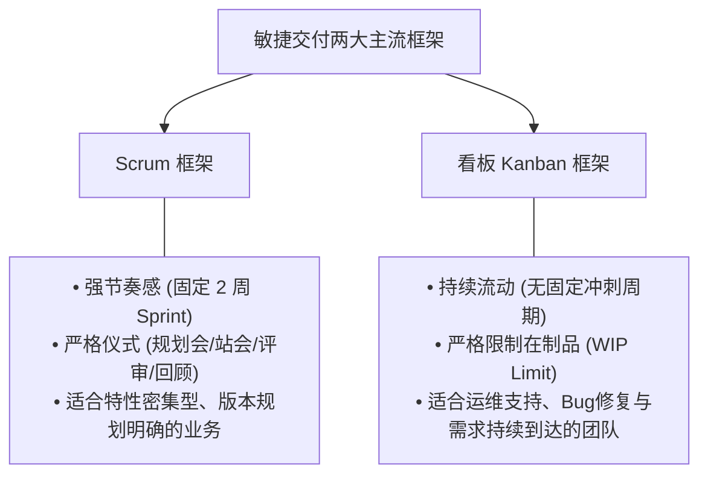
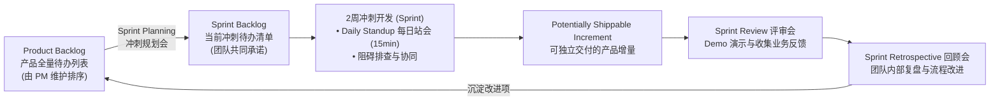
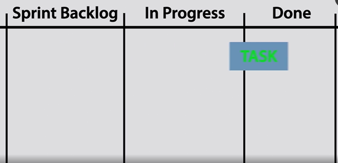
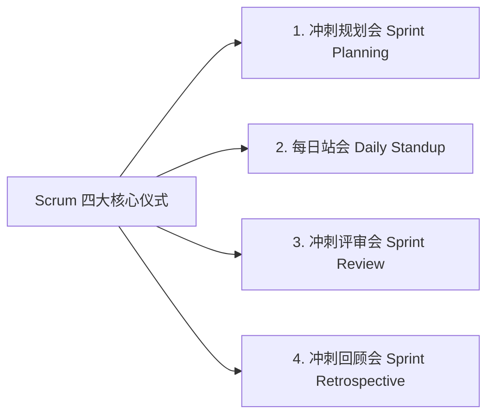
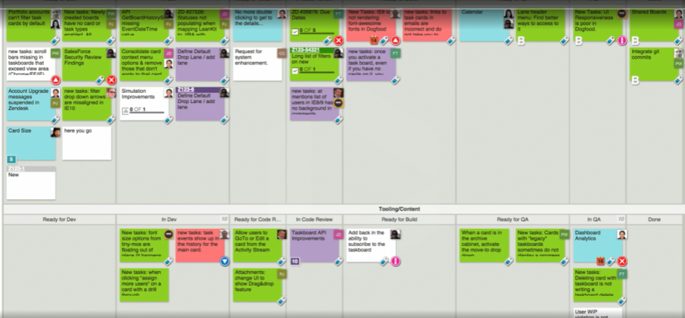
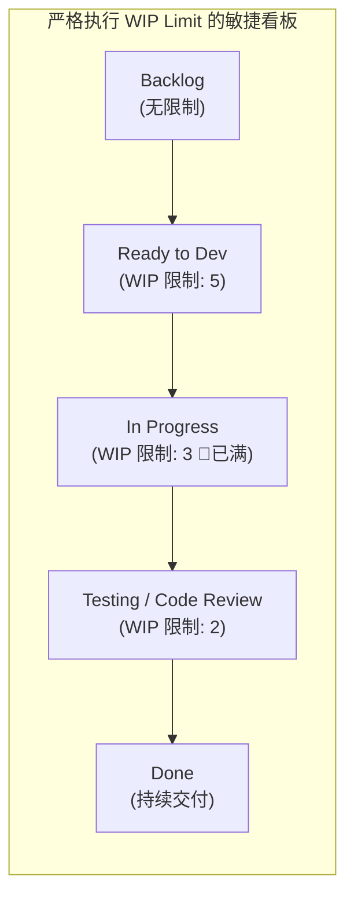
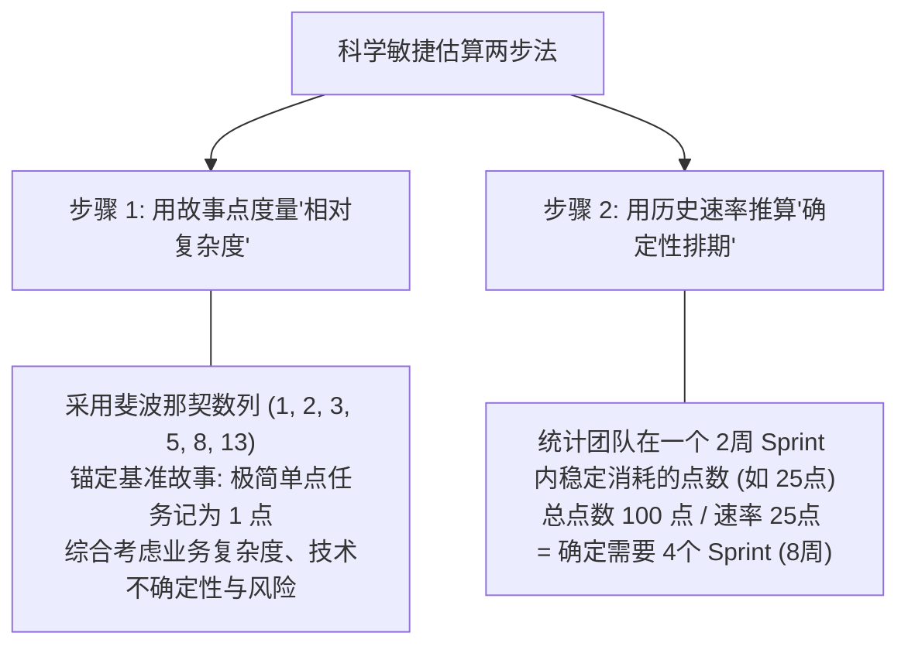

# 第 13 章：Scrum 与看板（Kanban）实战指南 —— 仪式、速率与在制品限制

> “许多团队宣称自己在做敏捷，但他们的敏捷往往只是：每天早上花半小时毫无重点地报流水账，每个两周加班熬夜赶一版充斥着 Bug 的发布，然后下一轮接着循环。没有在制品限制的看板只是无意义的便签纸，缺乏回顾改进的 Scrum 只是变相的工时催逼。”

---

## 13.1 敏捷双雄：Scrum 与看板（Kanban）的选型认知

在敏捷世界中，**Scrum** 与 **看板（Kanban）** 是应用最广泛的两大落地框架。它们并不是非此即彼的对立关系，而是适合不同业务节奏的协同引擎：

---

## 13.2 Scrum 深度实战：物件、仪式与角色运作

Scrum 通过严密的节奏律动，帮助跨职能团队将混沌的需求转化为有序、高质量的代码产出：

*图 13-1：Scrum 冲刺卡片在列状态间的流动（To do -> In progress -> Done）*

### 1. 核心物件（Artifacts）的分工与权责
- **Product Backlog（产品待办列表）**：
  - **唯一责任人**：**产品经理（PM / Product Owner）**。
  - **特征**：动态、持续演进。存放全量未开始的需求、缺陷与技术债务，严格自上而下按商业优先级排序。
- **Sprint Backlog（冲刺待办列表）**：
  - **唯一责任人**：**开发团队（Developers）**。
  - **特征**：在冲刺规划会上，团队根据历史交付速率从 Product Backlog 顶部拉取的一组任务。**一旦 Sprint 启动，外部严禁随意插入新需求**。
- **Increment（可工作增量）**：
  - 每一个 Sprint 结束时，代码必须达到**“潜在可发布状态”（Done）**，绝不接受“代码写完了但没自测、不能跑”的假半成品。

### 2. 四大仪式实操与避坑指南

*图 13-2：高效站会的核心是全员站立、保持简练、快速排雷*

#### 冲刺规划会（Sprint Planning）：2 周周期为黄金标准
- **会议时长**：两周一个 Sprint，规划会控制在 2 小时以内。
- **会议三大输出**：
  1. **Why（冲刺目标）**：用一句话提炼本期核心主题（例如：“完成海外信用卡在线支付闭环”）；
  2. **What（拉入哪些需求）**：讨论选中的 User Stories，确保工程师对业务规则无歧义；
  3. **How（技术拆解）**：工程师自主将每个故事拆解为具体的研发子任务（Task），并估算工时。

#### 每日站会（Daily Standup）：绝不允许超过 15 分钟！
- **站立原则**：所有成员必须物理站立或线上高专注，每个人仅限回答三个问题：
  1. *昨天我完成了什么？*
  2. *今天我计划完成什么？*
  3. *我在推进中遇到了什么阻碍（Blockers）？需要谁协助？*
- **致命避坑**：**站会绝不是向 PM 汇报工作的批斗会，更严禁在站会上就某一个深奥技术细节展开长达半小时的争论！** 遇到技术卡点，站会记录为 Blocker，散会后相关 2~3 人线下单独拉会对齐。

#### 冲刺评审会（Sprint Review）：活体演示，不讲 PPT
- 拒绝向管理层读 PPT。直接演示**真实运行的代码环境（Staging / Test Build）**。让市场、销售等业务 Stakeholders 亲自上手试用，收集第一手反馈。

#### 冲刺回顾会（Sprint Retrospective）：团队内部的真心话大冒险
- 这是一个**关门会议**（只允许产研核心团队参加，管理层回避），围绕三栏看板开诚布公复盘：
  - **What went well（哪些做得好？）**：表彰优秀的协作与工程突破；
  - **What didn't go well（哪些做得极差？）**：复盘因需求含糊导致的返工、技术联调断层或测试环境崩溃；
  - **Action Items（下一步具体改进）**：必须输出 1~2 条明确责任人并能在下个冲刺执行的流程改进行动项。

---

## 13.3 看板（Kanban）实战：在制品限制（WIP Limit）的魔法

相比于 Scrum 严格的冲刺时间盒，看板（Kanban）源自丰田精益生产，强调的是**“持续平滑流动（Continuous Flow）”**。

*图 13-3：标准物理/数字化看板列状态与在制品流动*

### 看板的核心灵魂：在制品限制（Work in Progress Limit, WIP）

很多人以为看板就是把任务卡片在“To Do”、“In Progress”、“Done”之间拖来拖去。**没有设置 WIP Limit 的看板，只是自欺欺人的电子便利贴！**

> [!IMPORTANT]
> ### 🛑 为什么必须严格设置 WIP Limit？
> 软件工程中最致命的瓶颈不是单任务效率，而是**“多任务上下文切换（Context Switching）”与“下游阻塞”**。  
> - 如果规定 `In Progress` 的上限是 3，当该列已经堆积了 3 个任务时，**团队中的任何工程师哪怕手上空闲，也严禁再从待办中拉取第 4 个新任务！**  
> - 此时全员的唯一使命，是掉转枪口协助正在阻塞的同事（做结对编程、协助写测试用例、排查环境 Bug），**合力将积压的任务推进至 Done，才能解锁拉取新任务的资格！**  
> - **口号：停止开坑，开始收尾！（Stop Starting, Start Finishing!）**

---

## 13.4 敏捷估算：故事点（Story Points）与团队速率（Velocity）

在评估工期时，为什么直接问程序员“这个功能你需要做几天”往往得到极其离谱的延期结果？
因为**人的时间直觉充满不可控变量**（技术债排查、开会打断、情绪波动、新人与老手能力差异）。

敏捷采用了一套更为科学的度量方法：**故事点（Story Points）与团队吞吐速率（Velocity）**。

### 敏捷速率（Velocity）的计算与应用实操

假设团队经过过去 3 个 Sprint 的磨合，完成的数据如下：
- Sprint 14：交付 24 个故事点
- Sprint 15：交付 26 个故事点
- Sprint 16：交付 25 个故事点
- **团队平均速率（Average Velocity）** $\approx 25 \text{ 点/冲刺}$。

当产品经理梳理出一个全新的核心业务模块（包含 15 个用户故事，合计估算为 75 个故事点）：
- 产品经理即可极其自信、有据可依地向管理层汇报：  
  > *“按照团队当前 25 点/冲刺的稳健吞吐速度，该模块**确定需要 3 个 Sprint（整整 6 周）**完成全部交付。如果管理层要求在 4 周内提前上线，唯一的工程解法是**从 75 个点中砍掉 25 个点的非核心特性（裁剪至 50 点）**，盲目强行加班或临时招人只会带来灾难性的系统崩溃（布鲁克斯法则）！”*

---

## 13.5 本章自检 Checklist

- [ ] 针对当前团队的研发节奏，我们是否准确匹配了 Scrum 的周期律动或 Kanban 的持续流动？
- [ ] 团队的每日站会是否严格保持在 15 分钟以内全员站立开会，杜绝就单点技术细节漫无边际地发散？
- [ ] 团队的看板是否设定了严格的在制品限制（WIP Limit），做到了“停止开坑，集中收尾”？
- [ ] 每一个 Sprint 结束时，团队是否举行了不讲 PPT、只跑真实代码的冲刺评审会（Review）？
- [ ] 我们是否建立起了团队客观的故事点吞吐速率（Velocity），并用其向业务方进行理性的工期排期谈判？
