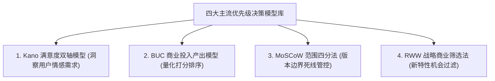
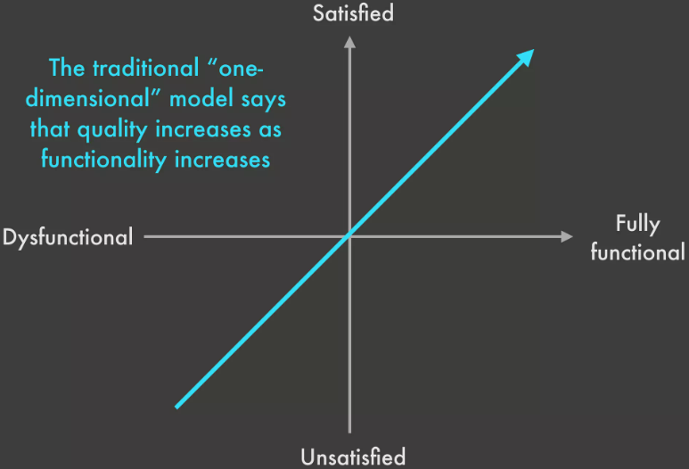
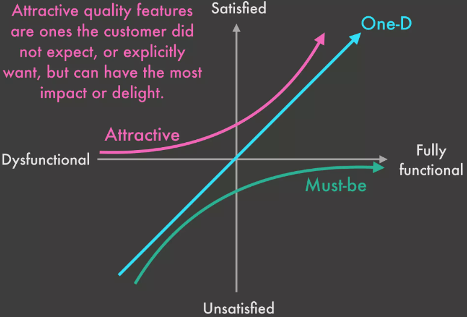
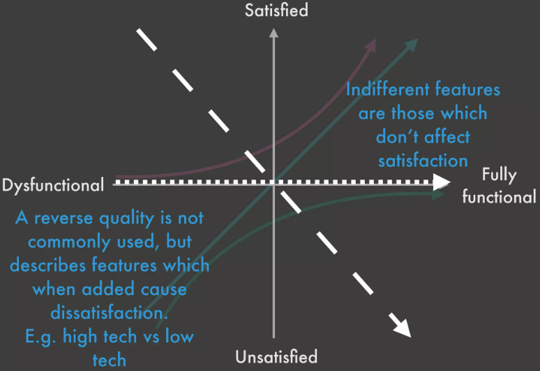
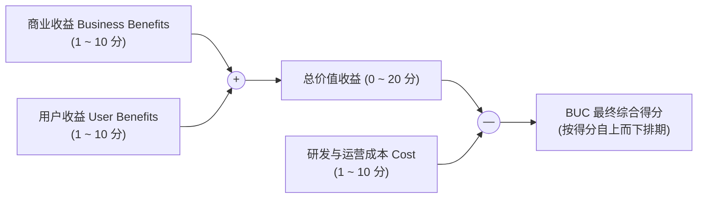
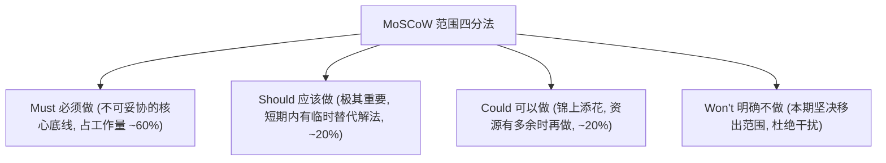
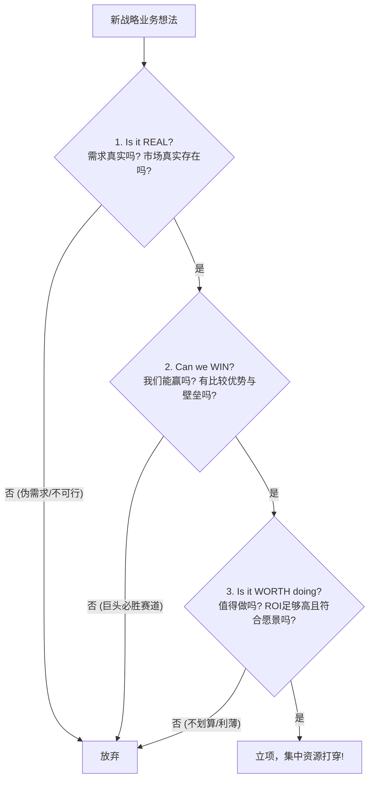

# 第 15 章：需求优先级排序决策模型库 —— Kano, BUC, MoSCoW 与 RWW

> “决定做什么很容易，决定‘不做什么’才见真功夫。平庸的产品经理试图讨好所有人，把每一个需求都标为‘最高优先级（P0）’；卓越的产品经理依靠科学的决策模型库，在商业价值、用户体验与工程成本的三岔路口上做出理性的权衡与取舍。”

---

## 15.1 优先级的残忍现实与决策困境

在任何产研组织中，**开发资源永远是极度稀缺的，而各方的欲望与需求是无限膨胀的**。

当高管要战略政绩、销售要大单定制、用户要体验细节、研发要架构重构时，产品经理若缺乏统一的量化决策模型，排期评审会就会沦为一场“谁嗓门大听谁的”权力撕扯。

为了建立理性的秩序，现代产品管理沉淀了四套开箱即用的优先级决策武器库：

---

## 15.2 Kano 分析模型深度实战：洞察人性的情感反馈

日本质量管理大师狩野纪昭（Noriaki Kano）提出的 Kano 模型，打破了“功能做得越多、用户就越满意”的传统线性迷思：

*图 15-1：传统认知误区——误以为功能堆砌与满意度呈简单线性正比*

*图 15-2：Kano 完整五曲线模型（具备度 vs 满意度）*

*图 15-3：Kano 问卷分析结果二维映射象限*

### Kano 五大质量属性深度剖析

1. **必备属性（Must-be Quality，基本因素）**：
   - **特点**：**具备了用户觉得理所应当，但不具备会导致极其强烈的不满与流失**。
   - *经典案例*：手机能拨通电话、牛奶盒不漏奶、银行系统能准确算账。
   - *策略*：必须投入 100% 精力严格保证，零容忍妥协。
2. **期望属性（One-dimensional Quality，一维因素）**：
   - **特点**：具备得越多越满意，反之越不满意。
   - *经典案例*：手机电池续航时间长短、App 打开加载速度、相同价格下牛奶的分量。
   - *策略*：持续跟进，根据 ROI 投入高性价比的优化。
3. **魅力属性（Attractive Quality，兴奋因素）**：
   - **特点**：**不具备时用户毫无怨言（因为未曾预期）；一旦具备，能极大激发用户的惊喜感与狂热忠诚**。
   - *经典案例*：牛奶盒上贴有变色温度计、微信最初摇一摇的咔嚓声与震动。
   - *策略*：差异化竞争、引爆市场的王牌，集中资源做 1~2 个极致亮点。
4. **无差异属性（Indifferent Quality）**：
   - **特点**：无论怎么折腾，用户完全不在乎。
   - *经典案例*：牛奶包装纸盒的涂蜡厚度增加了 0.1 毫米。
   - *策略*：坚决剔除，切勿在用户无感的地方浪费研发资源！
5. **反向属性（Reverse Quality）**：
   - **特点**：做了反而引发用户反感（例如过度的炫技弹窗、强制诱导分享）。坚决不做。

---

## 15.3 BUC 价值评估模型：清晰量化投入产出比

当面对待办列表（Backlog）中几十个常规业务需求时，**BUC 模型**是最简便、最能凝聚跨部门共识的打分工具：

$$\text{BUC 得分} = \text{商业收益 (Business)} + \text{用户收益 (User)} - \text{研发成本 (Cost)}$$

### 评分维度细则与实操示例

- **Business Benefits（商业收益，1~10分）**：该功能能否带来新客户签约？能否减少运营支出？能否增强品牌壁垒？
- **User Benefits（用户收益，1~10分）**：能否切实解决目标客群的高频核心痛点？能为用户节省多少操作时间？
- **Cost（实施成本，1~10分）**：评估全链路成本（前端开发、后端架构改造、测试覆盖、后期运维人工）。

| 需求代号 | 需求简述 | 商业收益 (B) | 用户收益 (U) | 实施成本 (C) | BUC 最终得分 | 排期决策 |
| :--- | :--- | :---: | :---: | :---: | :---: | :---: |
| **REQ-01** | 导出常用账单 PDF 模板 | 6 | 8 | 2 | **+12** | **最高优先，立即排入 Sprint** |
| **REQ-02** | 接入微信小程序一键支付 | 9 | 9 | 7 | **+11** | **次高优先，重点攻坚** |
| **REQ-03** | 个人主页自定义皮肤与装扮 | 2 | 4 | 8 | **-2** | **负分项，直接无限期搁置！** |

---

## 15.4 MoSCoW 优先级四分法：守住版本的交付死线

在面对固定截止日期（如重大会展、双十一大促、合规截止日）的攻坚版本中，**MoSCoW 法**是防止项目延期的神兵利器：

### 四层划分原则

1. **Must have（必须拥有）**：
   - 系统的**生命线**。如果缺少该项，产品根本无法运行或无法上市（例如：电商系统必须能完成结账支付、医疗系统必须符合隐私脱敏法规）。
2. **Should have（应该拥有）**：
   - 极其重要，但即便延后几天上线，业务不会瞬间瘫痪，短期内可以通过人工客服或替代流程暂时代替。
3. **Could have（可以拥有）**：
   - 体验很好、有了会更酷，但哪怕砍掉，也不会对版本发布造成任何实质影响。
4. **Won't have this time（本次坚决不做）**：
   - **最高明的一点在于明确宣布“哪些不做”**。将其正式写入文档归档，彻底打消业务方的纠缠，让研发在当前冲刺内拥有 100% 的聚焦力。

---

## 15.5 RWW 商业筛选法：战略新机会的试金石

当团队面临一个全新产品线或重大战略级功能时，必须通过哈佛商学院经典 **RWW（Real, Win, Worth）三步法** 的严厉拷问：

1. **Is it REAL?（真实性）**：
   - 市场真的存在吗？客户真的有这个未满足的痛点吗？技术上在现有物理规律下是否可行？
2. **Can we WIN?（制胜力）**：
   - 我们拥有怎样的非对称比较优势？我们的算法更强、供应链更稳、还是团队执行力更快？大厂如果跟进，我们是否具备防御壁垒？
3. **Is it WORTH doing?（商业价值）**：
   - 算完所有隐性成本后，它是否能带来健康的毛利与现金流？它是否符合公司长远的战略愿景？

---

## 15.6 本章自检 Checklist

- [ ] 面对海量待办需求，团队是否停止了“拍脑袋定 P0”的恶习，建立了规范的量化优先级排序工具？
- [ ] 我所规划的需求，在 Kano 模型中是否兼顾了必备属性的稳固性与魅力属性的惊艳感？
- [ ] 在版本面临不可逾越的死线（Deadline）时，我是否果断动用了 MoSCoW 法，坚决把 Could 和 Won't 项剥离出冲刺？
- [ ] 针对关键技术改造与商业特性，我们是否通过 BUC 公式量化了它的“投入产出比”？
- [ ] 面对重大创新点子，团队是否通过 RWW（真实、能赢、值得）完成了战略层面的严密审视？
