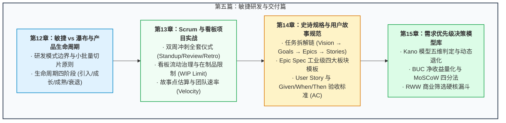

# 第五篇：敏捷研发与项目推进篇 —— 从文档到代码的高效交付

> “写出一份完美的 PRD 只是产品管理长征的第一步。如果不能把文档翻译成研发团队心领神会的语言，不能在两周一个 Sprint 的节奏中把控技术债务与交付速率，不能在有限的资源下为几百个需求排定优先级，产品经理就永远只是一个停留在纸面上的空想家。”

---

## 篇章导读

当想法完成了客户验证与初步原型后，产品正式进入“研发实施与交付”的高负荷推进期：
- **开发模式之选**：到底该用敏捷（Agile）还是瀑布（Waterfall）？敏捷真的适合所有场景吗？
- **敏捷双雄的落地**：Scrum 的每日站会为什么经常沦为毫无营养的形式主义？看板（Kanban）的核心机制到底是什么？如何用故事点（Story Points）科学估算团队的交付速率（Velocity）？
- **工业级交付物规范**：史诗需求说明书（Epic Spec Sheet）该怎么写？工程师最痛恨什么样的用户故事（User Story）？验收准则（Acceptance Criteria, AC）如何做到让测试与技术挑不出歧义？
- **残酷的取舍决策**：资源永远短缺，老板、销售、用户都在催，究竟该用什么模型（Kano、BUC、MoSCoW、RWW）决定哪一个需求进当前冲刺、哪一个需求留在 Backlog？

本篇将从软件工程底层的交付范式出发，系统拆解**瀑布与敏捷的本质边界**、**Scrum 与 Kanban 实战仪式流程**、提供全套**工业级需求文档与验收模版**，并构建一套多维度的**需求优先级决策工具箱**。

---

## 本篇知识图谱

---

## 章节导航

- **[第 12 章：研发模式对比：敏捷 vs 瀑布与产品生命周期](./12-agile-vs-waterfall-and-lifecycle.md)**
  - 深度对比敏捷与瀑布模式的风险收益边界、瀑布开发不可替代的特定工程场景，以及产品生命周期四阶段的演进与退市管理。
- **[第 13 章：Scrum 与看板（Kanban）实战指南 —— 仪式、速率与在制品限制](./13-scrum-and-kanban-in-practice.md)**
  - 详述 Scrum 四大核心仪式与两类 Backlog 运作、看板（Kanban）流动与在制品限制（WIP）、故事点与团队研发吞吐速率的测算心法。
- **[第 14 章：标准交付物模板与规范 —— Epic Specs, User Stories 与 AC 标准](./14-epic-specs-and-user-stories.md)**
  - 提供大厂级别的 Epic 规格说明书四模块模板、无歧义的用户故事编写准则，以及 `Given-When-Then` 验收标准的编写范例。
- **[第 15 章：需求优先级排序决策模型库 —— Kano, BUC, MoSCoW 与 RWW](./15-prioritization-frameworks.md)**
  - 汇总实战中最经典的四大需求决策工具：Kano 双轴模型、BUC 投入产出公式、MoSCoW 边界划分法与 RWW 商业筛选矩阵。
