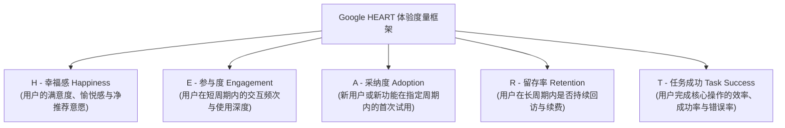
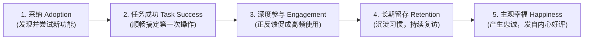
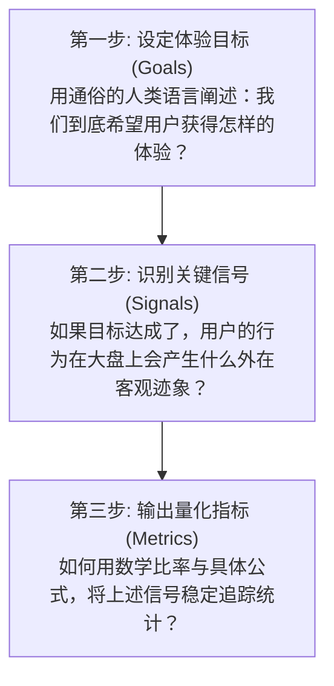

# 第 17 章：HEART 框架落地实践 —— 从用户旅程到指标映射

> “传统的数据分析往往偏向冰冷的商业变现，却常常对用户真实的情感体验一无所知。Google 提出的 HEART 框架，将抽象、主观的‘用户体验’拆解为可量化、可追踪、可归因的工程指标，让产品经理能够在追求商业回报的同时，精准把控产品的灵魂。”

---

## 17.1 Google HEART 框架的五大维度全景

HEART 框架由 Google 资深用研专家凯莉·罗登（Kerry Rodden）等人提出，是全球科技界衡量**用户体验质量（User Experience Quality）**的通用标准。

它将复杂的软件体验拆解为五个互为支撑的黄金维度：

### 五大维度核心内涵与典型指标

| 维度 | 关注核心 | 典型业务场景 | 经典度量指标 |
| :--- | :--- | :--- | :--- |
| **Happiness（幸福感）** | 用户的**主观体验与情感反馈**。用户觉得产品好不好用？愿不愿意向朋友推荐？ | 问卷调研、应用商店评价、客服反馈。 | • 净推荐值（NPS） • 客户满意度评分（CSAT） • 应用商店评分（1~5星分布） |
| **Engagement（参与度）** | 用户的**使用深度与活跃交互频次**。用户在系统中是否足够投入？ | 社交互动、内容消费、工具使用深度。 | • 每日人均访问会话数（Sessions） • 核心动作人均触发次数（如人均分享数） • 每次会话停留时长（Time Spent） |
| **Adoption（采纳度）** | **新功能或新产品的渗透速度**。有多少人开始尝试新推出的特性？ | 新版本发布、改版试水、新模块推广。 | • 新功能发布 7 天内的试用渗透率 • 新注册用户在 24 小时内的首购率 • 账号升级或高级权益开通比例 |
| **Retention（留存率）** | **用户的长期忠诚度与粘性**。尝鲜之后，大家是否留了下来？ | 订阅付费续费、月活活跃度、流失防范。 | • 次日 / 7日 / 30日 滚动留存率 • SaaS 软件月度订阅续费率 • 活跃用户流失率（Churn Rate） |
| **Task Success（任务成功）** | **人机交互的效率与阻碍**。用户能否顺畅无误地达成他的核心目的？ | 注册流程、搜索查找、结账支付、文件上传。 | • 核心任务完成成功率（%） • 任务平均耗时（Time on Task） • 错误率与中断放弃率（Drop-off Rate） |

---

## 17.2 还原真实体验发生的流向：A.T.E.R.H. 法则

在学习 HEART 框架时，产品经理必须看穿一个文字游戏：  
**“HEART” 只是为了朗朗上口而拼出的缩写单词。在真实世界中，用户与产品交互的自然流向从来不是先有 Happiness，而是严格遵循“A.T.E.R.H.”的链条演进！**

### 体验链条的因果逻辑
1. **Adoption（采纳）是起点**：用户首先必须迈出第一步，愿意点击进入你的新功能；
2. **Task Success（任务成功）是基石**：如果用户第一次尝试就遇到了 Bug、卡顿或者复杂的报错，任务失败，体验链条在此刻**瞬间断裂**；
3. **Engagement（参与）是正反馈**：唯有当用户以极高效率完成了任务，他才会愿意在接下来的几天里频繁使用；
4. **Retention（留存）是习惯的沉淀**：持续的高频参与最终演变为不可逆的工作流依赖；
5. **Happiness（幸福感）是终局果实**：只有当一个软件长期稳定、高效地帮用户解决问题，用户在填写满意度调查或在社交媒体打分时，才会给出由衷的高分。

---

## 17.3 落地神器：目标 - 信号 - 指标（GSM）三步映射工作流

很多团队在定义指标时，喜欢直接拍脑袋写一堆公式，结果指标与真实用户体验完全脱节。

Google 官方推荐推行 **GSM（Goals - Signals - Metrics）工作流**，通过自上而下的三步推演建立指标：

### 协同办公文档工具的 HEART 实战 GSM 映射表

假设我们正在负责一款类似 Notion / 飞书文档的在线协同工具，其标准的 GSM 映射推演如下：

| HEART 维度 | 体验目标（Goals） | 观察信号（Signals） | 落地量化指标（Metrics） |
| :--- | :--- | :--- | :--- |
| **Happiness（幸福感）** | 用户觉得协同编辑极其流畅，乐意向团队其他同事安利。 | 调研问卷给出高分，在社交平台主动分享推荐。 | • 季度 NPS 净推荐值 $\ge 60$ • 7天内无负面操作卡顿差评工单 |
| **Engagement（参与度）** | 用户在日常工作中高频使用文档记录、评论与协同。 | 频繁创建文档、多人同时在线编辑、积极发表评论。 | • 团队平均日均在线编辑时长 • 单周人均 `@` 提及他人与评论回复数 |
| **Adoption（采纳度）** | 团队新加入的成员能快速上手开始写第一篇文档。 | 新入职员工快速创建第一篇文档或完成首次划词评论。 | • 新用户加入企业后 3 天内的首篇文档创建转化率 • 新发布的 AI 续写按钮在首周的点击渗透率 |
| **Retention（留存率）** | 团队对云文档产生深度依赖，月度持续使用并按年续约。 | 团队每周持续有文档新增与查看，极少出现整周不活跃。 | • 注册后第 4 周的团队留存率（Team Cohort Retention） • 客户年度席位续费率（Renewal Rate） |
| **Task Success（任务成功）** | 用户能够快速找到目标文档，且离线编辑内容绝不丢失。 | 搜索命中率高，文档冲突合并成功，云端保存零报错。 | • 站内搜索首屏点击命中率（%） • 50 人并发协同编辑下的内容冲突丢失率（必须为 $0\%$） • 文档从点击到首屏加载渲染完成耗时 P90 $\le 800\text{ms}$ |

---

## 17.4 本章自检 Checklist

- [ ] 在规划用户体验度量时，我们是否涵盖了 HEART 的五个维度，而不是单纯只看留存或日活？
- [ ] 针对新推出的重大功能特性，我是否遵循了“A.T.E.R.H.”的链条，优先监控新功能的首次采纳率（Adoption）与首发任务成功率（Task Success）？
- [ ] 我们的指标设计是否严格经过了“目标（Goals）-> 信号（Signals）-> 指标（Metrics）”的理性推导，避免无意义的自嗨公式？
- [ ] 团队是否为核心操作链路设定了明确的任务成功耗时（Time on Task）与报错放弃率监控？
- [ ] 我们的“幸福感（Happiness）”调研，是否能够剔除水军与偶发抱怨，真实反映出净推荐值（NPS）的长期趋势？
