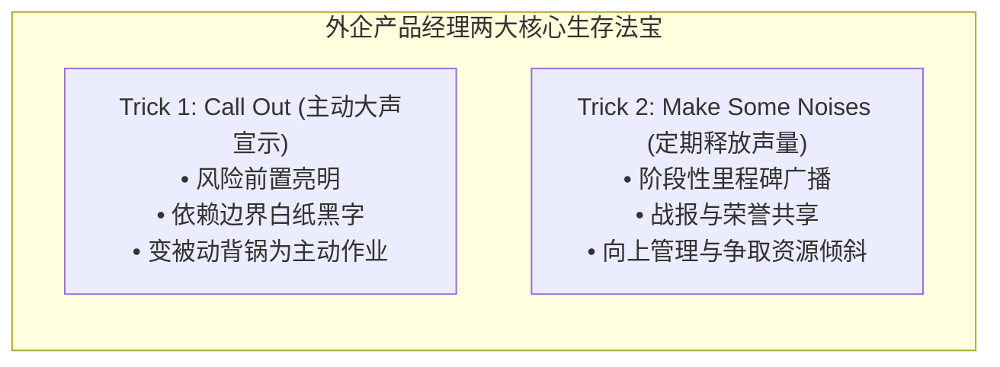
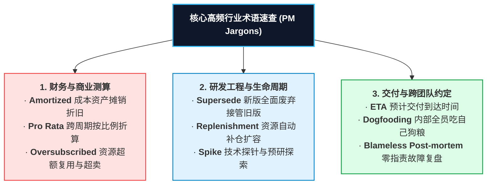

# 第 21 章：外企与行业暗语速查与生存心法 —— Call Out, Make Noises 与行业行话

> “进入外企或大厂产研体系，很多新人会被各种混杂着英文缩写的‘行业暗语’砸得晕头转向。熟练掌握这些词汇不是为了在日常沟通中装腔作势，而是因为它们背后沉淀了极其高效的商业契约逻辑、财务思维与团队避险生存法则。”

---

## 21.1 外企产品经理的两大核心生存心法

在一线外企、大厂及跨国团队中，优秀的产品经理几乎每天都在熟练运用两项不可言说的核心心法：**Call Out** 与 **Make Some Noises**。

### 1. Call Out（主动大声疾呼 / 风险边界前置）
- **核心内涵**：在需求立项、方案评审或跨部门周会中，**主动、旗帜鲜明地把产品的潜在风险、技术限制、外部依赖的不确定性以及不可妥协的边界‘大声喊出来’**，并务必在邮件纪要中白纸黑字记录在案。
- **避险的黄金逻辑**：
  > **在事故发生前说出来的，叫“专业风险预警与前瞻管控”；  
  > 在事故发生后才去解释的，叫“推卸责任与苍白狡辩”！**
- **典型话术示范**：
  *“这里我必须重点 Call out 一下：虽然我们承诺在下个月上线短信营销中台，但该功能百分之百依赖于外部电信运营商的通道资质批复。如果运营商审核在月底前无法通过，该功能将被迫顺延，请业务端务必做好备用预案！”*

### 2. Make Some Noises（定期释放声量 / 荣誉与存在感塑造）
- **核心内涵**：很多工程师出身的 PM 习惯当“默默耕耘的劳模”，以为只要把功能做好了自然有人赏识。真相是：在庞大的组织中，没人有闲心去主动探究你做了什么。**产品经理必须成为产品的头号布道者**。
- **实操节奏**：
  - 核心功能内测上线时，在内部大群发布 1 分钟高清体验视频与致谢名单；
  - 达成阶段性里程碑（如首周成单破百、系统压测抗住万级高并发）时，整理成简明图文战报，大方同步给高管并@所有通宵攻坚的技术设计骨干；
  - 作用：不仅实现了高情商的向上管理，更能让整个跨职能团队深切感受到并肩作战的荣誉感，在下一次调兵遣将时一呼百应。

---

## 21.2 核心外企与跨国科技行业高频暗语深度解码

以下是产研与商业协同中最为高频的硬核术语，每一项背后都对应着严密的工程或财务逻辑：

### 1. Armotized / Amortized（成本摊销 / 资产折旧平摊）
- **商业含义**：在开发一套大型系统或采购昂贵硬件时，如果将 100 万元的支出全部计入当月成本，当月的财务报表将出现巨额难看的亏损。**摊销（Amortization）**是将该笔重度资产支出，按照预估的受益使用寿命（如 36 个月），逐月平摊计入成本（每月仅承担约 2.7 万元）。
- **实战语境**：*“虽然这套数据库底层升级前期投入了 30 万美元，但由于它是平台级能力，我们可以将成本按三年期 Armotized 到各个业务线的利润中心，单月的财务冲击非常小。”*

### 2. Oversubscribed（超额认购 / 资源超卖）
- **商业含义**：源于金融与电信/云计算领域的经典运营模型。基于大数定律，**1,000 个企业客户绝不可能在同一秒钟同时占满 100% 的网络带宽或计算资源**。因此运营商通常会按照 120%~200% 的比例超额售卖容量，在保障服务等级（SLA）的前提下实现毛利的最大化。
- **实战语境**：*“当前香港骨干节点的国际出口带宽利用率仅为 45%，在风控允许范围内我们完全可以适度 Oversubscribed 20%，提升单机房的资本利用效率。”*

### 3. Supersede（全面取代 / 历史版本接管）
- **商业含义**：在复杂的系统架构或产品手册迭代中，新特性不是简单的“打补丁”，而是**在功能、法律效力或系统生命周期上，正式、全面地宣布旧系统作废并强制接管**。
- **实战语境**：*“请所有前端架构师注意，下个月发布的 V3 统一鉴权接口将全面 Supersede 现存的 V1 和 V2 接口，老接口将在 90 天后强制关闭，请各业务方排期迁移。”*

### 4. Replenishment（水位补给 / 资源补仓）
- **商业含义**：在硬件设备供应链、云资源弹性扩容或 API 余额调度中，当监控水位跌破预警阈值时，触发的标准化自动补货或备件调配动作。

### 5. Pro Rata（按比例分配 / 平均折算）
- **商业含义**：拉丁语术语，意为“按比例（In Proportion）”。常用于企业客户在中途退订或升降级时，按照实际消耗的天数精确折算费用；或多租户共享专线时按流量权重拆分账单。
- **实战语境**：*“客户在年度订阅进行到第 75 天时申请解约，我们按照合同条款支持 Pro Rata 退款，扣除已履约天数后返还剩余金额。”*

### 6. ETA（Estimated Time of Arrival / 预计准确交付到达时间）
- **商业含义**：从物流领域引申至产研排期。**它不是一个敷衍的“大概这两天吧”，而是一个必须附带具体日期甚至时间点的确定性交付承诺**。
- **实战语境**：*“针对那个支付网关接口的性能压测修复，技术团队承诺的最终 ETA 是明天下午 17:00，随后即可交付集成测试。”*

### 7. Spike（技术探针 / 探路工程任务）
- **商业含义**：在敏捷开发中，当遇到一个完全未知的全新技术难题（如引入一套全新的大模型框架）、研发团队完全无法预估故事点时，**专门开辟一个为期 1~2 天的小任务，不做最终交付，只用来写最简原型探明技术可行性与坑点**。

### 8. Dogfooding（吃自己的狗粮）
- **商业含义**：*“Eating your own dog food.”* 产品团队在将软件推向外部客户之前，强制在公司内部全员使用自己的产品作为日常办公工具。这是在极短时间内发现低级 Bug 和人机工程反人类体验最快、最残忍的手段。

### 9. Blameless Post-mortem（对事不对人的无指责复盘）
- **商业含义**：源于 Google SRE 体系。当发生严重线上故障时，**复盘会严禁将责任归咎为“某某工程师手抖打错了一行配置”，而是深挖为什么系统的防御机制、自动化校验与审批流程允许这个手抖发生**。只有免于被惩罚的恐惧，团队才能坦诚说出真相、消除系统性的安全隐患。

---

## 21.3 本章自检 Checklist

- [ ] 在最近一次的需求评审中，我是否在方案萌芽期就主动“Call out”了关键的技术瓶颈与外部依赖风险？
- [ ] 我所带领的团队在攻坚并取得了关键业务里程碑时，我是否懂得适度“Make some noises”，向更广阔的组织展示团队价值并共享荣誉？
- [ ] 面对成本、折旧与多租户分摊等场景，我是否能够熟练运用 Amortized、Pro Rata 等专业财务术语与财务和商务精准对话？
- [ ] 在团队面临未知的高难度技术盲区时，我是否主动规划了为期 1~2 天的“Spike 探针任务”，而不是逼迫工程师在迷雾中盲目承诺？
- [ ] 在产品正式向公众发布前，团队是否真正执行了严密的“Dogfooding（吃自己的狗粮）”，确保最明显的体验瑕疵被消灭在内部？
