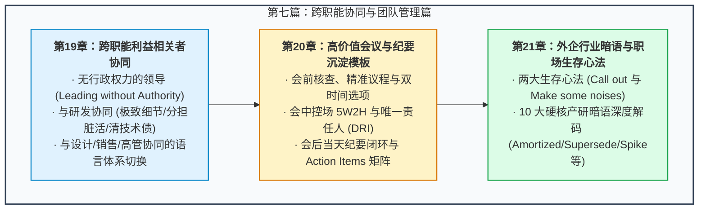

# 第七篇：跨职能协同与团队管理篇 —— 作为无行政权力的沟通中枢

> “作为产品经理，你手中没有任何一张任免令，你不能直接命令研发一行代码，也不能强制设计师改掉任何一个像素，更不能随意给销售人员下硬指标。但你却要对整个产品的成败负最终责任。这就是产品管理最迷人也最凶险的地方——在没有行政权威的前提下，依靠逻辑、同理心、信息透明与愿景来领导团队（Leading without Authority）。”

---

## 篇章导读

很多技术或设计出身的新人产品经理，往往死在“沟通协同”这道鬼门关上：
- 面对工程师，讲不清逻辑细节，被研发当面质疑到面红耳赤；
- 面对设计师，直接下命令指挥颜色和字号，被吐槽为“不懂审美的外行”；
- 面对销售团队，疲于应付各种紧急定制承诺，沦为被动填坑的受气包；
- 面对高管汇报，讲了一大堆零碎的原型和技术细节，被领导无情打断；
- 每天被拖入无数冗长、低效、没有结论的拉皮条会议，身心俱疲。

产品经理的本质是**组织的沟通中枢（Communication Hub）**与**同传翻译器**。

本篇将全景拆解产品经理在跨职能协同中的生存与致胜体系：
- 针对**研发、设计、销售、市场、高管、法务与财务**不同利益相关者（Stakeholders）的定制化沟通心法；
- 建立从会议前、会议中到会议后的**高价值闭环会议管理体系**，附赠开箱即用的标准《会议纪要（Meeting Minutes）》与《Action Items 追踪表》；
- 解码外企与大厂高频生存技巧（**Call out** 的避险艺术、**Make noises** 的存在感塑造），以及从 **Armotized、Oversubscribed 到 ETA** 的硬核暗语速查。

---

## 本篇知识图谱

---

## 章节导航

- **[第 19 章：跨部门 Stakeholder 协同沟通指南 —— 沟通中枢的影响力法则](./19-cross-functional-stakeholder-management.md)**
  - 针对研发（逻辑与技术债）、设计（目标与空间）、销售（赋能与武器库）、高管（简明与商业回报）等不同角色的差异化沟通范式。
- **[第 20 章：高价值会议管理与沉淀机制 —— 会议前中后闭环与 Meeting Minutes](./20-high-value-meeting-and-minutes-template.md)**
  - 阐述杜绝低效会议的“前中后三步法则”、5W2H 控场要义，并提供标准会议纪要与 Action Items 追踪模版。
- **[第 21 章：外企与行业暗语速查与生存心法 —— Call Out, Make Noises 与行业行话](./21-pm-jargon-and-survival-tricks.md)**
  - 详解 Call out 避险与 Make noises 向上管理两大法宝，并深度剖析外企、通信与互联网行业的高频专业术语。
