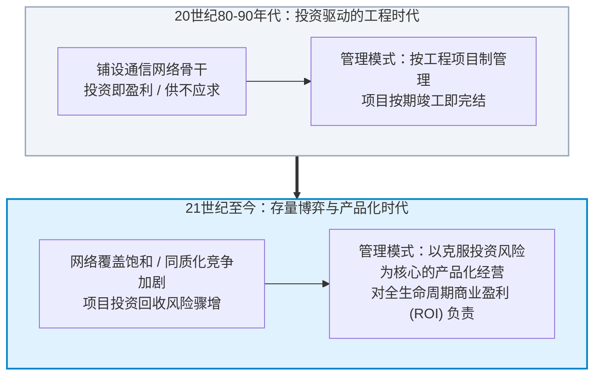
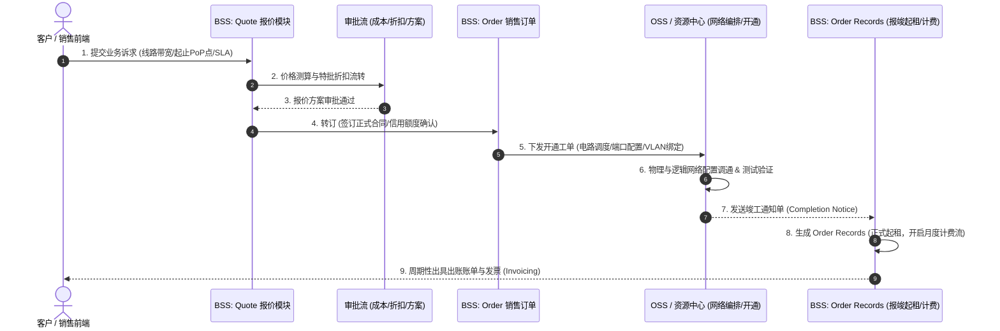
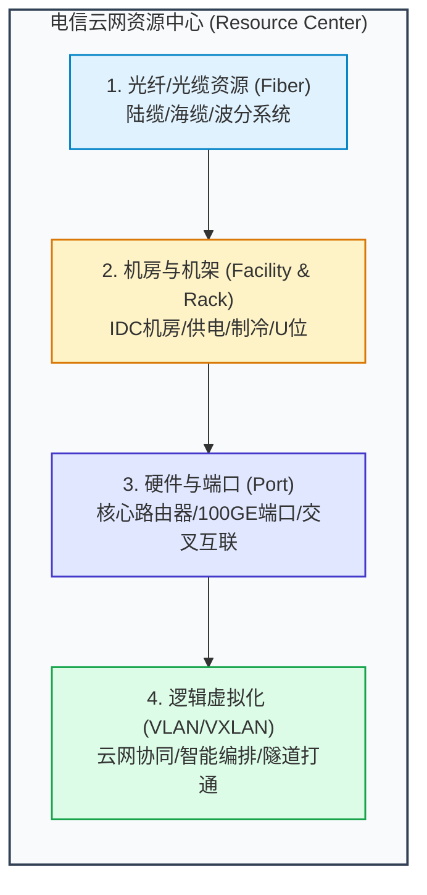

# 第23章：电信运营商与 ICT 云网系统 (Telecom & ICT Cloud-Network Systems)

在广袤的数字基础设施世界中，电信运营商（Carriers / Telcos）与 ICT 基础设施系统构成了全球互联网与企业数字化转型的物理生命线。然而，电信级产品管理是一套兼具“超高技术门槛、重资本资产属性、极端可用性要求与庞大组织协同”的独特体系。

许多互联网产品经理习惯了“快速试错、每周发版、停机维护是常态”的敏捷思维，一旦进入电信与 ICT 领域，面对“电信级 99.999%（五个九）可用性”、“数以亿计的骨干网建设投资”、“复杂的 BSS/OSS 业支流转”以及“跨国合规牌照与物理光缆资产”时，往往深感规则完全不同。

本章将基于真实的电信运营商（如中国电信国际 CTG、华为数通等）业务实战演进，深度解剖电信产品经理的核心心法、BSS/OSS 业支运转闭环与云网协同架构。

---

## 1. 行业巨变：从“工程网络项目建设”走向“产品化经营”

要读懂电信产品经理的角色，必须回溯电信运营商的发展史：

### 1.1 传统模式的弊端与反思
在早期的网络建设红利期，运营商的核心任务是“修路”（铺设海缆、建交换机房、立基站）。然而，当网络基础设施铺设完毕后，单纯的项目制管理暴露了致命缺陷：
- **项目完工 $\neq$ 商业成功**：工程项目经理以“项目按期按质竣工验收”为目标，验收通过项目即告结束；但网络建好后，有没有客户来买带宽？有没有产生持续现金流？工程团队概不负责。
- **部门代替产品经理**：部门管理了一大批网络资源，但淡化了对市场需求变化的感知，部门利益大于全局商业利益，造成大量通信资产空置浪费。

### 1.2 电信产品经理的角色崛起
电信产品经理的核心使命，就是**打破纯技术与工程视角的壁垒，以全生命周期的商业回报为导向，使网络资源建设与终端市场需求精准对接**。
- **横向管理 vs 纵向专业**：产品经理从事的是贯通需求、立项、研发、交付、销售到运维的**横向端到端管理**；而网络规划部、运维部、财务部、IT 业支部门从事的是**纵向专业能力深耕**。横向驱动纵向，构筑了现代电信企业的核心竞争力。

---

## 2. 电信产品立项的八大刚性决策要素

在电信与 ICT 领域，由于涉及巨额网络设备采购（光缆租赁、交换机/路由器采购、PoP 点机房租赁），一次错误立项可能带来数千万甚至数亿元的坏账或资产折旧。因此，电信产品立项具备极其严格的决策审查标准：

```mermaid
flowchart TD
    Root["<b>电信产品立项 8 大刚性决策要素</b>"]

    Root --> E1["<b>1. 目标客户群体</b><br/>细分行业客户 / 中资出海企业 / OTT大客户"]
    Root --> E2["<b>2. 市场总量与空间</b><br/>TAM/SAM 理论峰值 / 带宽与线路最大销售规模"]
    Root --> E3["<b>3. 客户真实需求</b><br/>极低时延要求 / 高可用容灾 / 云网协同互联"]
    Root --> E4["<b>4. 价格承受能力</b><br/>需求价格弹性 / 成本底线与毛利红线测算"]
    Root --> E5["<b>5. 市场竞争要素</b><br/>同类对手海缆资源 / 骨干网 PoP 覆盖优劣势"]
    Root --> E6["<b>6. 市场与技术演进</b><br/>从物理专线到 SD-WAN、SASE 与云互联"]
    Root --> E7["<b>7. 技术实现能力</b><br/>端到端交付自动化 / 资源覆盖率与运维 SLA"]
    Root --> E8["<b>8. 投资成本与收益</b><br/>CAPEX 资本支出 / OPEX 运营支出 / 财务 ROI"]

    style Root fill:#0f172a,stroke:#38bdf8,stroke-width:2px,color:#fff;
    style E1 fill:#e0f2fe,stroke:#0284c7,stroke-width:1.5px;
    style E2 fill:#f8fafc,stroke:#64748b,stroke-width:1.5px;
    style E3 fill:#f0fdf4,stroke:#16a34a,stroke-width:1.5px;
    style E4 fill:#fef3c7,stroke:#d97706,stroke-width:1.5px;
    style E5 fill:#fee2e2,stroke:#dc2626,stroke-width:1.5px;
    style E6 fill:#f5f3ff,stroke:#7c3aed,stroke-width:1.5px;
    style E7 fill:#fdf4ff,stroke:#c026d3,stroke-width:1.5px;
    style E8 fill:#dcfce7,stroke:#16a34a,stroke-width:2px;
```

1. **目标消费群体（Target Customers）**：明确细分市场。例如针对中资金融机构出海，其对跨境通信的核心诉求是“数据合规与金融级确定性超低时延”，而跨境电商客户则更看重“峰值弹性与单位带宽成本”。
2. **市场总量（Market Total Volume）**：测算目标群体在理论上能达到的最大采购规模，决定了立项投资的规模天花板。
3. **消费者需求差异（Customer Demand Profiles）**：明确功能规格、SLA 等级、冗余主备要求。
4. **消费者承受能力与定价策略（Affordability & Price Elasticity）**：电信带宽通常具有较强的规模效应，产品经理必须测算固定成本与变动成本，推导出满足盈亏平衡点的定价下限。
5. **竞争格局与替代威胁（Competitive Landscape）**：分析主流对手在相同物理路径上的海缆分布、PoP 覆盖与资费策略。
6. **技术与市场演进动态（Technology Trends）**：例如企业广域网正从传统昂贵的 MPLS VPN 向云网融合、SD-WAN 与 SASE（安全访问服务边缘）快速演进。
7. **技术实现与运维保障能力（Feasibility & Operability）**：不仅看能否调通网络，更看后端的资源开通自动化水平、网络监测与故障恢复 SLA 能否达到合同承诺。
8. **投资回报与财务模型（ROI & Financial Viability）**：精准测算 **CAPEX**（Capital Expenditure，机房建设与设备购置等资本性支出）与 **OPEX**（Operational Expenditure，电路租用与水电维保等运营支出），计算投资回报周期与净现值（NPV）。

---

## 3. 电信业支系统全貌：BSS 与 OSS 运转闭环

电信运营商的 IT 架构主要由两大支柱支撑：**BSS（业务支撑系统）** 与 **OSS（运营支撑系统）**。如果说 OSS 负责“管好网络设备与物理信号”，那么 BSS 则负责“管好客户、合同、订单与钞票”。

### BSS 核心订单三大模块演进
在运营商的生产级 BSS 体系中，一个业务商机的生命周期流转极为严密：
1. **Quote 模块（售前报价单）**：
   - 处于售前商机阶段。销售与售前工程师根据客户需求，选择产品规格（如 100M MPLS 跨境专线），系统自动调用定价引擎计算底线成本、审批利润率与折扣，生成正式商务报价单。
2. **Order 模块（转订与正式订单）**：
   - 客户盖章确认后，报价单转订为正式销售订单。校验客户实名牌照、财务信用额度与付款方式，进入跨部门合同履约序列。
3. **Order Records 模块（报竣起租与计费资产）**：
   - 这是电信行业独有的关键节点。网络调通并不等于开始收费，必须在客户侧完成 PoC 交付与业务验收测试，双方签署**《工程业务竣工确认单》（Completion Form）**。
   - BSS 接收到报竣信号后，订单转为 **Order Records（起租资产单）**。系统在此刻打上时间戳，正式开始计算租期、月租扣费与产生应收账款（AR）。

---

## 4. 骨干网产品度量：Looking Glass、时延矩阵与资源中心

在跨国通信与高端专线产品中，带宽数值本身并不是最高壁垒，**网络的确定性、透明度与 SLA 可度量性**才是核心溢价来源。

### 4.1 Looking Glass（路由探测显微镜）
- **功能定位**：面向技术客户与工程师的公开/半公开路由诊断工具。
- **实战作用**：允许客户从全球主要骨干路由器节点发起真实的 `ping`、`traceroute` 与 `show ip bgp` 查询。
- **商业价值**：通过实时公开透明的路由跳转，直接向全球客户证明运营商骨干网（如电信下一代承载网 CN2、CTGNet）的直连跳数优势与抗抖动能力。

### 4.2 时延矩阵 (Latency Matrix) 与 SLA 监控
- **度量维度**：实时采集全球数百个核心 PoP（Point of Presence）节点与主要国际大都市（香港、新加坡、东京、法兰克福、伦敦、硅谷等）之间的往返时延（RTT）、丢包率与网络抖动。
- **分层展示体系**：
  - **公开/售前层**：基于区域大区（如亚太至北美、欧洲至亚太）的时延大盘，用于招商宣介与标准合同承诺。
  - **智能运营工作台**：精确到城市 PoP 节点机房与主备海缆路由的毫秒级时延监控。一旦海缆遭遇地震发生断缆、流量倒换至备份路由导致时延超出 SLA 阈值，系统自动触发告警并进入赔付核算流程。

### 4.3 云网融合与资源中心 (Cloud-Network Integration & Resource Center)
- **底层资源沉淀**：资源中心对光缆路由、机架机位、设备板卡端口进行全数字化拓扑建模，彻底告别传统的 Excel 记账模式。
- **云网协同（Cloud Exchange / 云互联）**：现代 ICT 客户不再满足于采购一段呆滞的端到端管道，而是要求专线能够一端连接本地企业分支，另一端一键直连公有云（AWS、Azure、阿里云、天翼云）。产品经理需要推动资源中心与云厂商 API 深度打通，实现**“分钟级开通、按需带宽弹性调整、故障秒级自愈”**的云网融合一体化产品体验。

---

## 5. 组织职责分工：产品创新部 vs 市场部与运营部

大型电信运营商在推进产品全生命周期管理时，通常建立高度清晰的权责界面与决策委员会机制（参考中电信国际组织治理最佳实践）：

| 部门角色 | 核心职责界面 (Responsibility Scope) | 关键产出物 |
| :--- | :--- | :--- |
| **市场部 (Marketing Dept)** | **全生命周期统筹牵头部门**。负责宏观市场洞察、产业政策解读、统筹制定年度产品规划、制定跨部门研发决策机制、管理**销售品目录（Sales Catalog）**（价格、渠道策略与可售区域）。 | 市场洞察报告、销售品全视图、商务定价策略 |
| **产品创新部 (Product Innovation)** | **研发过程主干管理部门**。负责产品立项编制、组建跨部门产品研发项目组（PDT）、主导功能设计、监督研发进度与质量、组织**功能性测试验收**、统筹公司底层**产品目录（Product Catalog）**。 | 产品需求规范（PRD）、立项可行性报告、功能性验收报告 |
| **研发实施与云网运营部 (R&D & Ops)** | **交付实施与底层保障部门**。负责底层网络调度、平台代码开发、日常网络运维保障、SLA 履约保证。已产品化的稳定网络平台移交运营部运维，持续迭代的敏捷平台由实施部门持续攻关。 | 系统部署代码、网络配置拓扑、运维监控报表 |
| **产品决策双委员会** | 1. **产品研发需求决策组**（市场部牵头）：负责全周期重大商机与立项战略决策。 2. **产品研发专家组**（产品创新部牵头）：负责技术架构把关与功能质量评审。 | 立项决议书、技术方案终审意见 |

---

## 6. 本章实战自测清单 (Checklist)

在规划或管理电信及 ICT 云网产品时，请逐一核对以下核心要素：

- [ ] 本产品的商业立项是否超越了单纯的工程建设思维，完成了包含 CAPEX、OPEX 与回本周期的全面财务可行性论证？
- [ ] 立项方案是否严格对照了电信产品 8 大要素（目标客群、市场总量、需求规格、客户承受力、竞争对手、技术演进、实现能力、投资收益）？
- [ ] BSS 业务支撑流转是否覆盖了售前报价（Quote）、转订合同（Order）与报竣起租（Order Records）的完整闭环？
- [ ] 产品的性能与质量是否有客观量化的指标（如时延矩阵、SLA 丢包率、可用性）支撑，并通过 Looking Glass 等工具向客户可视化展示？
- [ ] 面对云网融合趋势，产品是否具备与多云厂商（Cloud Exchange）及资源中心端口快速拉通协同的敏捷弹性能力？
- [ ] 跨部门职责界面是否清晰划分？市场部的“销售品”、产品创新部的“产品目录”与运维实施部门的“运维交付”是否形成了无缝契合？
