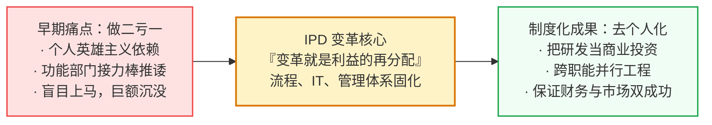
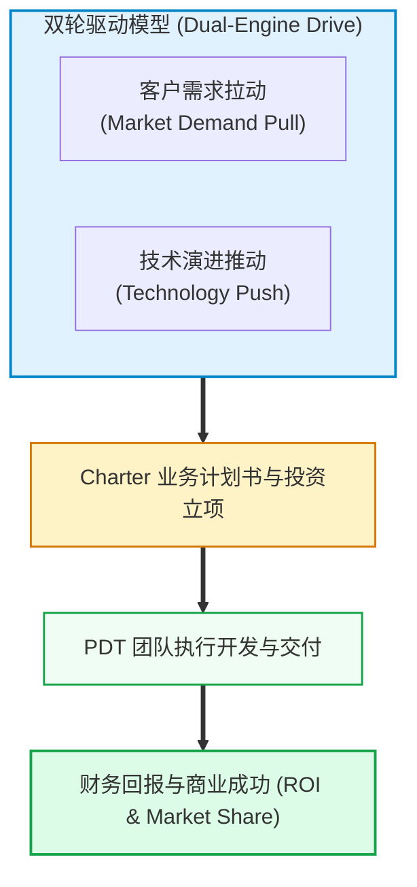
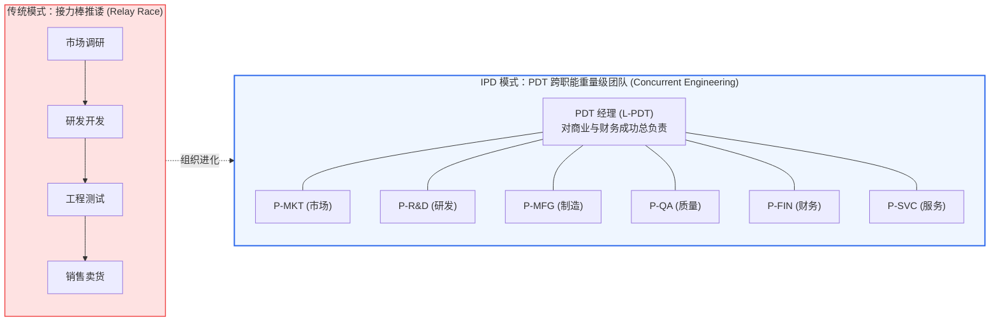
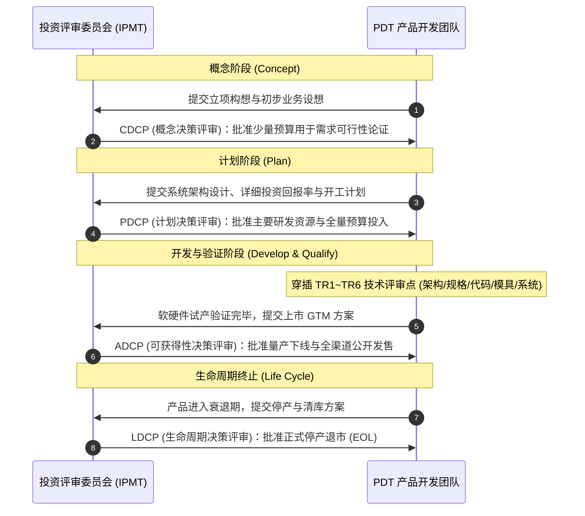
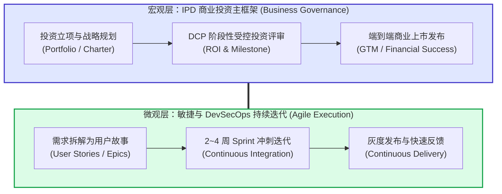

# 第25章：华为 IPD 集成产品开发体系实录 (Huawei IPD: Integrated Product Development)

在现代高科技研发与千亿级工业巨头的治理史上，华为从一家草莽起步的民营通信设备厂，蜕变为横跨通信设备、数字能源、企业 ICT 与智能终端的世界级巨头，其背后最核心的制度基石就是**集成产品开发体系（IPD, Integrated Product Development）**。

早期的华为与今天绝大多数初创企业一样，充满狂热与混沌：“英雄式研发”、全靠几个技术天才单打独斗、交付延期是家常便饭、甚至**“做两个产品，亏一个产品”**。1998 年任正非力排众议，斥资数亿美金引入 IBM 顾问体系，开启了长达数年的 IPD 变革苦旅。

本章源自华为一线产品体系培训与实录精粹，带你穿透 IPD 复杂的专业术语，揭开这套“世界级研发投资决策与作战体系”的底层运行机理。

---

## 1. 变革的本质与初心：从“做二亏一”到“去个人化”

任何企业引入复杂研发管理体系，首先要理解变革背后的痛点与代价：

### 1.1 “变革就是利益的再分配”
任正非在推行 IPD 变革时曾一针见血地指出：**“变革就是利益的再分配。”**
在传统职能制组织中，研发部长、销售总监、制造厂长各自拥有独立的封地与话语权。推行 IPD 意味着必须打破部门“诸侯”，将研发立项与预算审批权力收归跨职能产品投资委员会，同时将跨部门资源调配权赋予产品线 PDT 经理。任何触及组织灵魂的研发体系改革，都必须做好承受利益格局重组的准备。

### 1.2 为什么必须“去个人化”？
- **告别英雄式救火**：初创期依靠某个天才架构师或研发狂人加班拼命或许能做成一两款爆品，但天才不可复制，且伴随着极高的人员离职流失风险。
- **管理体系固化于 IT 与流程**：华为通过将产品全生命周期管理规则固化进 IT 软件和制度模板中，实现**“去个人化”**。哪怕核心工程师换人，新人依托标准化流程与知识库也能在短时间内输出合格质量的产品。
- **为什么从产品变革切入？** 华为之所以将全公司组织变革的第一刀砍向产品开发，原因极度朴素：**“因为华为是以产品为核心的，产品好，公司才能活下去。”**

---

## 2. 核心战略观：把产品开发作为一项商业投资来管理

在 IPD 的哲学里，产品经理和研发团队最容易犯的职业病是“自嗨式技术崇拜”——总觉得自己掌握了世界领先的技术，就一定要做成产品卖给市场。IPD 对此做出了彻底的纠偏：

> [!IMPORTANT]
> **IPD 核心投资第一定律**：
> **产品开发不是纯粹的技术研究，而是一项商业投资（Business Investment）。**
> 研发团队的花销不是不可控的成本费用，而是企业的投资本金。衡量一个产品开发的唯一标准，是其最终产出的**商业结果与投资回报率（ROI）**，即是否保证产品在财务和市场上同时取得成功。

### 客户需求与技术演进双轮推进
- **客户需求（需求拉动）**：紧贴客户当下正在发生的业务痛点，解决“客户今天愿意掏钱买什么”。
- **技术演进（技术推动）**：预判未来 3~5 年底层芯片、算法、通信协议与制造工艺的发展趋势，**技术演进是产品开发的重要输入**。
- 两者结合，既避免了“闭门造车无人买单”，又防止了“目光短浅被技术代差颠覆”。

---

## 3. 组织革命：从“接力棒”到 PDT 重量级团队

传统企业研发最大的内耗在于“接力棒式”推诿：市场提完需求扔给研发，研发写完代码扔给测试，测试测完扔给工厂试产，工厂做出来扔给销售去卖，一旦卖不动或质量出故障，各部门全员互相甩锅。

### 3.1 跨部门重量级团队（PDT）的运行准则
- **组建全功能 PDT 团队**：包含市场（P-MKT）、研发（P-R&D）、制造工程（P-MFG）、采购供应（P-PROC）、财务（P-FIN）、客户服务（P-SVC）。
- **当谈到活动，就要谈角色与责任人**：每个业务动作必须落实到具体的 PDT 角色上，谁主责（Owner）、谁协同、谁决策，彻底杜绝无人认领的灰色地带。
- **并行工程（Concurrent Engineering）**：研发在写底层架构的同时，制造团队同步评估产线工装夹具，服务团队同步编写技术支持与现场排障手册，财务团队同步核算阶梯 BOM 成本。在产品发布第一天，交付、售后与定价体系全部就绪。

---

## 4. 结构化流程：资源分批受控投入与决策评审点 (DCP)

企业的资源（现金、顶级人力、设备工位）永远是极其稀缺有限的。为了防止项目过度投入导致巨额亏损，IPD 建立了**“资源分批受控投入”**机制。

### 4.1 四大业务决策评审点 (DCP - Decision Checkpoints)
业务决策评审是 **IPMT（投资评审委员会）** 对 PDT 团队做出的商业投资关卡，重点评审“做不做、投不投钱、继不继续”：
1. **CDCP（概念决策评审）**：评估商业机会是否值得探索，只批准少量前瞻研究预算。
2. **PDCP（计划决策评审）**：**最关键的生死线**。评审详细的商业计划书（Charter）。一旦通过，公司全额划拨几千万甚至上亿研发预算。
3. **ADCP（可获得性/发售决策评审）**：评估产品是否真正具备高质量大批量交付给客户的能力。
4. **LDCP（生命周期/退市决策评审）**：评估老旧产品是否应当停产下线，以释放资源投入下一代新技术。

### 4.2 技术评审点 (TR - Technical Reviews)
与 DCP 关注“商业投资”不同，TR 是纯技术专家对技术工程成熟度的刚性把控（TR1 需求、TR2 架构、TR3 详细设计、TR4 原型机验证、TR5 初始生产、TR6 量产）。
- **原则**：**没有通过技术 TR 评审，绝对不允许强行跨越到下一阶段**。严禁用市场紧急为借口，将未经验证的半成品推向产线或客户现网。

---

## 5. IPD 宏观投资框架与敏捷微观迭代的融合艺术

许多互联网人常有误解：“IPD 是不是就是僵化的传统瀑布式（Waterfall）开发？在快速变化的软件时代是不是过时了？”

在华为的现代实践中，给出了极具穿透力的解答：**IPD 与敏捷并不对立，而是宏观投资治理与微观研发实施的有机融合。**

### 5.1 三级分层管理体系
1. **产品级（Product Level）**：遵循 IPD 投资管理流程，对整机的商业成功、三年演进路线图、合规准入与整体投资回报负责。
2. **版本级（Release/Version Level）**：按照年度/季度规划（R版本），控制重大功能特性的集成与全系统回归测试。
3. **项目级（Project/Sprint Level）**：全面引入敏捷模式（Scrum/Kanban）。软件和嵌入式开发以 2~4 周为一个冲刺周期，通过自动化持续集成（CI/CD）与日构建，实现快速交付与快速纠错。

### 5.2 战略滚动：五年规划与年度 GAP 复盘
- **每年做五年规划**：华为各产品线每年都会制定未来五年的滚动业务发展计划（SP）。
- **年度 GAP 差距复盘**：到了第二年，绝不是重新拍脑袋，而是对照去年制定的计划，严密复盘**“业绩差距（Performance GAP）”**与**“机会差距（Opportunity GAP）”**：
  - 为什么去年定下的 40 亿营收只完成了 30 亿？是市场份额被对手蚕食？还是关键功能延期交付？
  - 通过层层归因（根因分析），将差距作为新一年产品战略与技术攻关的核心输入。

---

## 6. 经典实战 Q&A：一线产品经理的灵魂三问

> **Q1：电信运营商与高科技企业，到底该选 IPD 还是敏捷？**
> **解答**：看业务场景。对于涉及底层网络、物理海缆、芯片硬件、大型金融结算等“试错成本极高、故障牵一发而动全身”的基础设施底座，必须用 IPD 的严谨投资框架护航；而对于前端门户、客户服务自助端、增值 SaaS 应用等“变化极快、试错成本低”的业务，应当在 IPD 的大框架下全面落地敏捷开发。

> **Q2：产品全生命周期里，如何科学决策一款产品该下线还是继续迭代？**
> **解答**：看边际贡献率与战略占位。若一款老产品营收持续下滑，且维护它需要消耗大量资深运维/研发人力，导致资源无法投入高毛利的新产品，且不承担核心大客户的政治任务或关键生态占位，就应果断启动 LDCP（退市流程），通过提价、转让或制定迁移补贴方案引导客户升级。

> **Q3：老板一开始拍板要做 40 亿收入目标，最后市场恶化没做到，如何公正衡量产品经理绩效？**
> **解答**：IPD 拒绝单一维度的“成王败寇”。产品经理的考核采用**“平衡计分卡（BSC）”**：
> 1. **财务结果（权重 40%）**：关注收入达成率与毛利底线，同时比对行业大盘（如果整个行业下滑 50%，而你的产品逆势增长或仅下滑 10%，依然是卓越表现）；
> 2. **关键战略里程碑（权重 30%）**：核心自研技术是否突破、关键大客户是否破局签约；
> 3. **组织与过程资产（权重 30%）**：是否为团队沉淀了高复用度的技术构件、是否在质量红线上实现零重大故障。

---

## 7. 本章实战自测清单 (Checklist)

在审视你所在企业或团队的产品研发管理机制时，请逐一评估：

- [ ] 团队是否具备“把产品研发当商业投资管理”的共识，是否对每一次立项计算了全生命周期的财务 ROI 与回本期？
- [ ] 研发流程是否做到了“去个人化”，是否有标准化的流程文档、技术规格基线与制度资产支撑日常运转？
- [ ] 是否打破了职能部门接力棒推诿，组建了对商业结果和交付质量端到端负责的跨部门 PDT 团队？
- [ ] 资源投入是否遵循“分批受控”原则，设立了清晰的商业决策评审点（DCP）与技术质量评审点（TR）？
- [ ] 在宏观投资决策严密的同时，微观研发执行是否融合了敏捷迭代与 CI/CD 快速验证能力？
- [ ] 是否建立了年度回顾与战略滚动机制，能够客观剖析业绩 GAP 与机会 GAP，实现产品能力的螺旋上升？
