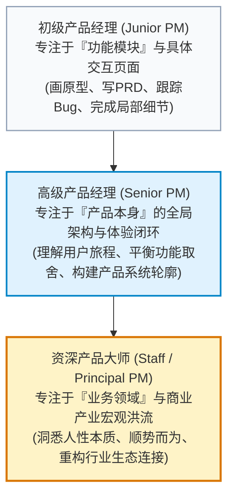
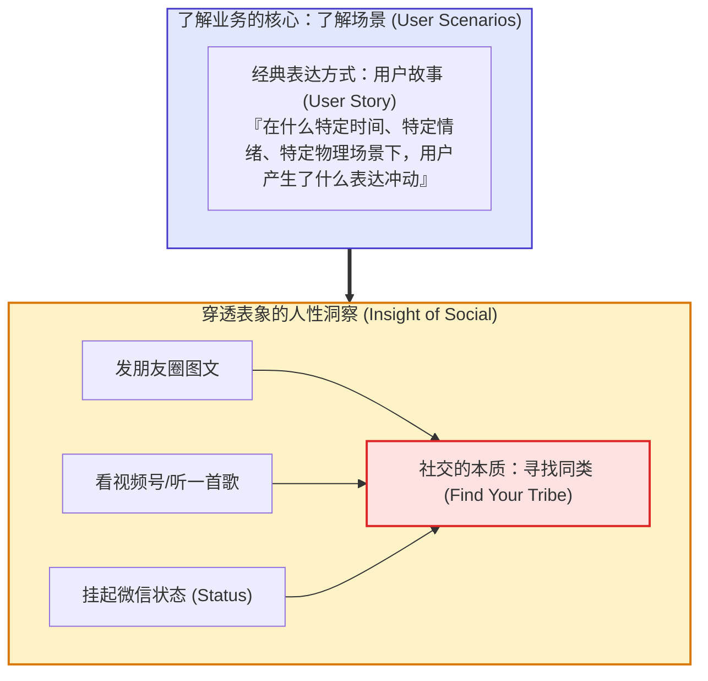
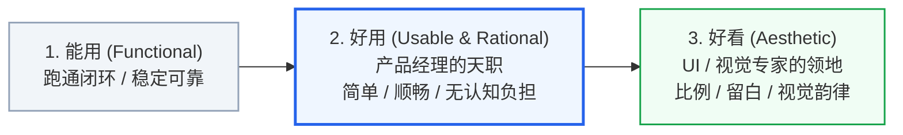
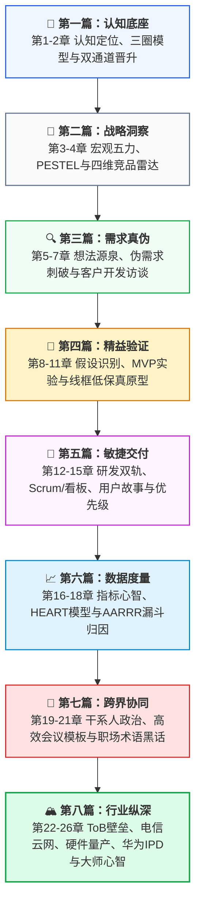

# 第26章：张小龙产品方法论与大师心智 (Allen Zhang Product Methodology & Master Mindset)

欢迎来到《产品经理全书》的最终章。

在经历前二十五章关于商业分析、需求刺破、敏捷交付、数据归因、组织协同与产业体系的严密淬炼后，我们最终必须回归到产品经理这项事业的灵魂深处——**关于人性洞察、直觉审美与顶级大师心智的哲学沉思**。

在中国乃至全球互联网的产品殿堂中，微信（WeChat）以超过 13 亿月活跃用户、十年如一日极简优雅的界面、以及支撑起整个中国移动数字化社会运转的庞大生态，成为了人类产品设计史上的奇迹。其缔造者张小龙（Allen Zhang）所展现出的产品方法论与哲学观，不仅超越了单一互联网产品的生命周期，更为所有追求极致的产品人提供了跨越时代的精神灯塔。

本章源自张小龙产品方法论与真实操盘沉思录，深度提炼其关于时代演进、社交本质、简单美学、敏捷决策与对抗组织熵增的核心智慧。

---

## 1. 产品经理的段位境界与终极进阶

张小龙对产品经理的段位划分，清晰地指明了每一个从业者从新手迈向大师的必经之路：

- **初级 PM 困于点（Feature）**：每天疲于应付按钮摆放、弹窗逻辑与细小交互，容易只见树木不见森林；
- **高级 PM 统筹面（Product）**：懂得站在全局视角审视信息架构、功能取舍与核心业务链路；
- **资深 PM 穿透体（Domain & Humanity）**：超越界面本身，深刻洞察所处时代的底层变革、商业博弈与人类心理的原始欲望。

---

## 2. 商业法则第一条：顺势而为，迎合时代的洪流

> [!IMPORTANT]
> **张小龙产品法则第一条**：
> **“产品的演进方向，一定要迎合时代的洪流，需顺势而为。”**

任何伟大的产品，其成功 80% 归功于**“时代的运势”**，20% 才是团队的精巧执行。
- 微信之所以能在 2011 年以迅雷之势席卷全国，核心不在于比手机 QQ 多了某几个滤镜，而在于抓住了 **3G/4G 智能手机普及、电容触控屏爆发、手机通讯录替代 PC 虚拟好友关系链**的时代洪流；
- 视频号的崛起，顺应的是**移动资费无限量、短视频成为全民信息摄取主流基础设施**的历史必然；
- **逆势与顺势的警示**：如果时代的技术浪潮与用户底层行为习惯尚未成熟（例如在 2G 时代强推高清直播），哪怕团队倾注百倍心血，终究只是烈士；顺应时代的大潮，顺势推舟，一个极其轻巧的小功能便能激荡出万顷波涛。

---

## 3. 用户需求端：场景表达与“社交的本质是找到同类”

很多产品经理在做需求调研时，沉迷于询问用户“你想要什么功能”。张小龙的方法论指出，这完全南辕北辙：

### 3.1 社交的本质是“找到同类”
无论是微信朋友圈的点赞、微信状态（“摸鱼中”、“听歌”、“沉思”）的设定，还是视频号的转发，表面上看是千奇百怪的内容消费，底层的心理驱动力只有一个：**人类骨子里的孤独感与寻找同类的渴望**。
- 用户点赞一首极其冷门的纯音乐，不是为了向全世界广播，而是在暗中探寻：“这个世界上，是否还有一个孤独的灵魂，在此刻与我产生了相同的共鸣？”
- **产品经理的功力**：不是给用户造复杂的玩具，而是为用户搭建一座**“能够优雅表达自我、低成本被同类识别”**的数字通道。

---

## 4. 产品设计端：灯塔定位与“能用 $\to$ 好用 $\to$ 好看”

当洞察了用户与场景后，产品团队必须回答：我们能够为用户做什么？

### 4.1 定位不需要细致，但一定是前行的灯塔
张小龙在公开课中多次强调定位的重要性。一个真正具备统治力的定位，往往只有一句话，却能为团队抵御数以千计的伪需求诱惑：
- **微信的定位**：**“微信是一个生活方式！”**（WeChat is a lifestyle）——这决定了它不会沦为充斥着弹窗横幅与营销广告的喧闹卖场，而必须像水电煤一样平静、可靠、不打扰。
- **视频号的定位**：**“视频号是一个人人都可创作的短内容平台！”**——这决定了它的推荐算法与产品机制绝不能仅仅服务于头部网红和大明星，而必须让普通人的点滴生活获得被看见的机会。

### 4.2 用户体验的三重进化阶梯
产品的发展演进，必然经历从功能到审美的递进旅程：

- **好看归 UI，好用归 PM**：界面视觉的色彩渐变、图标描边与排版美学，是 UI/视觉设计师的专业领域。但界面的交互逻辑是否顺理成章、用户是否不需要看说明书就能本能地上手，是产品经理不可推卸的核心职责。
- **“简单”的终极诠释**：
  > **“我用‘简单’来作为美观、实用、合理、优雅的代名词。”**
  > 极简绝不是粗暴的减法，而是将无数复杂的系统工程隐藏于冰山之下，在水面之上只留给用户最纯粹、最自然的触点。

---

## 5. 大师心智精粹：关于做产品的五大底层信念

在具体的日常研发推进中，张小龙传授的产品心智为应对复杂局面提供了极具力量的行动准则：

### 信念一：要做就做成做大，拒绝“为完成任务而动作变形”
- **超越机械的 KPI**：
  > “我们要做，就一定要做成做大。这并不是公司给的行政任务，因为单纯为了完成任务是枯燥无味的，并且往往会因此导致动作变形。我们必须给自己设定具有挑战性的目标，这样工作才会有趣。”
- 当一个产品人把“应付老板的交差”当成目标时，他做出的设计必然充满套路、妥协与防御姿态；只有为了创造前所未有的用户价值而战，产品才能散发出惊人的感染力。

### 信念二：做产品是验证想法的愉悦旅程
- 脑海中突然冒出一个看似不靠谱、但仔细推敲又极其美妙的想法。经过反复论证、方案推翻、技术打磨，最终化为真实世界中亿万人使用的功能——**这是产品经理这个职业独一无二的极致快乐**。
- 坦然面对失败：做创新产品，绝大多数想法注定是行不通的；但只要有少数几个核心想法能够跑通并被验证，就足以改写商业格局。

### 信念三：极其硬核的“三天法则”（The 3-Day Rule）
> [!TIP]
> **张小龙的“三天解决或放弃法则”**：
> **“如果一个产品设计难题，你想了三天都没有想出令自己满意的答案，那么三个月也照样想不出来。因此，要么在三天内找到优雅的解决方法，要么果断放弃它，去寻找全新的路径，而不是死耗在那里。”**

很多团队在某个死胡同里纠结数月，设计出无数层套娃式的复杂补丁，实际上是因为最初的假设就错了。敢于在三天无解后直接掀桌重来，是顶级产品人对抗沉没成本的核心魄力。

### 信念四：警惕加功能将产品推向垃圾
> **“以前在饭否，看到很多产品越做越复杂，我吐槽说：一个产品，要加多少功能，才能成为一个垃圾产品啊！”**
- 增加功能往往是平庸团队掩盖战略懒惰的遮羞布——当产品数据增长乏力时，人们本能地想“再加一个功能试试”。
- **克制的艺术**：好产品不是加无可加，而是**减无可减**。加了不必要的功能，或者以错误的方式把功能塞给用户，是在持续透支产品的寿命。

### 信念五：对抗团队规模膨胀与组织内耗
> **“如果一个一百人的团队做不出来一个产品，给一千人也照样做不出来，甚至会做得更差，因为一千人的组织内耗太大了。”**
- 软件与互联网创新遵循的是**“外科手术式团队模式”**（The Surgical Team）。极少数高度默契、心智共鸣的精英极客，往往能碾压成百上千人臃肿官僚的庞大兵团。
- 警惕把敏捷研发变成层层汇报的官僚流程，警惕为了“显得团队壮大”而盲目扩张团队人数。

---

## 6. 全书结语：致未来的卓越产品经理

从第 1 章的“认知定位与三圈模型”，一路走到第 26 章的“张小龙大师心智”，我们跨越了产品经理从初生萌芽到大成之境的整座高峰：

产品经理，是数字时代最激动人心的职业之一。你手中握着的键盘与文档，在未来可能会转化为数十万行代码、数百条工业产线的精密装配、以及全球数亿用户指尖的愉悦跳动。

愿你在这条道路上：
- **既有深潜泥土、直面繁琐工程与组织博弈的坚韧执行力；**
- **亦有仰望星空、穿透商业洪流与体察人性本质的非凡直觉与从容。**

保持热爱，保持简单，顺势而为，奔赴山海！

---

## 7. 本章实战自测清单 (Checklist)

在每一次重大产品决策与迭代前，请用大师的心智叩问自己：

- [ ] 你的产品演进方向，是在迎合当前时代的科技与行为洪流，还是在逆水行舟盲目蛮干？
- [ ] 你的产品是否拥有一句如灯塔般清晰有力的核心定位？团队每增加一个新功能时，是否都在强化而非削弱这一灯塔？
- [ ] 你是否穿透了用户口头说出的功能诉求，看清了他在特定生活场景下渴望“寻找同类”或“释放自我”的深层心理？
- [ ] 面对复杂难题，你是否具备在“三天内优雅解决或果断掀桌放弃”的决断力，而非陷于死胡同中自我感动？
- [ ] 你是否对“增加新功能”保持着高度的警惕与审慎，时刻捍卫着产品的极简、优雅与克制？
- [ ] 团队是否在保持着外科手术式精悍小团队的高效活力，是否成功抵御了人浮于事的组织熵增？
